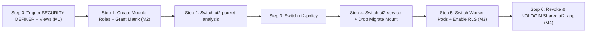

# Least-Privilege Database Roles and Data Ownership per Module

- **Status**: `DRAFT` (the document stays a draft until the PO freezes it; the implementation progress below is a fact about the repository, not a freeze)
- **Date**: 2026-11-14 (rollout status and §6–§7 added 2026-11-16; Step 0 / `V259` built 2026-11-20)
- **Rollout status (2026-11-20)**: PO decision 2026-11-16 fixed the direction (per-module database users with least privilege first, working with the database in the cluster or on a separate server; the network egress rule comes later). **Step 1 (`M2` = `V242`) and Step 0 (`M1` = `V259`) are `IMPLEMENTED` + `AUTOMATED_VALIDATED`** (migrations `V242` and `V259`, integration tests `DatabaseRoleGrantMatrixIntegrationTest` and `DatabaseRoleStep0TriggerAndViewIntegrationTest`, architecture test `ModuleDatabaseOwnershipArchTest`, plus removal of `UI2_DB_MIGRATE_USER_FILE` / `UI2_DB_MIGRATE_PASSWORD_FILE` and addition of explicit `items: [app-user, app-password]` on `deploy/ui2/52-worker-deployment.yaml`). **Next step is Step 2 (switching `ui2-packet-analysis` to `ui2_packet_analysis`)**, which requires an out-of-band HOST-A / DBA action to provision a login password on `ui2_packet_analysis` and create Kubernetes Secret `ui2-db-packet-analysis` before switching `secretName` in `58-packet-analysis-deployment.yaml` (exact steps in §4.2 Step 2 and §6.6). Steps 2–6 remain `PLANNED`; no workload uses a module role yet, and no credential or connection changed. What Step 1 and Step 0 built: §6. The external-database case: §7.
- **Backlog Item**: `ui2_database_roles_and_data_ownership`
- **Related Contracts & Designs**:
  - `docs/design/MODULE_POD_RUNTIME_CONTRACT.md` (`FROZEN`)
  - `docs/design/MODULE_PER_POD_PLAN.md` (`APPROVED`)
  - `docs/design/UI2_CONFIGURATION_MICROSERVICE_ARCHITECTURE.md` (`DRAFT`)
  - `docs/design/UI2_COMPLIANCE_MICROSERVICE_ARCHITECTURE.md` (`DRAFT`)

---

## Executive Summary

Today, every stateful runtime deployment in `deploy/ui2/` (`ui2-service`, `ui2-worker`, `ui2-policy`, and `ui2-packet-analysis`) authenticates to PostgreSQL (`ui2-db`) using the same shared login role `ui2_app` from Kubernetes Secret `ui2-db` (`app-user` / `app-password`). Furthermore, `50-service-deployment.yaml` and `52-worker-deployment.yaml` mount the entire `ui2-db` Secret volume without an `items:` filter and expose `UI2_DB_MIGRATE_USER_FILE` and `UI2_DB_MIGRATE_PASSWORD_FILE` (`/run/secrets/ui2-db/migrate-password`), allowing a compromised `ui2-service` or `ui2-worker` pod to escalate directly to the schema owner role `ui2_migrate`.

Because `ui2_app` holds union `SELECT`, `INSERT`, `UPDATE`, and `DELETE` privileges across almost all 135 application tables in the `public` schema, a compromise or SQL bug in a single module pod (for example, `ui2-packet-analysis` parsing untrusted PCAP uploads or `ui2-policy` parsing vendor payloads) allows arbitrary reads and writes across every operational plane: session tokens (`sessions`), local password hashes (`local_credentials`), encrypted device secrets (`credentials`), failover approvals (`failover_approval`), and sanitizer vaults (`sanitize_vault_entry`).

This document defines the target least-privilege PostgreSQL role architecture, exact table ownership and `GRANT` matrix across all **135 active tables** (migrations `V1` through `V211`), required `SECURITY DEFINER` trigger boundary fixes, targeted Row-Level Security (RLS) policies on shared control/queue tables, per-module Kubernetes Secret mounts and rotation, and a zero-downtime, reversible rollout plan.

---

## 1. Inventory: Modules, Repositories, and Table Access (`V1`–`V211`)

### 1.1 Current Database Role Baseline

Inspection of `deploy/ui2/` and `ui2/service/src/main/resources/db/migration/V1__initial_schema.sql` through `V211__actor_authz_state_directory_display_name.sql` shows two database roles today:

1. **`ui2_migrate` (Migrations / DDL Owner)**:
   - Provisioned as `POSTGRESQL_USER` by the `ui2-db` StatefulSet (`deploy/ui2/40-database-statefulset.yaml`) from Secret `ui2-db` keys `migrate-user` / `migrate-password`.
   - Runs Flyway migrations via Job `ui2-flyway-bootstrap` (`deploy/ui2/05-flyway-bootstrap.yaml`) and at `ui2-service` boot via `com.securityexpert.nexus.ui2.service.boot.MigrationStartupRunner` -> `com.securityexpert.nexus.ui2.persistence.FlywayMigrationRunner`.
   - Owns the `public` schema, `flyway_schema_history`, all **135 active tables** (`directory_profiles` from `V26` was dropped in `V204`), all sequences (`endpoint_permit_epoch`, `audit_log_audit_id_seq`, `failover_schedule_ledger_id_seq`, `policy_rule_history_revision_id_seq`), and all 53 SQL/PLpgSQL functions.
2. **`ui2_app` (Shared Application Role)**:
   - Provisioned by `/usr/share/container-scripts/postgresql/start/create-app-role.sh` (`deploy/ui2/10-configmap.yaml`) with `LOGIN`, `NOSUPERUSER`, `NOCREATEDB`, `NOCREATEROLE`, `NOREPLICATION`, `NOBYPASSRLS`.
   - Used at runtime by `com.securityexpert.nexus.ui2.service.boot.DatabaseConfiguration` and `com.securityexpert.nexus.ui2.worker.Ui2WorkerMain`.

### 1.2 Runtime Modules and Deployment Mapping

Per `docs/design/MODULE_POD_RUNTIME_CONTRACT.md` (`FROZEN`), `V128__module_endpoint_runtime.sql`, and `V154__packet_analysis_shell.sql` (both define `ui2_job_module(capability)`), the runtime architecture is partitioned into the following modules:

| Runtime Module ID | K8s Workload (`deploy/ui2/`) | Main Entrypoint / Package Root | Primary Responsibilities |
| :--- | :--- | :--- | :--- |
| `service` | `50-service-deployment.yaml` (`ui2-service`), `59-advisory-fetch-cronjob.yaml` | `com.securityexpert.nexus.ui2.service.Ui2ServiceApplication` | Operator HTTP/UI gateway, authentication/sessions/RBAC, pseudonymization, job submission, read projections, sanitizer, topology, reports, advisory feed ingestion |
| `policy` | `57-policy-deployment.yaml` (`ui2-policy`) | `com.securityexpert.nexus.ui2.worker.Ui2WorkerMain` (`startPolicy`) | Capabilities `cp_policy_collect`, `pan_policy_collect` |
| `packet_analysis` | `58-packet-analysis-deployment.yaml` (`ui2-packet-analysis`) | `com.securityexpert.nexus.ui2.worker.Ui2WorkerMain` (`startPacketAnalysis`) | Capability `packet_analysis_run`, `PacketAnalysisRetentionPruner` (plus local DuckDB on PVC `/app/packet-analysis`) |
| `backup` | Split target (`52-worker-deployment.yaml` fallback today) | `com.securityexpert.nexus.ui2.worker.backup.*` | 10 backup/canary capabilities (`cp_gateway_backup`, `cp_spark_sftp_backup`, `cp_gaia_snapshot`, `pan_device_state_backup`, `cp_mds_export`, `https_vendor_backup`, `rdw_cc_config_backup`, `asa_config_backup`, `fgt_config_backup`, `credential_canary`), `OrphanArtefactPurger`, `RetentionPruningService` |
| `inventory` | Split target (`52-worker-deployment.yaml` fallback today) | `com.securityexpert.nexus.ui2.worker.inventory.*`, `...discovery.*`, `...onboarding.*` | 15 capabilities: 5 confirm (`device_confirm_*`), 5 inventory (`*_inventory_collect`), 5 discovery (`*_discovery_enumerate`), inline lifecycle reads |
| `diagnostics` | Split target (`52-worker-deployment.yaml` fallback today) | `com.securityexpert.nexus.ui2.worker.diagnostics.*`, `...syslog.*`, `...pathvalidation.*` | 7 capabilities (`diagnostic_read`, `fmg_interface_detail`, `pan_syslog_measure`, `cp_system_log_collect`, `pan_system_log_collect`, `cp_spike_layout_review`, `path_validation`), `SystemLogRetentionPruner` |
| `failover` | Split target (`52-worker-deployment.yaml` fallback today) | `com.securityexpert.nexus.ui2.worker.failover.*` | 5 capabilities (`cp_failover_readiness`, `pan_failover_readiness`, `cp_cluster_failover`, `pan_cluster_failover`, `pan_failover_config_sync`), `reconcileDispatches`, `expireResumeRequests` |
| `configuration` | `54-configuration-deployment.yaml` (`ui2-configuration`) | `com.securityexpert.nexus.ui2.worker.configuration.*` | Stateless parser today (`:8084`); Step 6 adds 5 `*_configuration_collect` capabilities + `ClusterDiffTask` |
| `compliance` | `55-compliance-deployment.yaml` (`ui2-compliance`) | `com.securityexpert.nexus.ui2.service.compliance.*` | Stateless evaluator today (`:8085`); Step 7 adds `ComplianceWarmup` + `compliance_evaluation` persistence |
| `scheduler` | Split target (in `service` + `worker` today) | `com.securityexpert.nexus.ui2.scheduler.*`, `...worker.JobReconciler`, `...service.notification.*` | Scheduled job producers (`BackupScheduleProducer`, `DiscoveryScheduleProducer`, `FailoverScheduledRunService`, etc.), `JobReconciler`, `NotificationForwarder`, `NotificationMailRouter` |
| `general` | `52-worker-deployment.yaml` (`ui2-worker`) | `com.securityexpert.nexus.ui2.worker.Ui2WorkerMain` (`startGeneral`) | Transitional fallback worker pod claiming unmigrated modules where `module_runtime_control.fallback_enabled = true` |

### 1.3 Audit Log and Immutability Baseline (`audit_log`, `audit_redaction_policy`)

`audit_log` (`V1`, `V3`, `V4`, `V5`, `V21`, `V24`) and `audit_redaction_policy` (`V5`, `V46`) are **already app-write-revoked**:
- `V1`, `V3`, and `V5` execute `REVOKE INSERT, UPDATE, DELETE, TRUNCATE ON audit_log FROM PUBLIC, ui2_app` and `REVOKE ALL ON audit_redaction_policy FROM PUBLIC, ui2_app`, granting only `SELECT ON audit_log TO ui2_app`.
- Every row in `audit_log` is inserted exclusively by **`SECURITY DEFINER`** functions owned by `ui2_migrate` (`search_path = pg_catalog, public`):
  - Generic row-audit trigger: `fn_audit_capture()` -> `fn_audit_redact(text, jsonb)` (`V3`, `V5`, `V148`) attached to `role_bindings`, `sessions`, `devices`, `endpoints`, `credential_references`, `jobs`, `job_steps`, `gate_registry`, `provenance_records`, `rbac_roles`, `rbac_role_permissions`, `backup_policy`, `backup_baseline`, `backup_artefact_deletion_request`, `discovery_candidate`, `device_configuration_override`, `failover_approval`, `failover_run`, `failover_quarantine`, `failover_resume`, `failover_schedules`, `pan_config_sync`, `packet_analysis_case`, `packet_analysis_capture`, `packet_analysis_run`, `topology_link_override`, and `sanitize_job`.
  - Specialized `SECURITY DEFINER` triggers: `fn_audit_capture_credentials` (`V23`), `fn_audit_capture_local_credentials` (`V27`), `fn_audit_capture_ldap_settings` (`V28`), `fn_audit_management_endpoint_ssh_trust` (`V24`), `fn_audit_management_endpoint_pan_cert_trust` (`V35`), `fn_audit_https_endpoint_cert_trust` (`V50`), `fn_audit_notification_config` (`V30`), `fn_audit_policy_offline_analysis` (`V124`), `fn_audit_ssh_host_key_policy` (`V125`), `fn_audit_sanitize_vault_entry` (`V156`), and `ui2_audit_quarantine_release` (`V131`).
  - Explicit `SECURITY DEFINER` RPC functions called by `service`: `audit_machine_session_event(...)` (`V21`, called from `com.securityexpert.nexus.ui2.service.auth.MachineSessionService`) and `audit_report_download(...)` (`V121`, called from `com.securityexpert.nexus.ui2.service.report.ReportDownloadAuditWriter`).
- **Implication for least-privilege roles**: Because all 16 audit functions are `SECURITY DEFINER` owned by `ui2_migrate`, runtime module roles require **zero** privileges on `audit_log` or `audit_redaction_policy` for triggers on their domain tables to succeed. Only `ui2_service` (for the Audit Log UI via `com.securityexpert.nexus.ui2.persistence.audit.JooqAuditLogRepository`) and `ui2_scheduler` (for `com.securityexpert.nexus.ui2.service.notification.NotificationForwarder` / `NotificationMailRouter` polling `audit_log`) require `SELECT ON audit_log`.

### 1.4 Exhaustive Table & Repository Inventory by Plane (All 135 Active Tables)

Every SQL/jOOQ query across `ui2/persistence`, `ui2/service`, `ui2/worker`, `ui2/job-engine`, and `ui2/packet-analysis` was mapped to its exact Java repository/service class and runtime module.

#### Plane A — Schema Migration & Audit Plane (2 tables + `flyway_schema_history`)

| Table (Migration) | Current `ui2_app` Grants | Java Classes & Packages Reading | Java Classes & Packages Writing | Owning / Accessing Modules |
| :--- | :--- | :--- | :--- | :--- |
| `flyway_schema_history` (Flyway) | None (`ui2_migrate` only) | `com.securityexpert.nexus.ui2.persistence.FlywayMigrationRunner` | `FlywayMigrationRunner` (`ui2_migrate`) | `ui2_migrate` only |
| `audit_log` (`V1`, `V3`, `V4`, `V5`, `V21`, `V24`) | `SELECT` (`EXECUTE` on `audit_machine_session_event`, `audit_report_download`) | `persistence.audit.JooqAuditLogRepository` (`service`), `service.notification.NotificationForwarder`, `service.notification.NotificationMailRouter` (`service`/`scheduler`) | None directly (`SECURITY DEFINER` triggers + `MachineSessionService`, `ReportDownloadAuditWriter` via RPC) | Read: `service`, `scheduler`; Write: `ui2_migrate` (`SECURITY DEFINER`) |
| `audit_redaction_policy` (`V5`, `V46`) | None (Revoked in `V5`) | `fn_audit_redact` (`SECURITY DEFINER`) | Migrations only (`ui2_migrate`) | `ui2_migrate` only |

#### Plane B — Shared Job Queue, Provenance & Runtime Control Plane (10 tables + 1 sequence)

| Table / Sequence (Migration) | Current `ui2_app` Grants | Java Classes & Packages Reading | Java Classes & Packages Writing | Accessing Modules |
| :--- | :--- | :--- | :--- | :--- |
| `jobs` (`V1`, `V36`, `V128`, `V207`) | `SELECT, INSERT, UPDATE, DELETE` | `persistence.job.JooqJobQueueRepository`, `JooqJobReconcilerRepository`, `persistence.device.JooqDeviceRepository`, `persistence.policy.JooqPolicyRepository`, `persistence.configuration.JooqConfigurationRepository`, `persistence.failover.JooqFailoverRepository`, `persistence.syslog.JooqSystemLogRepository`, `persistence.packetanalysis.PacketAnalysisRepository`, `service.diagnostics.DiagnosticService`, `service.discovery.DiscoveryService`, `service.inventory.InventoryJobSubmissionService` | **Insert**: `service` (`JooqJobQueueRepository.submitJob`, `DiscoveryService`, `DiagnosticService`, `FailoverService`, `PolicyCollectionSubmissionService`, `PacketAnalysisService`, `SanitizeService`), `scheduler` (due-job producers), `inventory` (`DiscoveryRunner` follow-up jobs). **Update**: all worker modules (`claimNextJob`, `completeJob`, `failJob`, `heartbeatJob`), `service` (`cancelJob`), `scheduler` (`JooqJobReconcilerRepository`). **Delete**: `service` (`JooqDeviceRepository.deleteDevice`) | `service`, `scheduler`, and all worker modules (`policy`, `packet_analysis`, `backup`, `inventory`, `diagnostics`, `failover`, `configuration`, `worker_general`) |
| `job_steps` (`V1`) | `SELECT, INSERT, UPDATE, DELETE` | `persistence.job.JooqJobQueueRepository`, `persistence.device.JooqDeviceRepository` | **Insert/Update**: all worker modules (`JooqJobQueueRepository.recordStepStart`, `recordStepCompletion`). **Delete**: `service` (`JooqDeviceRepository.deleteDevice`) | `service`, all worker modules |
| `job_step_attempt` (`V132`) | `SELECT, INSERT, UPDATE` | `persistence.job.JooqJobStepAttemptRepository` | **Insert/Update**: all worker modules (`WorkerClaimLoop` -> `JooqJobStepAttemptRepository`) | `service` (read), all worker modules (read/write) |
| `job_reconciliation` (`V36`) | `SELECT, INSERT` | `persistence.job.JooqJobReconcilerRepository` (`service` admin read, `scheduler`) | `persistence.job.JooqJobReconcilerRepository` (`scheduler` / `JobReconciler`) | Read: `service`, `scheduler`; Write: `scheduler` |
| `gate_registry` (`V1`) | `SELECT, INSERT, UPDATE, DELETE` | `persistence.gate.JooqGateRegistryRepository` (`service`, worker capability gate check) | `persistence.gate.JooqGateRegistryRepository` (`service` gate administration) | Read: `service`, all worker modules; Write: `service` |
| `provenance_records` (`V1`) | `SELECT, INSERT, UPDATE, DELETE` | `persistence.provenance.JooqProvenanceRepository` (`service`) | `persistence.provenance.JooqProvenanceRepository` (`backup`, `inventory`, `policy`, `configuration`, `diagnostics`, `failover`, `packet_analysis`), `JooqDeviceRepository.deleteDevice` (`service`) | Read: `service`; Insert: all worker modules; Delete: `service` |
| `module_runtime_control` (`V128`, `V154`) | `SELECT`, column-level `UPDATE(...)` | `persistence.runtime.JooqModuleRuntimeControlRepository` (`service`, `worker` `WorkerClaimLoop`) | Column-level `UPDATE` of heartbeat/drain/pool metrics by each worker module (`JooqModuleRuntimeControlRepository`); operator drain toggle via `SECURITY DEFINER` `ui2_request_module_drain`, `ui2_set_module_fallback` (`service`) | `service`, all worker modules (scoped to own `module_id` row) |
| `runtime_instance_heartbeat` (`V131`) | `SELECT, INSERT, UPDATE, DELETE` | `persistence.runtime.JooqModuleRuntimeControlRepository` (`service`, `failover` quarantine check) | Trigger `ui2_record_instance_heartbeat()` on `module_runtime_control` (`V131`) | Read: `service`, `failover`; Write: `ui2_migrate` via `SECURITY DEFINER` trigger |
| `endpoint_admission` (`V128`) | `SELECT, INSERT, UPDATE, DELETE` (+ seq `endpoint_permit_epoch`) | `persistence.runtime.JooqEndpointAdmissionRepository` (`service`, device-contacting workers) | `persistence.runtime.JooqEndpointAdmissionRepository` (`service` inline diagnostic/trust probe, `policy`, `backup`, `inventory`, `diagnostics`, `failover`, `configuration`, `worker_general`) | `service` + device-contacting worker modules (NOT `packet_analysis`, `compliance`, `scheduler`) |
| `runtime_task_lease` (`V128`, `V139`) | `SELECT, INSERT, UPDATE, DELETE` | `jobs.lease.JdbcTaskLeaseCoordinator`, `persistence.runtime.JooqModuleRuntimeControlRepository` (`service`) | `jobs.lease.JdbcTaskLeaseCoordinator` (`service`, `scheduler`, all worker modules running periodic singleton tasks) | `service`, `scheduler`, all worker modules (scoped to own `task_name` / `owner_instance`) |

#### Plane C — Shared Device, Endpoint, Credential & Transport Trust Plane (13 tables)

| Table (Migration) | Current `ui2_app` Grants | Java Classes & Packages Reading | Java Classes & Packages Writing | Accessing Modules |
| :--- | :--- | :--- | :--- | :--- |
| `devices` (`V1`, `V6`..`V195`) | `SELECT, INSERT, UPDATE, DELETE` | `persistence.device.JooqDeviceRepository` (`service`, `inventory`, `backup`, `policy`, `configuration`, `diagnostics`, `failover`, `compliance`), `persistence.topology.JooqTopologyRepository`, `persistence.compliance.JooqComplianceRepository` | `persistence.device.JooqDeviceRepository` (`service` CRUD + `deleteDevice`; `inventory` confirmation/facts update; `configuration` `updatePanoramaManagedUnitSerials`) | Read: `service`, `inventory`, `backup`, `policy`, `configuration`, `diagnostics`, `failover`, `compliance`, `scheduler`; Write: `service`, `inventory`, `configuration` (narrow) |
| `endpoints` (`V1`, `V6`, `V24`, `V35`) | `SELECT, INSERT, UPDATE, DELETE` | `persistence.device.JooqDeviceRepository` (`service`, device-contacting workers) | `persistence.device.JooqDeviceRepository` (`service` CRUD + `deleteDevice`; `inventory` probe status update) | Read: `service`, device-contacting workers; Write: `service`, `inventory` |
| `credential_references` (`V1`, `V6`, `V23`) | `SELECT, INSERT, UPDATE, DELETE` | `persistence.device.JooqDeviceRepository`, `persistence.credential.JooqCredentialVaultRepository` | `persistence.device.JooqDeviceRepository`, `JooqCredentialVaultRepository` (`service` CRUD; `backup` `credential_canary` verification status) | Read: `service`, device-contacting workers; Write: `service`, `backup` (canary status only) |
| `credentials` (`V23`) | `SELECT, INSERT, UPDATE, DELETE` | `persistence.credential.JooqCredentialVaultRepository` (`service` test-connection/onboarding, `policy`, `backup`, `inventory`, `diagnostics`, `failover`, `configuration`, `worker_general`) | `persistence.credential.JooqCredentialVaultRepository` (`service` only) | Read: `service`, device-contacting workers; Write: `service` only |
| `device_secret_reference` (`V8`) | `SELECT, INSERT, UPDATE, DELETE` | `persistence.device.JooqDeviceRepository` (`service`, device-contacting workers) | `persistence.device.JooqDeviceRepository` (`service` only) | Read: `service`, device-contacting workers; Write: `service` only |
| `secrets_metadata` (`V7`, `V8`) | `SELECT, INSERT, UPDATE, DELETE` | `persistence.secret.JooqSecretsMetadataRepository` (`service`, device-contacting workers) | `persistence.secret.JooqSecretsMetadataRepository` (`service` only) | Read: `service`, device-contacting workers; Write: `service` only |
| `device_platform_facts` (`V9`..`V209`) | `SELECT, INSERT, UPDATE, DELETE` | `persistence.device.JooqDeviceRepository` (`service`, `inventory`, `backup`, `policy`, `configuration`, `diagnostics`, `failover`, `compliance`) | `persistence.device.JooqDeviceRepository` (`service`, `inventory`, `backup` archive facts, `configuration` PAN/CP facts) | Read: `service`, workers, `compliance`; Write: `service`, `inventory`, `backup`, `configuration` |
| `device_identity_check` (`V11`, `V12`) | `SELECT, INSERT, UPDATE, DELETE` | `persistence.device.JooqDeviceIdentityCheckRepository` (`service`, `inventory`) | `persistence.device.JooqDeviceIdentityCheckRepository` (`service`, `inventory`, `backup`, `policy`, `configuration`, `diagnostics`, `failover`) | Read: `service`, `inventory`; Insert: `service`, device-contacting workers; Delete: `service` |
| `management_endpoint_ssh_trust` (`V24`, `V145`) | `SELECT, INSERT, UPDATE` (`DELETE` revoked in `V24`) | `persistence.trust.JooqEndpointSshTrustRepository` (`service`, SSH-contacting workers) | `persistence.trust.JooqEndpointSshTrustRepository` (`service`, `inventory`, `backup`, `policy`, `configuration`, `diagnostics`, `failover` TOFU/observation update) | Read/Insert/Update: `service`, device-contacting workers |
| `ssh_trust_settings` (`V125`) | `SELECT, UPDATE` | `persistence.trust.JooqSshTrustSettingsRepository` (`service`, SSH-contacting workers) | `persistence.trust.JooqSshTrustSettingsRepository` (`service` only) | Read: `service`, device-contacting workers; Update: `service` only |
| `ssh_host_key_observation` (`V125`) | `SELECT, INSERT, UPDATE, DELETE` | `persistence.trust.JooqSshHostKeyObservationRepository` (`service`, SSH-contacting workers) | `persistence.trust.JooqSshHostKeyObservationRepository` (`service`, SSH-contacting workers) | Read/Insert/Update: `service`, device-contacting workers; Delete: `service` |
| `management_endpoint_pan_cert_trust` (`V35`) | `SELECT, INSERT, UPDATE` (`DELETE` revoked in `V35`) | `persistence.trust.JooqEndpointPanCertTrustRepository` (`service`, PAN-contacting workers) | `persistence.trust.JooqEndpointPanCertTrustRepository` (`service`, PAN-contacting workers) | Read/Insert/Update: `service`, device-contacting workers |
| `https_endpoint_cert_trust` (`V50`) | `SELECT, INSERT, UPDATE, DELETE` | `persistence.trust.JooqHttpsEndpointCertTrustRepository` (`service`, HTTPS-contacting workers) | `persistence.trust.JooqHttpsEndpointCertTrustRepository` (`service`, HTTPS-contacting workers) | Read/Insert/Update: `service`, device-contacting workers; Delete: `service` |

#### Plane D — Service-Exclusive Identity, RBAC, Privacy, Notifications, Schedules, Sanitizer, Topology & Reports Plane (31 tables)

| Table (Migration) | Current `ui2_app` Grants | Java Classes & Packages Reading / Writing | Accessing Modules |
| :--- | :--- | :--- | :--- |
| `sessions` (`V1`, `V2`, `V20`, `V25`, `V48`) | `SELECT, INSERT, UPDATE, DELETE` | `persistence.auth.JooqSessionRepository` (`service`) | `service` only |
| `role_bindings` (`V1`, `V2`, `V26`) | `SELECT, INSERT, UPDATE, DELETE` | `persistence.auth.JooqRoleBindingRepository` (`service`) | `service` only |
| `actor_authz_state` (`V25`, `V204`, `V211`) | `SELECT, INSERT, UPDATE, DELETE` | `persistence.auth.JooqActorAuthzStateRepository` (`service`) + trigger `trg_expire_directory_authz_after_session_end` (`V25`) | `service` only |
| `authz_decisions` (`V2`) | `SELECT, INSERT` (append-only) | `persistence.auth.JooqAuthzDecisionRepository` (`service`) | `service` only (`SELECT, INSERT`) |
| `local_credentials` (`V27`) | `SELECT, INSERT, UPDATE, DELETE` | `persistence.auth.JooqLocalCredentialRepository` (`service`) | `service` only |
| `root_identity` (`V19`) | `SELECT, INSERT` (append-only) | `persistence.auth.JooqRootIdentityRepository` (`service`) | `service` only (`SELECT, INSERT`) |
| `ldap_settings` (`V28`, `V29`, `V204`..`V210`) | `SELECT, INSERT, UPDATE, DELETE` | `persistence.auth.JooqLdapSettingsRepository` (`service`) | `service` only |
| `rbac_roles` (`V45`, `V53`, `V141`, `V142`) | `SELECT, INSERT, UPDATE, DELETE` | `persistence.auth.JooqRbacRepository` (`service`) | `service` only |
| `rbac_permissions` (`V45`) | `SELECT, INSERT, UPDATE, DELETE` | `persistence.auth.JooqRbacRepository` (`service`) | `service` only (`SELECT` only at runtime; seeded by `ui2_migrate`) |
| `rbac_role_permissions` (`V45`) | `SELECT, INSERT, UPDATE, DELETE` | `persistence.auth.JooqRbacRepository` (`service`) | `service` only |
| `pseudonym_registry` (`V53`, `V146`, `V156`, `V197`) | `SELECT, INSERT` (`UPDATE/DELETE` revoked in `V53`) | `persistence.privacy.JooqPseudonymRegistryRepository` (`service`, `packet_analysis` masked report projection) | `service` (`SELECT, INSERT`), `packet_analysis` (`SELECT, INSERT`) |
| `notification_settings` (`V30`, `V123`, `V171`) | `SELECT, INSERT, UPDATE, DELETE` | `persistence.notification.JooqNotificationSettingsRepository` (`service`, `scheduler`) | `service` (`SELECT, INSERT, UPDATE, DELETE`), `scheduler` (`SELECT`) |
| `notification_routes` (`V30`, `V123`, `V171`) | `SELECT, INSERT, UPDATE, DELETE` | `persistence.notification.JooqNotificationSettingsRepository` (`service`, `scheduler`) | `service` (`SELECT, INSERT, UPDATE, DELETE`), `scheduler` (`SELECT`) |
| `notification_state` (`V30`, `V123`) | `SELECT, INSERT, UPDATE, DELETE` | `persistence.notification.JooqNotificationSettingsRepository` (`service`, `scheduler`) | `service`, `scheduler` (`SELECT, INSERT, UPDATE`) |
| `scheduled_job_family` (`V139`, `V169`, `V174`, `V182`) | `SELECT, INSERT, UPDATE` | `persistence.schedule.JooqScheduledJobFamilyRepository` (`service`, `scheduler`) | `service` (`SELECT, UPDATE`), `scheduler` (`SELECT, INSERT, UPDATE`) |
| `advisory` (`V89`..`V115`, `V180`..`V184`) | `SELECT, INSERT, UPDATE, DELETE` | `persistence.advisory.JooqAdvisoryRepository` (`service`, `59-advisory-fetch-cronjob`, `compliance`) | `service` (`SELECT, INSERT, UPDATE, DELETE`), `compliance` (`SELECT`) |
| `advisory_product_rule` (`V89`..`V115`, `V180`..`V184`) | `SELECT, INSERT, UPDATE, DELETE` | `persistence.advisory.JooqAdvisoryRepository` (`service`, `compliance`) | `service` (`SELECT`), `compliance` (`SELECT`); seeded by `ui2_migrate` |
| `known_exploited_cve` (`V108`, `V180`) | `SELECT, INSERT, UPDATE, DELETE` | `persistence.advisory.JooqAdvisoryRepository` (`service`, `compliance`) | `service` (`SELECT, INSERT, UPDATE, DELETE`), `compliance` (`SELECT`) |
| `advisory_feed_run` (`V180`) | `SELECT, INSERT, UPDATE, DELETE` | `persistence.advisory.JooqAdvisoryFeedRunRepository` (`service`, `scheduler`) | `service`, `scheduler` (`SELECT, INSERT, UPDATE`) |
| `lifecycle_catalog` (`V90`, `V109`, `V181`) | `SELECT, INSERT, UPDATE, DELETE` | `persistence.lifecycle.JooqLifecycleCatalogRepository` (`service`, `compliance`) | `service` (`SELECT, INSERT, UPDATE`), `compliance` (`SELECT`) |
| `report_run` (`V121`, `V122`) | `SELECT, INSERT, UPDATE, DELETE` | `persistence.report.JooqReportRunRepository` (`service`) | `service` only |
| `sanitize_job` (`V156`, `V158`) | `SELECT, INSERT, UPDATE` | `persistence.sanitize.SanitizeRepository` (`service`) | `service` only |
| `sanitize_revert_job` (`V156`) | `SELECT, INSERT, UPDATE` | `persistence.sanitize.SanitizeRepository` (`service`) | `service` only |
| `sanitize_vault_entry` (`V156`) | `SELECT, INSERT, UPDATE` | `persistence.sanitize.SanitizeRepository` (`service`) | `service` only |
| `sanitize_ledger` (`V156`) | `SELECT, INSERT` (append-only) | `persistence.sanitize.SanitizeRepository` (`service`) | `service` only (`SELECT, INSERT`) |
| `topology_snapshot` (`V186`) | `SELECT, INSERT, UPDATE, DELETE` | `persistence.topology.JooqTopologyRepository` (`service`) | `service` only |
| `topology_conflict` (`V186`) | `SELECT, INSERT, UPDATE, DELETE` | `persistence.topology.JooqTopologyRepository` (`service`) | `service` only |
| `topology_link_override` (`V186`) | `SELECT, INSERT, UPDATE, DELETE` | `persistence.topology.JooqTopologyRepository` (`service`) | `service` only |
| `discovery_acknowledgement` (`V191`) | `SELECT, INSERT, UPDATE, DELETE` | `persistence.discovery.JooqDiscoveryAcknowledgementRepository` (`service`) | `service` only |

*(Note: `rbac_roles`, `rbac_permissions`, `rbac_role_permissions`, `sessions`, `role_bindings`, `actor_authz_state`, `authz_decisions`, `local_credentials`, `root_identity`, `ldap_settings`, `pseudonym_registry`, `notification_settings`, `notification_routes`, `notification_state`, `scheduled_job_family`, `advisory`, `advisory_product_rule`, `known_exploited_cve`, `advisory_feed_run`, `lifecycle_catalog`, `report_run`, `sanitize_job`, `sanitize_revert_job`, `sanitize_vault_entry`, `sanitize_ledger`, `topology_snapshot`, `topology_conflict`, `topology_link_override`, `discovery_acknowledgement` = 29 tables here; plus `backup_policy` and `system_log_settings` in their respective domain planes below.)*

#### Plane E — Policy Plane (16 tables)

| Table (Migration) | Current `ui2_app` Grants | Java Classes & Packages Reading | Java Classes & Packages Writing | Owning / Accessing Modules |
| :--- | :--- | :--- | :--- | :--- |
| `policy_snapshot` (`V38`..`V150`) | `SELECT, INSERT, UPDATE, DELETE` | `persistence.policy.JooqPolicyRepository` (`service`, `policy`, `compliance`), `persistence.device.JooqDeviceRepository` | `JooqPolicyRepository` (`policy` worker insert/update; `service` delete on device deletion) | Owner: `policy`; Read: `service`, `compliance`; Delete (cascade): `service` |
| `policy_collection_request` (`V51`, `V57`) | `SELECT, INSERT, UPDATE, DELETE` | `persistence.policy.JooqPolicyCollectionRequestRepository` (`service`, `policy`, `scheduler`) | `JooqPolicyCollectionRequestRepository` (`service` submit, `scheduler` due requests, `policy` status updates, `service` device delete) | Owner: `policy` / `service`; Access: `service`, `policy`, `scheduler` |
| `policy_collection_domain` (`V57`, `V58`) | `SELECT, INSERT, UPDATE, DELETE` | `persistence.policy.JooqPolicyCollectionRequestRepository` (`service`, `policy`) | `JooqPolicyCollectionRequestRepository` (`service`, `policy`) | `service`, `policy` |
| `policy_unit_checkpoint` (`V56`, `V61`) | `SELECT, INSERT, UPDATE, DELETE` | `persistence.policy.JooqPolicyUnitCheckpointRepository` (`service`, `policy`) | `JooqPolicyUnitCheckpointRepository` (`policy` worker; `service` device delete) | Owner: `policy`; Read/Delete: `service` |
| `policy_rule_history` (`V120`, `V150`) | `SELECT, INSERT, UPDATE, DELETE` | `persistence.policy.JooqPolicyRuleHistoryRepository` (`service`, `compliance`) | Trigger `fn_capture_policy_rule_history()` on `policy_snapshot` (`V120`/`V150`); `JooqDeviceRepository.deleteDevice` (`service`) | Read: `service`, `compliance`, `policy`; Write: `ui2_migrate` (`SECURITY DEFINER` trigger), `service` (device delete) |
| `policy_rule_history_baseline` (`V120`, `V150`) | `SELECT, INSERT, UPDATE, DELETE` | `persistence.policy.JooqPolicyRuleHistoryRepository` (`service`) | Trigger `fn_capture_policy_rule_history()`; `JooqDeviceRepository.deleteDevice` (`service`) | Read: `service`, `policy`; Write: `ui2_migrate` (`SECURITY DEFINER` trigger), `service` (device delete) |
| `cp_policy_object_inventory` (`V62`) | `SELECT, INSERT, UPDATE, DELETE` | `persistence.policy.JooqCpPolicyObjectInventoryRepository` (`service`, `policy`) | `JooqCpPolicyObjectInventoryRepository` (`policy`; `service` device delete) | Owner: `policy`; Read/Delete: `service` |
| `cp_policy_domain_run` (`V63`, `V64`) | `SELECT, INSERT, UPDATE, DELETE` | `persistence.policy.JooqCpPolicyDomainRunRepository` (`service`, `policy`) | `JooqCpPolicyDomainRunRepository` (`policy`; `service` device delete) | Owner: `policy`; Read/Delete: `service` |
| `cp_policy_json_chunk` (`V64`) | `SELECT, INSERT, UPDATE, DELETE` | `persistence.policy.JooqCpPolicyDomainRunRepository` (`service`, `policy`) | `JooqCpPolicyDomainRunRepository` (`policy`; `service` device delete) | Owner: `policy`; Read/Delete: `service` |
| `cp_domain_server_placement` (`V60`) | `SELECT, INSERT, UPDATE, DELETE` | `persistence.policy.JooqCpDomainServerPlacementRepository` (`service`, `policy`, `inventory`) | `JooqCpDomainServerPlacementRepository` (`policy`, `inventory`; `service` device delete) | `policy`, `inventory`, `service` |
| `policy_revision` (`V65`) | `SELECT, INSERT, UPDATE, DELETE` | `persistence.policy.JooqPolicyRevisionRepository` (`service`, `policy`) | `JooqPolicyRevisionRepository` (`policy`; `service` device delete) | Owner: `policy`; Read/Delete: `service` |
| `policy_change_evidence` (`V65`, `V66`) | `SELECT, INSERT, UPDATE, DELETE` | `persistence.policy.JooqPolicyChangeEvidenceRepository` (`service`, `policy`) | `JooqPolicyChangeEvidenceRepository` (`policy`; `service` device delete) | Owner: `policy`; Read/Delete: `service` |
| `policy_change_cursor` (`V66`) | `SELECT, INSERT, UPDATE, DELETE` | `persistence.policy.JooqPolicyChangeEvidenceRepository` (`service`, `policy`) | `JooqPolicyChangeEvidenceRepository` (`policy`; `service` device delete) | Owner: `policy`; Read/Delete: `service` |
| `policy_change_actor_link` (`V67`) | `SELECT, INSERT, UPDATE, DELETE` | `persistence.policy.JooqPolicyChangeEvidenceRepository` (`service`, `policy`) | `JooqPolicyChangeEvidenceRepository` (`policy`; `service` device delete) | Owner: `policy`; Read/Delete: `service` |
| `policy_target_binding` (`V68`, `V69`) | `SELECT, INSERT, UPDATE, DELETE` | `persistence.policy.JooqPolicyTargetBindingRepository` (`service`, `policy`, `compliance`) | `JooqPolicyTargetBindingRepository` (`policy`; `service` device delete) | Owner: `policy`; Read: `service`, `compliance`; Delete: `service` |
| `policy_offline_analysis` (`V124`) | `SELECT, INSERT, UPDATE, DELETE` | `persistence.policy.JooqPolicyOfflineAnalysisRepository` (`service`) | `JooqPolicyOfflineAnalysisRepository` (`service`) | `service` only |

#### Plane F — Packet Analysis Plane (5 tables)

| Table (Migration) | Current `ui2_app` Grants | Java Classes & Packages Reading | Java Classes & Packages Writing | Owning / Accessing Modules |
| :--- | :--- | :--- | :--- | :--- |
| `packet_analysis_case` (`V154`, `V155`, `V196`) | `SELECT, INSERT, UPDATE, DELETE` | `persistence.packetanalysis.PacketAnalysisRepository` (`service`, `packet_analysis`) | `PacketAnalysisRepository` (`service` create/delete case; `packet_analysis` status/summary update & retention pruner delete) | `service`, `packet_analysis` |
| `packet_analysis_capture` (`V154`, `V155`, `V199`) | `SELECT, INSERT, UPDATE, DELETE` | `persistence.packetanalysis.PacketAnalysisRepository` (`service`, `packet_analysis`) | `PacketAnalysisRepository` (`service` upload/delete capture; `packet_analysis` metadata update & retention pruner delete) | `service`, `packet_analysis` |
| `packet_analysis_run` (`V154`, `V155`, `V198`..`V203`) | `SELECT, INSERT, UPDATE, DELETE` | `persistence.packetanalysis.PacketAnalysisRepository` (`service`, `packet_analysis`) | `PacketAnalysisRepository` (`service` request run; `packet_analysis` `PacketAnalysisWorkerTask` progress/result update & pruner delete) | `service`, `packet_analysis` |
| `packet_analysis_ledger` (`V154`) | `SELECT, INSERT` (append-only) | `persistence.packetanalysis.PacketAnalysisRepository` (`service`, `packet_analysis`) | `PacketAnalysisRepository` (`service`, `packet_analysis` append ledger entries) | `service`, `packet_analysis` (`SELECT, INSERT`) |
| `packet_analysis_host_telemetry` (`V199`) | `SELECT, INSERT, UPDATE, DELETE` | `persistence.packetanalysis.PacketAnalysisRepository` (`service`, `packet_analysis`) | `PacketAnalysisRepository` (`service` upload, `packet_analysis` parse/prune) | `service`, `packet_analysis` |

#### Plane G — Backup, Recovery & Retention Plane (12 tables)

| Table (Migration) | Current `ui2_app` Grants | Java Classes & Packages Reading | Java Classes & Packages Writing | Owning / Accessing Modules |
| :--- | :--- | :--- | :--- | :--- |
| `backup_artefact` (`V10`..`V195`) | `SELECT, INSERT, UPDATE, DELETE` | `persistence.backup.JooqBackupArtefactRepository` (`service`, `backup`, `configuration`, `compliance`) | `JooqBackupArtefactRepository` (`backup` workers + `RetentionPruningService` + `OrphanArtefactPurger`; `service` deletion approval & device delete) | Owner: `backup`; Read: `service`, `configuration`, `compliance`; Write: `backup`, `service` |
| `backup_artefact_content_listing` (`V16`) | `SELECT, INSERT, UPDATE, DELETE` | `persistence.backup.JooqBackupContentListingRepository` (`service`, `backup`) | `JooqBackupContentListingRepository` (`backup`; `service` device delete) | Owner: `backup`; Read/Delete: `service` |
| `backup_artefact_entry` (`V42`) | `SELECT, INSERT, UPDATE, DELETE` | `persistence.backup.JooqBackupArtefactEntryRepository` (`service`, `backup`, `configuration`) | `JooqBackupArtefactEntryRepository` (`backup`; `service` device delete) | Owner: `backup`; Read: `service`, `configuration`; Delete: `service` |
| `backup_artefact_retrieval` (`V18`) | `SELECT, INSERT` (append-only) | `persistence.backup.JooqBackupRetrievalRepository` (`service`) | `JooqBackupRetrievalRepository` (`service`) | `service` only (`SELECT, INSERT`) |
| `backup_artefact_deletion_request` (`V44`) | `SELECT, INSERT, UPDATE, DELETE` | `persistence.backup.JooqBackupDeletionRequestRepository` (`service`, `backup`) | `JooqBackupDeletionRequestRepository` (`service` request/approve/reject; `backup` execute) | `service`, `backup` |
| `backup_baseline` (`V15`, `V41`) | `SELECT, INSERT, UPDATE, DELETE` | `persistence.backup.JooqBackupBaselineRepository` (`service`, `backup`) | `JooqBackupBaselineRepository` (`service` pin baseline, `backup` auto-baseline; `service` device delete) | `service`, `backup` |
| `backup_deviation_record` (`V15`) | `SELECT, INSERT, UPDATE, DELETE` | `persistence.backup.JooqBackupDeviationRepository` (`service`, `backup`) | `JooqBackupDeviationRepository` (`backup` record deviation, `service` acknowledge/delete) | `service`, `backup` |
| `backup_endpoint_ineligibility` (`V34`) | `SELECT, INSERT, UPDATE, DELETE` | `persistence.backup.JooqBackupIneligibilityRepository` (`service`, `backup`, `scheduler`) | `JooqBackupIneligibilityRepository` (`backup`; `service` clear/delete) | `backup`, `service`, `scheduler` (read) |
| `backup_policy` (`V17`, `V31`, `V37`, `V140`) | `SELECT, INSERT, UPDATE, DELETE` | `persistence.backup.JooqBackupPolicyRepository` (`service`, `backup`, `scheduler`) | `JooqBackupPolicyRepository` (`service` configure policy; `scheduler` update `last_scheduled_at`) | `service` (read/write), `backup` (read), `scheduler` (read/update) |
| `artefact_retention_ledger` (`V17`) | `SELECT, INSERT` (append-only) | `persistence.backup.JooqRetentionLedgerRepository` (`service`, `backup`) | `JooqRetentionLedgerRepository` (`backup` `RetentionPruningService`, `service` manual delete) | `backup`, `service` (`SELECT, INSERT`) |
| `cp_device_archive` (`V43`) | `SELECT, INSERT, UPDATE, DELETE` | `persistence.backup.JooqCpDeviceArchiveRepository` (`service`, `backup`, `configuration`) | `JooqCpDeviceArchiveRepository` (`backup`; `service` device delete) | Owner: `backup`; Read: `service`, `configuration`; Delete: `service` |
| `credential_failure_alert` (`V33`) | `SELECT, INSERT, UPDATE, DELETE` | `persistence.credential.JooqCredentialFailureAlertRepository` (`service`, `backup`, `scheduler`) | `JooqCredentialFailureAlertRepository` (`backup` `credential_canary` & device workers on auth failure; `service` acknowledge/resolve) | `backup`, device-contacting workers (insert/update), `service` (read/update/delete), `scheduler` (read) |

#### Plane H — Inventory, Onboarding, Discovery & Device Lifecycle Plane (16 tables)

| Table (Migration) | Current `ui2_app` Grants | Java Classes & Packages Reading | Java Classes & Packages Writing | Owning / Accessing Modules |
| :--- | :--- | :--- | :--- | :--- |
| `device_onboarding` (`V13`, `V14`) | `SELECT, INSERT, UPDATE, DELETE` | `persistence.onboarding.JooqDeviceOnboardingRepository` (`service`, `inventory`) | `JooqDeviceOnboardingRepository` (`service`, `inventory`) | `service`, `inventory` |
| `cp_inventory_projection` (`V14`) | `SELECT, INSERT, UPDATE, DELETE` | `persistence.inventory.JooqCpInventoryProjectionRepository` (`service`, `inventory`) | `JooqCpInventoryProjectionRepository` (`inventory`; `service` device delete) | Owner: `inventory`; Read/Delete: `service` |
| `device_inventory_run` (`V47`..`V88`) | `SELECT, INSERT, UPDATE, DELETE` | `persistence.inventory.JooqDeviceInventoryRepository` (`service`, `inventory`, `topology`, `compliance`, `failover`) | `JooqDeviceInventoryRepository` (`inventory`; `service` device delete) | Owner: `inventory`; Read: `service`, `compliance`, `failover`; Delete: `service` |
| `device_interface` (`V47`, `V52`, `V185`) | `SELECT, INSERT, UPDATE, DELETE` | `persistence.inventory.JooqDeviceInventoryRepository` (`service`, `inventory`, `diagnostics`) | `JooqDeviceInventoryRepository` (`inventory`, `diagnostics` `fmg_interface_detail`; `service` device delete) | Owner: `inventory` (+ `diagnostics` FMG enrichment); Read: `service`, `diagnostics`; Delete: `service` |
| `device_interface_address` (`V47`) | `SELECT, INSERT, UPDATE, DELETE` | `persistence.inventory.JooqDeviceInventoryRepository` (`service`, `inventory`, `diagnostics`) | `JooqDeviceInventoryRepository` (`inventory`, `diagnostics` `fmg_interface_detail`; `service` device delete) | Owner: `inventory` (+ `diagnostics`); Read: `service`, `diagnostics`; Delete: `service` |
| `device_route` (`V47`, `V187`) | `SELECT, INSERT, UPDATE, DELETE` | `persistence.inventory.JooqDeviceInventoryRepository` (`service`, `inventory`, `diagnostics`) | `JooqDeviceInventoryRepository` (`inventory`; `service` device delete) | Owner: `inventory`; Read: `service`, `diagnostics` (`path_validation`); Delete: `service` |
| `device_inventory_ha` (`V47`, `V54`, `V55`) | `SELECT, INSERT, UPDATE, DELETE` | `persistence.inventory.JooqDeviceInventoryRepository` (`service`, `inventory`, `failover`, `compliance`) | `JooqDeviceInventoryRepository` (`inventory`; `service` device delete) | Owner: `inventory`; Read: `service`, `failover`, `compliance`; Delete: `service` |
| `device_policy_install` (`V47`) | `SELECT, INSERT, UPDATE, DELETE` | `persistence.inventory.JooqDeviceInventoryRepository` (`service`, `inventory`, `policy`, `compliance`) | `JooqDeviceInventoryRepository` (`inventory`; `service` device delete) | Owner: `inventory`; Read: `service`, `policy`, `compliance`; Delete: `service` |
| `grid_member` (`V59`) | `SELECT, INSERT, UPDATE, DELETE` | `persistence.inventory.JooqDeviceInventoryRepository` (`service`, `inventory`) | `JooqDeviceInventoryRepository` (`inventory`; `service` device delete) | Owner: `inventory`; Read/Delete: `service` |
| `infoblox_grid_summary` (`V59`) | `SELECT, INSERT, UPDATE, DELETE` | `persistence.inventory.JooqDeviceInventoryRepository` (`service`, `inventory`) | `JooqDeviceInventoryRepository` (`inventory`; `service` device delete) | Owner: `inventory`; Read/Delete: `service` |
| `ha_pair_identity` (`V55`, `V133`) | `SELECT, INSERT, UPDATE, DELETE` | `persistence.inventory.JooqHaPairIdentityRepository` (`service`, `inventory`, `failover`, `configuration`) | `JooqHaPairIdentityRepository` (`inventory`; `service` device delete) | Owner: `inventory`; Read: `service`, `failover`, `configuration`; Delete: `service` |
| `discovery_run` (`V70`..`V87`) | `SELECT, INSERT, UPDATE, DELETE` | `persistence.discovery.JooqDiscoveryRepository` (`service`, `inventory`, `scheduler`) | `JooqDiscoveryRepository` (`service` start run, `inventory` worker update, `service` device delete) | `inventory`, `service`, `scheduler` (read) |
| `discovery_candidate` (`V70`..`V87`, `V137`) | `SELECT, INSERT, UPDATE, DELETE` | `persistence.discovery.JooqDiscoveryRepository` (`service`, `inventory`, `failover`) | `JooqDiscoveryRepository` (`inventory` upsert candidates, `service` enroll/dismiss/delete) | `inventory`, `service`; Read: `failover` |
| `device_lifecycle_read` (`V91`, `V110`) | `SELECT, INSERT, UPDATE, DELETE` | `persistence.lifecycle.JooqDeviceLifecycleRepository` (`service`, `inventory`, `compliance`) | `JooqDeviceLifecycleRepository` (`service` inline refresh, `inventory` worker, `service` device delete) | `inventory`, `service`; Read: `compliance` |
| `device_license_item` (`V91`, `V110`) | `SELECT, INSERT, UPDATE, DELETE` | `persistence.lifecycle.JooqDeviceLifecycleRepository` (`service`, `inventory`, `compliance`) | `JooqDeviceLifecycleRepository` (`service`, `inventory`) | `inventory`, `service`; Read: `compliance` |
| `device_live_patch_item` (`V110`) | `SELECT, INSERT, UPDATE, DELETE` | `persistence.lifecycle.JooqDeviceLifecycleRepository` (`service`, `inventory`, `compliance`) | `JooqDeviceLifecycleRepository` (`service`, `inventory`) | `inventory`, `service`; Read: `compliance` |

#### Plane I — Configuration Plane (9 tables)

| Table (Migration) | Current `ui2_app` Grants | Java Classes & Packages Reading | Java Classes & Packages Writing | Owning / Accessing Modules |
| :--- | :--- | :--- | :--- | :--- |
| `configuration_artefact` (`V72`, `V73`) | `SELECT, INSERT, UPDATE, DELETE` | `persistence.configuration.JooqConfigurationRepository` (`service`, `configuration`, `compliance`, `failover`, `diagnostics`) | `JooqConfigurationRepository` (`configuration` worker; `service` device delete) | Owner: `configuration`; Read: `service`, `compliance`, `failover`, `diagnostics`; Delete: `service` |
| `device_configuration_run` (`V72`..`V119`) | `SELECT, INSERT, UPDATE, DELETE` | `persistence.configuration.JooqConfigurationRepository` (`service`, `configuration`, `compliance`, `failover`, `diagnostics`) | `JooqConfigurationRepository` (`configuration` worker; `service` device delete) | Owner: `configuration`; Read: `service`, `compliance`, `failover`, `diagnostics`; Delete: `service` |
| `device_configuration_index` (`V73`, `V74`) | `SELECT, INSERT, UPDATE, DELETE` | `persistence.configuration.JooqConfigurationRepository` (`service`, `configuration`, `compliance`) | `JooqConfigurationRepository` (`configuration`; `service` device delete) | Owner: `configuration`; Read: `service`, `compliance`; Delete: `service` |
| `device_configuration_override` (`V75`, `V116`) | `SELECT, INSERT, UPDATE, DELETE` | `persistence.configuration.JooqConfigurationOverrideRepository` (`service`, `configuration`, `compliance`) | `JooqConfigurationOverrideRepository` (`service` operator override CRUD) | Owner: `service` (intent overrides); Read: `configuration`, `compliance` |
| `configuration_run_deviation_summary` (`V76`, `V117`) | `SELECT, INSERT, UPDATE, DELETE` | `persistence.configuration.JooqConfigurationRepository` (`service`, `configuration`, `compliance`) | `JooqConfigurationRepository` (`configuration`, `service` recompute on override change & device delete) | Owner: `configuration`, `service`; Read: `compliance` |
| `configuration_run_deviation_entry` (`V76`, `V117`) | `SELECT, INSERT, UPDATE, DELETE` | `persistence.configuration.JooqConfigurationRepository` (`service`, `configuration`, `compliance`) | `JooqConfigurationRepository` (`configuration`, `service` recompute & device delete) | Owner: `configuration`, `service`; Read: `compliance` |
| `configuration_notification` (`V77`) | `SELECT, INSERT, UPDATE, DELETE` | `persistence.configuration.JooqConfigurationNotificationRepository` (`service`, `configuration`, `scheduler`) | `JooqConfigurationNotificationRepository` (`configuration` insert, `service` acknowledge/delete, `scheduler` dispatch) | `configuration`, `service`, `scheduler` |
| `panorama_assignment` (`V82`, `V85`) | `SELECT, INSERT, UPDATE, DELETE` | `persistence.configuration.JooqPanoramaAssignmentRepository` (`service`, `configuration`, `inventory`) | `JooqPanoramaAssignmentRepository` (`configuration`, `inventory`; `service` device delete) | `configuration`, `inventory`, `service` |
| `cluster_member_diff` (`V151`, `V152`) | `SELECT, INSERT, UPDATE, DELETE` | `persistence.configuration.JooqClusterMemberDiffRepository` (`service`, `configuration`, `compliance`) | `JooqClusterMemberDiffRepository` (`configuration` `ClusterDiffTask`, `service` on-demand compute & device delete) | Owner: `configuration`, `service`; Read: `compliance` |

#### Plane J — Compliance Plane (1 table)

| Table (Migration) | Current `ui2_app` Grants | Java Classes & Packages Reading | Java Classes & Packages Writing | Owning / Accessing Modules |
| :--- | :--- | :--- | :--- | :--- |
| `compliance_evaluation` (`V153`) | `SELECT, INSERT, UPDATE, DELETE` | `persistence.compliance.JooqComplianceEvaluationRepository` (`service`, `compliance`) | `JooqComplianceEvaluationRepository` (`compliance` `ComplianceWarmup` / evaluator, `service` fallback/device delete) | Owner: `compliance`; Read/Delete: `service` |

#### Plane K — Failover Plane (10 tables)

| Table (Migration) | Current `ui2_app` Grants | Java Classes & Packages Reading | Java Classes & Packages Writing | Owning / Accessing Modules |
| :--- | :--- | :--- | :--- | :--- |
| `failover_approval` (`V96`, `V134`, `V137`) | `SELECT, INSERT, UPDATE, DELETE` | `persistence.failover.JooqFailoverRepository` (`service`, `failover`, `scheduler`) | `JooqFailoverRepository` (`service` grant/revoke approval, `failover` consume/invalidate, triggers `failover_membership_approval_invalidate` & `failover_discovery_approval_invalidate` in `V137`) | `service`, `failover`, `scheduler` (read) |
| `failover_run` (`V96`..`V193`) | `SELECT, INSERT, UPDATE, DELETE` | `persistence.failover.JooqFailoverRepository` (`service`, `failover`, `scheduler`) | `JooqFailoverRepository` (`service` create readiness/execution run, `scheduler` scheduled runs, `failover` worker update; triggers `failover_job_failure` `V136` & `failover_readiness_job_terminal` `V162`) | `service`, `failover`, `scheduler` |
| `failover_check_result` (`V96`, `V103`) | `SELECT, INSERT, UPDATE, DELETE` | `persistence.failover.JooqFailoverRepository` (`service`, `failover`) | `JooqFailoverRepository` (`failover` worker; `service` device delete) | Owner: `failover`; Read/Delete: `service` |
| `failover_dispatch_intent` (`V97`, `V130`) | `SELECT, INSERT, UPDATE, DELETE` | `persistence.failover.JooqFailoverRepository` (`service`, `failover`) | `JooqFailoverRepository` (`failover` worker write-ahead dispatch intent & `reconcileDispatches`; `service` device delete) | Owner: `failover`; Read/Delete: `service` |
| `failover_quarantine` (`V97`, `V131`, `V160`) | `SELECT, INSERT, UPDATE, DELETE` | `persistence.failover.JooqFailoverRepository` (`service`, `failover`, `scheduler`) | `JooqFailoverRepository` (`failover` raise/release quarantine; `service` operator release & `ui2_audit_quarantine_release`) | `failover`, `service`, `scheduler` (read) |
| `failover_resume` (`V100`, `V170`) | `SELECT, INSERT, UPDATE, DELETE` | `persistence.failover.JooqFailoverRepository` (`service`, `failover`) | `JooqFailoverRepository` (`service` request/approve resume, `failover` worker execute & `expireResumeRequests`, trigger `failover_resume_job_end` `V170`) | `service`, `failover` |
| `failover_schedules` (`V135`, `V138`, `V161`..`V175`) | `SELECT, INSERT, UPDATE, DELETE` | `persistence.failover.JooqFailoverScheduleRepository` (`service`, `failover`, `scheduler`) | `JooqFailoverScheduleRepository` (`service` schedule CRUD, `scheduler` `FailoverScheduledRunService`, `failover` outcome recording) | `service`, `scheduler`, `failover` |
| `failover_schedule_ledger` (`V135`) | `SELECT, INSERT` (immutable trigger `V135`) | `persistence.failover.JooqFailoverScheduleRepository` (`service`, `scheduler`, `failover`) | `JooqFailoverScheduleRepository` (`service`, `scheduler`, `failover` append entries) | `service`, `scheduler`, `failover` (`SELECT, INSERT`) |
| `failover_grant_consumption` (`V135`) | `SELECT, INSERT` (immutable trigger `V135`) | `persistence.failover.JooqFailoverScheduleRepository` (`service`, `scheduler`, `failover`) | `JooqFailoverScheduleRepository` (`scheduler`, `failover`, `service` append consumption) | `service`, `scheduler`, `failover` (`SELECT, INSERT`) |
| `pan_config_sync` (`V178`, `V179`) | `SELECT, INSERT, UPDATE, DELETE` | `persistence.failover.JooqPanConfigSyncRepository` (`service`, `failover`) | `JooqPanConfigSyncRepository` (`service` initiate sync, `failover` `pan_failover_config_sync` worker, trigger `pan_config_sync_job_end` `V178`) | `service`, `failover` |

#### Plane L — Diagnostics, System Logs & Path Validation Plane (12 tables)

| Table (Migration) | Current `ui2_app` Grants | Java Classes & Packages Reading | Java Classes & Packages Writing | Owning / Accessing Modules |
| :--- | :--- | :--- | :--- | :--- |
| `system_log_measurement` (`V104`) | `SELECT, INSERT, UPDATE, DELETE` | `persistence.syslog.JooqSystemLogRepository` (`service`, `diagnostics`) | `JooqSystemLogRepository` (`diagnostics` `pan_syslog_measure`; `service` device delete) | Owner: `diagnostics`; Read/Delete: `service` |
| `system_log_settings` (`V105`, `V127`) | `SELECT, INSERT, UPDATE, DELETE` | `persistence.syslog.JooqSystemLogRepository` (`service`, `diagnostics`, `scheduler`) | `JooqSystemLogRepository` (`service` settings update) | Owner: `service`; Read: `diagnostics`, `scheduler` |
| `system_log_run` (`V105`, `V106`) | `SELECT, INSERT, UPDATE, DELETE` | `persistence.syslog.JooqSystemLogRepository` (`service`, `diagnostics`, `scheduler`) | `JooqSystemLogRepository` (`service` request run, `diagnostics` worker & `SystemLogRetentionPruner`) | `diagnostics`, `service`, `scheduler` (read) |
| `system_log_cursor` (`V105`) | `SELECT, INSERT, UPDATE, DELETE` | `persistence.syslog.JooqSystemLogRepository` (`service`, `diagnostics`) | `JooqSystemLogRepository` (`diagnostics`; `service` device delete) | Owner: `diagnostics`; Read/Delete: `service` |
| `system_log_chunk` (`V105`) | `SELECT, INSERT, UPDATE, DELETE` | `persistence.syslog.JooqSystemLogRepository` (`service`, `diagnostics`) | `JooqSystemLogRepository` (`diagnostics` collect + `SystemLogRetentionPruner`; `service` device delete) | Owner: `diagnostics`; Read/Delete: `service` |
| `system_log_file` (`V106`) | `SELECT, INSERT, UPDATE, DELETE` | `persistence.syslog.JooqSystemLogRepository` (`service`, `diagnostics`) | `JooqSystemLogRepository` (`diagnostics`; `service` device delete) | Owner: `diagnostics`; Read/Delete: `service` |
| `system_log_gap` (`V105`) | `SELECT, INSERT, UPDATE, DELETE` | `persistence.syslog.JooqSystemLogRepository` (`service`, `diagnostics`) | `JooqSystemLogRepository` (`diagnostics`; `service` device delete) | Owner: `diagnostics`; Read/Delete: `service` |
| `system_log_spike_directory` (`V126`) | `SELECT, INSERT, UPDATE, DELETE` | `persistence.syslog.JooqSystemLogSpikeRepository` (`service`, `diagnostics`) | `JooqSystemLogSpikeRepository` (`diagnostics` `cp_spike_layout_review`; `service` device delete) | Owner: `diagnostics`; Read/Delete: `service` |
| `device_crash_entry` (`V172`) | `SELECT, INSERT, UPDATE, DELETE` | `persistence.syslog.JooqDeviceCrashRepository` (`service`, `diagnostics`, `inventory`) | `JooqDeviceCrashRepository` (`diagnostics`, `inventory`; `service` device delete) | `diagnostics`, `inventory`, `service` |
| `device_crash_alert` (`V172`, `V173`) | `SELECT, INSERT, UPDATE, DELETE` | `persistence.syslog.JooqDeviceCrashRepository` (`service`, `diagnostics`, `inventory`, `scheduler`) | `JooqDeviceCrashRepository` (`diagnostics`, `inventory` raise alert, `service` acknowledge/delete) | `diagnostics`, `inventory`, `service`, `scheduler` (read) |
| `path_validation` (`V188`, `V189`) | `SELECT, INSERT` (`UPDATE/DELETE` revoked in `V188`) | `persistence.pathvalidation.JooqPathValidationRepository` (`service`, `diagnostics`) | `JooqPathValidationRepository` (`service` create request, `diagnostics` `PathValidationWorkerTask` insert result) | `service`, `diagnostics` (`SELECT, INSERT`) |
| `path_validation_hop` (`V188`, `V189`) | `SELECT, INSERT` (append-only) | `persistence.pathvalidation.JooqPathValidationRepository` (`service`, `diagnostics`) | `JooqPathValidationRepository` (`diagnostics` insert hops) | Read: `service`, `diagnostics`; Insert: `diagnostics` |

---

## 2. Target Database Role & Data Ownership Model

### 2.1 Role Hierarchy and Login Roles

Every database object (`TABLE`, `VIEW`, `SEQUENCE`, `FUNCTION`, `TYPE`) in schema `public` remains **owned by `ui2_migrate`**. No runtime login role owns any schema object or holds `CREATE` on `SCHEMA public`. This guarantees that even a fully compromised runtime pod cannot execute `ALTER TABLE`, `DROP TABLE`, `TRUNCATE`, `CREATE TRIGGER`, or `GRANT` privileges to other roles.

| PostgreSQL Role | Attributes | Kubernetes Workload(s) | Purpose |
| :--- | :--- | :--- | :--- |
| `ui2_migrate` | `LOGIN NOSUPERUSER NOCREATEDB NOCREATEROLE NOREPLICATION NOBYPASSRLS` | `05-flyway-bootstrap.yaml` (`ui2-flyway-bootstrap` Job only) | Schema owner (`public`), Flyway migrations (`flyway_schema_history`), owner of all `SECURITY DEFINER` triggers, views, and functions |
| `ui2_service` | `LOGIN` (no DDL, no `BYPASSRLS`) | `50-service-deployment.yaml` (`ui2-service`), `59-advisory-fetch-cronjob.yaml` | HTTP UI/API gateway, operator authentication/RBAC, pseudonymization, job submission, sanitizer, topology, reports, device lifecycle admin |
| `ui2_policy` | `LOGIN` (no DDL, no `BYPASSRLS`) | `57-policy-deployment.yaml` (`ui2-policy`) | Policy collection worker (`cp_policy_collect`, `pan_policy_collect`) |
| `ui2_packet_analysis` | `LOGIN` (no DDL, no `BYPASSRLS`) | `58-packet-analysis-deployment.yaml` (`ui2-packet-analysis`) | Packet Analysis worker (`packet_analysis_run`) & retention pruner; **zero access to `devices`, `endpoints`, `credentials`, or network trust tables** |
| `ui2_backup` | `LOGIN` (no DDL, no `BYPASSRLS`) | `ui2-backup` Deployment (Step 2 pod split) | Backup & canary workers (10 capabilities) + `RetentionPruningService` + `OrphanArtefactPurger` |
| `ui2_inventory` | `LOGIN` (no DDL, no `BYPASSRLS`) | `ui2-inventory` Deployment (Step 3 pod split) | Confirmation, inventory collection, discovery enumeration (15 capabilities) |
| `ui2_diagnostics` | `LOGIN` (no DDL, no `BYPASSRLS`) | `ui2-diagnostics` Deployment (Step 4 pod split) | Diagnostics, system log collection, crash detection, path validation (7 capabilities) + `SystemLogRetentionPruner` |
| `ui2_failover` | `LOGIN` (no DDL, no `BYPASSRLS`) | `ui2-failover` Deployment (Step 5 pod split) | Failover readiness, cluster failover execution, PAN config sync, dispatch reconciliation, resume expiry |
| `ui2_configuration` | `LOGIN` (no DDL, no `BYPASSRLS`) | `54-configuration-deployment.yaml` (`ui2-configuration`) | Configuration collection (`*_configuration_collect`), deviation indexing, `ClusterDiffTask` |
| `ui2_compliance` | `LOGIN` (no DDL, no `BYPASSRLS`) | `55-compliance-deployment.yaml` (`ui2-compliance`) | Compliance evaluation & `ComplianceWarmup`; **zero access to `credentials` or `endpoint_admission`** |
| `ui2_scheduler` | `LOGIN` (no DDL, no `BYPASSRLS`) | `ui2-scheduler` Deployment (Step 8 pod split) | Scheduled job producers, `JobReconciler`, `NotificationForwarder`, `NotificationMailRouter` |
| `ui2_worker_general` | `LOGIN` (no DDL, no `BYPASSRLS`) | `52-worker-deployment.yaml` (`ui2-worker`) | Transitional fallback role for `ui2-worker` while `fallback_enabled = true` for unmigrated worker modules; retired once Steps 2–8 complete |

### 2.2 Prerequisite Trigger Refactoring (`SECURITY INVOKER` -> `SECURITY DEFINER`)

Our audit of all 53 SQL functions in `V1`–`V211` uncovered **9 cross-domain trigger functions** that are currently `SECURITY INVOKER` (the PostgreSQL default). Because `SECURITY INVOKER` triggers execute with the privileges of the session executing the triggering `UPDATE` or `INSERT`, leaving them as `SECURITY INVOKER` would force us to grant cross-module write privileges (such as granting `ui2_policy` and `ui2_packet_analysis` `UPDATE` on `failover_run`, `failover_resume`, and `pan_config_sync` merely because they update `jobs.state`!).

Before revoking cross-module grants, a preparatory Flyway migration MUST alter these 9 trigger functions to `SECURITY DEFINER SET search_path = pg_catalog, public` (owned by `ui2_migrate`, with `REVOKE ALL ON FUNCTION ... FROM PUBLIC`):

1. **`ui2_failover_job_failure()` (`V136`, trigger `failover_job_failure` `AFTER UPDATE OF state ON jobs`)**:
   - Currently `SECURITY INVOKER`; runs `UPDATE failover_run ... WHERE job_id = NEW.job_id`.
   - Fix: Mark `SECURITY DEFINER SET search_path = pg_catalog, public` AND add a fast guard `IF NEW.capability_id NOT IN ('cp_failover_readiness', 'pan_failover_readiness', 'cp_cluster_failover', 'pan_cluster_failover') THEN RETURN NEW; END IF;`.
2. **`ui2_failover_readiness_job_terminal()` (`V162`, trigger `failover_readiness_job_terminal` `AFTER UPDATE OF state ON jobs`)**:
   - Currently `SECURITY INVOKER`; reads/updates `failover_run`.
   - Fix: Mark `SECURITY DEFINER SET search_path = pg_catalog, public` and guard on readiness capabilities.
3. **`ui2_failover_resume_job_end()` (`V170`, trigger `failover_resume_job_end` `AFTER UPDATE OF state ON jobs`)**:
   - Currently `SECURITY INVOKER`; updates `failover_resume`.
   - Fix: Mark `SECURITY DEFINER SET search_path = pg_catalog, public`.
4. **`ui2_pan_config_sync_job_end()` (`V178`, trigger `pan_config_sync_job_end` `AFTER UPDATE OF state ON jobs`)**:
   - Currently `SECURITY INVOKER`; updates `pan_config_sync`.
   - Fix: Mark `SECURITY DEFINER SET search_path = pg_catalog, public` and guard on `NEW.capability_id = 'pan_failover_config_sync'`.
5. **`ui2_fence_claim()` (`V128`, trigger `jobs_module_claim_fence` `BEFORE UPDATE ON jobs`)**:
   - Currently `SECURITY INVOKER`; locks `module_runtime_control FOR UPDATE` and reads `runtime_task_lease` (`worker-reconciler`).
   - Fix: Mark `SECURITY DEFINER SET search_path = pg_catalog, public` so worker roles do not need cross-row read access on `runtime_task_lease` or `module_runtime_control`.
6. **`ui2_failover_membership_approval_invalidate()` (`V137`, trigger `failover_membership_approval_invalidate` `AFTER UPDATE ON devices`)**:
   - Currently `SECURITY INVOKER`; updates `failover_approval` when a device's HA/cluster membership changes.
   - Fix: Mark `SECURITY DEFINER SET search_path = pg_catalog, public` so `ui2_inventory` and `ui2_configuration` do not need `UPDATE` on `failover_approval`.
7. **`ui2_failover_discovery_approval_invalidate()` (`V137`, trigger `failover_discovery_approval_invalidate` `AFTER INSERT OR UPDATE ON discovery_candidate`)**:
   - Currently `SECURITY INVOKER`; updates `failover_approval`.
   - Fix: Mark `SECURITY DEFINER SET search_path = pg_catalog, public` so `ui2_inventory` does not need `UPDATE` on `failover_approval`.
8. **`ui2_record_instance_heartbeat()` (`V131`, trigger `module_instance_heartbeat` `AFTER UPDATE ON module_runtime_control`)**:
   - Currently `SECURITY INVOKER`; upserts `runtime_instance_heartbeat`.
   - Fix: Mark `SECURITY DEFINER SET search_path = pg_catalog, public` so worker roles need zero write grants on `runtime_instance_heartbeat`.
9. **`fn_capture_policy_rule_history()` (`V120`, `V150`, trigger `policy_rule_history_capture` `AFTER INSERT ON policy_snapshot`)**:
   - Currently `SECURITY INVOKER`; inserts/updates `policy_rule_history` and `policy_rule_history_baseline`.
   - Fix: Mark `SECURITY DEFINER SET search_path = pg_catalog, public` so `policy_rule_history` and `policy_rule_history_baseline` become strictly trigger-maintained (`SELECT`-only for `ui2_policy`, `ui2_service`, and `ui2_compliance`, with no direct `INSERT`/`UPDATE` grant to any runtime role).

### 2.3 Complete Table & Sequence GRANT Matrix

Legend:
- `S` = `SELECT`, `I` = `INSERT`, `U` = `UPDATE`, `U(cols)` = column-restricted `UPDATE`, `D` = `DELETE`, `-` = No privilege.
- `ui2_migrate` owns all objects and retains full DDL/DML privileges.
- `ui2_worker_general` (not shown as a separate column to keep width readable) receives the union of worker columns (`policy`, `backup`, `inventory`, `diagnostics`, `failover`, `configuration`) ONLY while `fallback_enabled = true`, and **never** receives `packet_analysis` or `service`-only (`sessions`, `local_credentials`, `rbac_*`, `sanitize_*`) privileges once `policy` and `packet_analysis` are disabled in fallback.

#### 2.3.1 Plane A & B — Audit, Job Queue & Runtime Control Grants

| Object Name | `ui2_service` | `ui2_policy` | `ui2_packet_analysis` | `ui2_backup` | `ui2_inventory` | `ui2_diagnostics` | `ui2_failover` | `ui2_configuration` | `ui2_compliance` | `ui2_scheduler` |
| :--- | :---: | :---: | :---: | :---: | :---: | :---: | :---: | :---: | :---: | :---: |
| `flyway_schema_history` | `-` | `-` | `-` | `-` | `-` | `-` | `-` | `-` | `-` | `-` |
| `audit_log` | `S` | `-` | `-` | `-` | `-` | `-` | `-` | `-` | `-` | `S` |
| `audit_redaction_policy` | `-` | `-` | `-` | `-` | `-` | `-` | `-` | `-` | `-` | `-` |
| `jobs` *(+ RLS §2.4)* | `S,I,U,D` | `S,U` | `S,U` | `S,U` | `S,I,U` | `S,U` | `S,U` | `S,U` | `-` | `S,I,U` |
| `job_steps` *(+ RLS §2.4)* | `S,I,U,D` | `S,I,U` | `S,I,U` | `S,I,U` | `S,I,U` | `S,I,U` | `S,I,U` | `S,I,U` | `-` | `S,U` |
| `job_step_attempt` | `S` | `S,I,U` | `S,I,U` | `S,I,U` | `S,I,U` | `S,I,U` | `S,I,U` | `S,I,U` | `-` | `S,U` |
| `job_reconciliation` | `S` | `-` | `-` | `-` | `-` | `-` | `-` | `-` | `-` | `S,I` |
| `gate_registry` | `S,I,U,D` | `S` | `S` | `S` | `S` | `S` | `S` | `S` | `S` | `S` |
| `provenance_records` | `S,D` | `S,I` | `S,I` | `S,I` | `S,I` | `S,I` | `S,I` | `S,I` | `-` | `-` |
| `module_runtime_control` *(+ RLS §2.4)* | `S` *(+ RPC)* | `S,U(cols)` | `S,U(cols)` | `S,U(cols)` | `S,U(cols)` | `S,U(cols)` | `S,U(cols)` | `S,U(cols)` | `S,U(cols)` | `S,U(cols)` |
| `runtime_instance_heartbeat` | `S` | `-` | `-` | `-` | `-` | `-` | `S` | `-` | `-` | `S` |
| `endpoint_admission` | `S,I,U,D` | `S,I,U,D` | `-` | `S,I,U,D` | `S,I,U,D` | `S,I,U,D` | `S,I,U,D` | `S,I,U,D` | `-` | `-` |
| `seq: endpoint_permit_epoch` | `USAGE,S` | `USAGE,S` | `-` | `USAGE,S` | `USAGE,S` | `USAGE,S` | `USAGE,S` | `USAGE,S` | `-` | `-` |
| `runtime_task_lease` *(+ RLS §2.4)* | `S,I,U,D` | `S,I,U,D` | `S,I,U,D` | `S,I,U,D` | `S,I,U,D` | `S,I,U,D` | `S,I,U,D` | `S,I,U,D` | `S,I,U,D` | `S,I,U,D` |

#### 2.3.2 Plane C — Shared Device, Endpoint, Credential & Trust Grants

| Object Name | `ui2_service` | `ui2_policy` | `ui2_packet_analysis` | `ui2_backup` | `ui2_inventory` | `ui2_diagnostics` | `ui2_failover` | `ui2_configuration` | `ui2_compliance` | `ui2_scheduler` |
| :--- | :---: | :---: | :---: | :---: | :---: | :---: | :---: | :---: | :---: | :---: |
| `devices` | `S,I,U,D` | `S` | `-` | `S` | `S,U` | `S` | `S` | `S,U(pan_serial)` | `S` | `S` |
| `endpoints` | `S,I,U,D` | `S` | `-` | `S` | `S,U` | `S` | `S` | `S` | `S` | `S` |
| `credential_references` | `S,I,U,D` | `S` | `-` | `S,U(canary)` | `S` | `S` | `S` | `S` | `-` | `-` |
| `credentials` | `S,I,U,D` | `S` | `-` | `S` | `S` | `S` | `S` | `S` | `-` | `-` |
| `device_secret_reference` | `S,I,U,D` | `S` | `-` | `S` | `S` | `S` | `S` | `S` | `-` | `-` |
| `secrets_metadata` | `S,I,U,D` | `S` | `-` | `S` | `S` | `S` | `S` | `S` | `-` | `-` |
| `device_platform_facts` | `S,I,U,D` | `S` | `-` | `S,I,U` | `S,I,U` | `S` | `S` | `S,I,U` | `S` | `-` |
| `device_identity_check` | `S,I,U,D` | `S,I` | `-` | `S,I` | `S,I,U` | `S,I` | `S,I` | `S,I` | `-` | `-` |
| `management_endpoint_ssh_trust` | `S,I,U` | `S,I,U` | `-` | `S,I,U` | `S,I,U` | `S,I,U` | `S,I,U` | `S,I,U` | `-` | `-` |
| `ssh_trust_settings` | `S,U` | `S` | `-` | `S` | `S` | `S` | `S` | `S` | `-` | `-` |
| `ssh_host_key_observation` | `S,I,U,D` | `S,I,U` | `-` | `S,I,U` | `S,I,U` | `S,I,U` | `S,I,U` | `S,I,U` | `-` | `-` |
| `management_endpoint_pan_cert_trust` | `S,I,U` | `S,I,U` | `-` | `S,I,U` | `S,I,U` | `S,I,U` | `S,I,U` | `S,I,U` | `-` | `-` |
| `https_endpoint_cert_trust` | `S,I,U,D` | `S,I,U` | `-` | `S,I,U` | `S,I,U` | `S,I,U` | `S,I,U` | `S,I,U` | `-` | `-` |

*Key security win in Plane C*:
- `ui2_packet_analysis`, `ui2_compliance`, and `ui2_scheduler` have **zero access** (`-`) to `credentials`, `credential_references`, `device_secret_reference`, `secrets_metadata`, and all SSH/TLS trust tables.
- `ui2_packet_analysis` also has **zero access** to `devices` and `endpoints`.
- No worker role has `DELETE` on `devices`, `endpoints`, `credentials`, or `credential_references`.

#### 2.3.3 Plane D — Service-Exclusive Identity, RBAC, Privacy, Notifications, Schedules, Sanitizer, Topology & Reports Grants

| Object Name | `ui2_service` | `ui2_policy` | `ui2_packet_analysis` | `ui2_backup` | `ui2_inventory` | `ui2_diagnostics` | `ui2_failover` | `ui2_configuration` | `ui2_compliance` | `ui2_scheduler` |
| :--- | :---: | :---: | :---: | :---: | :---: | :---: | :---: | :---: | :---: | :---: |
| `sessions` | `S,I,U,D` | `-` | `-` | `-` | `-` | `-` | `-` | `-` | `-` | `-` |
| `role_bindings` | `S,I,U,D` | `-` | `-` | `-` | `-` | `-` | `-` | `-` | `-` | `-` |
| `actor_authz_state` | `S,I,U,D` | `-` | `-` | `-` | `-` | `-` | `-` | `-` | `-` | `-` |
| `authz_decisions` | `S,I` | `-` | `-` | `-` | `-` | `-` | `-` | `-` | `-` | `-` |
| `local_credentials` | `S,I,U,D` | `-` | `-` | `-` | `-` | `-` | `-` | `-` | `-` | `-` |
| `root_identity` | `S,I` | `-` | `-` | `-` | `-` | `-` | `-` | `-` | `-` | `-` |
| `ldap_settings` | `S,I,U,D` | `-` | `-` | `-` | `-` | `-` | `-` | `-` | `-` | `-` |
| `rbac_roles` | `S,I,U,D` | `-` | `-` | `-` | `-` | `-` | `-` | `-` | `-` | `-` |
| `rbac_permissions` | `S` | `-` | `-` | `-` | `-` | `-` | `-` | `-` | `-` | `-` |
| `rbac_role_permissions` | `S,I,U,D` | `-` | `-` | `-` | `-` | `-` | `-` | `-` | `-` | `-` |
| `pseudonym_registry` | `S,I` | `-` | `S,I` | `-` | `-` | `-` | `-` | `-` | `-` | `-` |
| `notification_settings` | `S,I,U,D` | `-` | `-` | `-` | `-` | `-` | `-` | `-` | `-` | `S` |
| `notification_routes` | `S,I,U,D` | `-` | `-` | `-` | `-` | `-` | `-` | `-` | `-` | `S` |
| `notification_state` | `S,I,U,D` | `-` | `-` | `-` | `-` | `-` | `-` | `-` | `-` | `S,I,U` |
| `scheduled_job_family` | `S,U` | `-` | `-` | `-` | `-` | `-` | `-` | `-` | `-` | `S,I,U` |
| `advisory` | `S,I,U,D` | `-` | `-` | `-` | `-` | `-` | `-` | `-` | `S` | `-` |
| `advisory_product_rule` | `S` | `-` | `-` | `-` | `-` | `-` | `-` | `-` | `S` | `-` |
| `known_exploited_cve` | `S,I,U,D` | `-` | `-` | `-` | `-` | `-` | `-` | `-` | `S` | `-` |
| `advisory_feed_run` | `S,I,U,D` | `-` | `-` | `-` | `-` | `-` | `-` | `-` | `-` | `S,I,U` |
| `lifecycle_catalog` | `S,I,U` | `-` | `-` | `-` | `-` | `-` | `-` | `-` | `S` | `-` |
| `report_run` | `S,I,U,D` | `-` | `-` | `-` | `-` | `-` | `-` | `-` | `-` | `-` |
| `sanitize_job` | `S,I,U` | `-` | `-` | `-` | `-` | `-` | `-` | `-` | `-` | `-` |
| `sanitize_revert_job` | `S,I,U` | `-` | `-` | `-` | `-` | `-` | `-` | `-` | `-` | `-` |
| `sanitize_vault_entry` | `S,I,U` | `-` | `-` | `-` | `-` | `-` | `-` | `-` | `-` | `-` |
| `sanitize_ledger` | `S,I` | `-` | `-` | `-` | `-` | `-` | `-` | `-` | `-` | `-` |
| `topology_snapshot` | `S,I,U,D` | `-` | `-` | `-` | `-` | `-` | `-` | `-` | `-` | `-` |
| `topology_conflict` | `S,I,U,D` | `-` | `-` | `-` | `-` | `-` | `-` | `-` | `-` | `-` |
| `topology_link_override` | `S,I,U,D` | `-` | `-` | `-` | `-` | `-` | `-` | `-` | `-` | `-` |
| `discovery_acknowledgement` | `S,I,U,D` | `-` | `-` | `-` | `-` | `-` | `-` | `-` | `-` | `-` |

#### 2.3.4 Plane E — Policy Plane Grants (16 tables)

| Object Name | `ui2_service` | `ui2_policy` | `ui2_packet_analysis` | `ui2_backup` | `ui2_inventory` | `ui2_diagnostics` | `ui2_failover` | `ui2_configuration` | `ui2_compliance` | `ui2_scheduler` |
| :--- | :---: | :---: | :---: | :---: | :---: | :---: | :---: | :---: | :---: | :---: |
| `policy_snapshot` | `S,D` | `S,I,U` | `-` | `-` | `-` | `-` | `-` | `-` | `S` | `-` |
| `policy_collection_request` | `S,I,U,D` | `S,U` | `-` | `-` | `-` | `-` | `-` | `-` | `-` | `S,I,U` |
| `policy_collection_domain` | `S,I,U,D` | `S,I,U` | `-` | `-` | `-` | `-` | `-` | `-` | `-` | `S` |
| `policy_unit_checkpoint` | `S,D` | `S,I,U,D` | `-` | `-` | `-` | `-` | `-` | `-` | `-` | `-` |
| `policy_rule_history` | `S,D` | `S` | `-` | `-` | `-` | `-` | `-` | `-` | `S` | `-` |
| `policy_rule_history_baseline` | `S,D` | `S` | `-` | `-` | `-` | `-` | `-` | `-` | `S` | `-` |
| `cp_policy_object_inventory` | `S,D` | `S,I,U,D` | `-` | `-` | `-` | `-` | `-` | `-` | `-` | `-` |
| `cp_policy_domain_run` | `S,D` | `S,I,U` | `-` | `-` | `-` | `-` | `-` | `-` | `-` | `-` |
| `cp_policy_json_chunk` | `S,D` | `S,I,U,D` | `-` | `-` | `-` | `-` | `-` | `-` | `-` | `-` |
| `cp_domain_server_placement` | `S,D` | `S,I,U,D` | `-` | `-` | `S,I,U,D` | `-` | `-` | `-` | `-` | `-` |
| `policy_revision` | `S,D` | `S,I,U` | `-` | `-` | `-` | `-` | `-` | `-` | `-` | `-` |
| `policy_change_evidence` | `S,D` | `S,I,U` | `-` | `-` | `-` | `-` | `-` | `-` | `-` | `-` |
| `policy_change_cursor` | `S,D` | `S,I,U` | `-` | `-` | `-` | `-` | `-` | `-` | `-` | `-` |
| `policy_change_actor_link` | `S,D` | `S,I,U` | `-` | `-` | `-` | `-` | `-` | `-` | `-` | `-` |
| `policy_target_binding` | `S,D` | `S,I,U,D` | `-` | `-` | `-` | `-` | `-` | `-` | `S` | `-` |
| `policy_offline_analysis` | `S,I,U,D` | `-` | `-` | `-` | `-` | `-` | `-` | `-` | `-` | `-` |

#### 2.3.5 Plane F — Packet Analysis Plane Grants (5 tables)

| Object Name | `ui2_service` | `ui2_policy` | `ui2_packet_analysis` | `ui2_backup` | `ui2_inventory` | `ui2_diagnostics` | `ui2_failover` | `ui2_configuration` | `ui2_compliance` | `ui2_scheduler` |
| :--- | :---: | :---: | :---: | :---: | :---: | :---: | :---: | :---: | :---: | :---: |
| `packet_analysis_case` | `S,I,U,D` | `-` | `S,U,D` | `-` | `-` | `-` | `-` | `-` | `-` | `-` |
| `packet_analysis_capture` | `S,I,U,D` | `-` | `S,U,D` | `-` | `-` | `-` | `-` | `-` | `-` | `-` |
| `packet_analysis_run` | `S,I,U,D` | `-` | `S,U,D` | `-` | `-` | `-` | `-` | `-` | `-` | `-` |
| `packet_analysis_ledger` | `S,I` | `-` | `S,I` | `-` | `-` | `-` | `-` | `-` | `-` | `-` |
| `packet_analysis_host_telemetry` | `S,I,U,D` | `-` | `S,U,D` | `-` | `-` | `-` | `-` | `-` | `-` | `-` |

#### 2.3.6 Plane G — Backup, Recovery & Retention Plane Grants (12 tables)

| Object Name | `ui2_service` | `ui2_policy` | `ui2_packet_analysis` | `ui2_backup` | `ui2_inventory` | `ui2_diagnostics` | `ui2_failover` | `ui2_configuration` | `ui2_compliance` | `ui2_scheduler` |
| :--- | :---: | :---: | :---: | :---: | :---: | :---: | :---: | :---: | :---: | :---: |
| `backup_artefact` | `S,U,D` | `-` | `-` | `S,I,U,D` | `-` | `-` | `-` | `S` | `S` | `S` |
| `backup_artefact_content_listing` | `S,D` | `-` | `-` | `S,I,U,D` | `-` | `-` | `-` | `-` | `-` | `-` |
| `backup_artefact_entry` | `S,D` | `-` | `-` | `S,I,U,D` | `-` | `-` | `-` | `S` | `-` | `-` |
| `backup_artefact_retrieval` | `S,I` | `-` | `-` | `-` | `-` | `-` | `-` | `-` | `-` | `-` |
| `backup_artefact_deletion_request` | `S,I,U,D` | `-` | `-` | `S,U` | `-` | `-` | `-` | `-` | `-` | `-` |
| `backup_baseline` | `S,I,U,D` | `-` | `-` | `S,I,U` | `-` | `-` | `-` | `-` | `-` | `-` |
| `backup_deviation_record` | `S,U,D` | `-` | `-` | `S,I,U` | `-` | `-` | `-` | `-` | `-` | `-` |
| `backup_endpoint_ineligibility` | `S,U,D` | `-` | `-` | `S,I,U,D` | `-` | `-` | `-` | `-` | `-` | `S` |
| `backup_policy` | `S,I,U,D` | `-` | `-` | `S` | `-` | `-` | `-` | `-` | `-` | `S,U` |
| `artefact_retention_ledger` | `S,I` | `-` | `-` | `S,I` | `-` | `-` | `-` | `-` | `-` | `-` |
| `cp_device_archive` | `S,D` | `-` | `-` | `S,I,U,D` | `-` | `-` | `-` | `S` | `-` | `-` |
| `credential_failure_alert` | `S,U,D` | `S,I,U` | `-` | `S,I,U` | `S,I,U` | `S,I,U` | `S,I,U` | `S,I,U` | `-` | `S` |

#### 2.3.7 Plane H — Inventory, Onboarding, Discovery & Lifecycle Plane Grants (16 tables)

| Object Name | `ui2_service` | `ui2_policy` | `ui2_packet_analysis` | `ui2_backup` | `ui2_inventory` | `ui2_diagnostics` | `ui2_failover` | `ui2_configuration` | `ui2_compliance` | `ui2_scheduler` |
| :--- | :---: | :---: | :---: | :---: | :---: | :---: | :---: | :---: | :---: | :---: |
| `device_onboarding` | `S,I,U,D` | `-` | `-` | `-` | `S,I,U` | `-` | `-` | `-` | `-` | `-` |
| `cp_inventory_projection` | `S,D` | `-` | `-` | `-` | `S,I,U,D` | `-` | `-` | `-` | `-` | `-` |
| `device_inventory_run` | `S,D` | `-` | `-` | `-` | `S,I,U` | `-` | `S` | `-` | `S` | `S` |
| `device_interface` | `S,D` | `-` | `-` | `-` | `S,I,U,D` | `S,I,U` | `-` | `-` | `-` | `-` |
| `device_interface_address` | `S,D` | `-` | `-` | `-` | `S,I,U,D` | `S,I,U` | `-` | `-` | `-` | `-` |
| `device_route` | `S,D` | `-` | `-` | `-` | `S,I,U,D` | `S` | `-` | `-` | `-` | `-` |
| `device_inventory_ha` | `S,D` | `-` | `-` | `-` | `S,I,U,D` | `-` | `S` | `-` | `S` | `-` |
| `device_policy_install` | `S,D` | `S` | `-` | `-` | `S,I,U,D` | `-` | `-` | `-` | `S` | `-` |
| `grid_member` | `S,D` | `-` | `-` | `-` | `S,I,U,D` | `-` | `-` | `-` | `-` | `-` |
| `infoblox_grid_summary` | `S,D` | `-` | `-` | `-` | `S,I,U,D` | `-` | `-` | `-` | `-` | `-` |
| `ha_pair_identity` | `S,D` | `-` | `-` | `-` | `S,I,U,D` | `-` | `S` | `S` | `-` | `-` |
| `discovery_run` | `S,I,U,D` | `-` | `-` | `-` | `S,I,U` | `-` | `-` | `-` | `-` | `S,I` |
| `discovery_candidate` | `S,I,U,D` | `-` | `-` | `-` | `S,I,U` | `-` | `S` | `-` | `-` | `-` |
| `device_lifecycle_read` | `S,I,U,D` | `-` | `-` | `-` | `S,I,U` | `-` | `-` | `-` | `S` | `-` |
| `device_license_item` | `S,I,U,D` | `-` | `-` | `-` | `S,I,U,D` | `-` | `-` | `-` | `S` | `-` |
| `device_live_patch_item` | `S,I,U,D` | `-` | `-` | `-` | `S,I,U,D` | `-` | `-` | `-` | `S` | `-` |

#### 2.3.8 Plane I & J — Configuration & Compliance Plane Grants (10 tables)

| Object Name | `ui2_service` | `ui2_policy` | `ui2_packet_analysis` | `ui2_backup` | `ui2_inventory` | `ui2_diagnostics` | `ui2_failover` | `ui2_configuration` | `ui2_compliance` | `ui2_scheduler` |
| :--- | :---: | :---: | :---: | :---: | :---: | :---: | :---: | :---: | :---: | :---: |
| `configuration_artefact` | `S,D` | `-` | `-` | `-` | `-` | `S` | `S` | `S,I,U` | `S` | `-` |
| `device_configuration_run` | `S,D` | `-` | `-` | `-` | `-` | `S` | `S` | `S,I,U` | `S` | `S` |
| `device_configuration_index` | `S,D` | `-` | `-` | `-` | `-` | `-` | `-` | `S,I,U,D` | `S` | `-` |
| `device_configuration_override` | `S,I,U,D` | `-` | `-` | `-` | `-` | `-` | `-` | `S` | `S` | `-` |
| `configuration_run_deviation_summary` | `S,I,U,D` | `-` | `-` | `-` | `-` | `-` | `-` | `S,I,U,D` | `S` | `-` |
| `configuration_run_deviation_entry` | `S,I,U,D` | `-` | `-` | `-` | `-` | `-` | `-` | `S,I,U,D` | `S` | `-` |
| `configuration_notification` | `S,U,D` | `-` | `-` | `-` | `-` | `-` | `-` | `S,I,U` | `-` | `S,U` |
| `panorama_assignment` | `S,D` | `-` | `-` | `-` | `S,I,U,D` | `-` | `-` | `S,I,U,D` | `-` | `-` |
| `cluster_member_diff` | `S,I,U,D` | `-` | `-` | `-` | `-` | `-` | `-` | `S,I,U,D` | `S` | `-` |
| `compliance_evaluation` | `S,I,U,D` | `-` | `-` | `-` | `-` | `-` | `-` | `-` | `S,I,U,D` | `-` |

#### 2.3.9 Plane K & L — Failover, Diagnostics, System Logs & Path Validation Grants (22 tables)

| Object Name | `ui2_service` | `ui2_policy` | `ui2_packet_analysis` | `ui2_backup` | `ui2_inventory` | `ui2_diagnostics` | `ui2_failover` | `ui2_configuration` | `ui2_compliance` | `ui2_scheduler` |
| :--- | :---: | :---: | :---: | :---: | :---: | :---: | :---: | :---: | :---: | :---: |
| `failover_approval` | `S,I,U,D` | `-` | `-` | `-` | `-` | `-` | `S,U` | `-` | `-` | `S` |
| `failover_run` | `S,I,U,D` | `-` | `-` | `-` | `-` | `-` | `S,U` | `-` | `-` | `S,I,U` |
| `failover_check_result` | `S,D` | `-` | `-` | `-` | `-` | `-` | `S,I,U` | `-` | `-` | `-` |
| `failover_dispatch_intent` | `S,D` | `-` | `-` | `-` | `-` | `-` | `S,I,U` | `-` | `-` | `-` |
| `failover_quarantine` | `S,I,U,D` | `-` | `-` | `-` | `-` | `-` | `S,I,U` | `-` | `-` | `S` |
| `failover_resume` | `S,I,U,D` | `-` | `-` | `-` | `-` | `-` | `S,U` | `-` | `-` | `-` |
| `failover_schedules` | `S,I,U,D` | `-` | `-` | `-` | `-` | `-` | `S,U` | `-` | `-` | `S,U` |
| `failover_schedule_ledger` | `S,I` | `-` | `-` | `-` | `-` | `-` | `S,I` | `-` | `-` | `S,I` |
| `failover_grant_consumption` | `S,I` | `-` | `-` | `-` | `-` | `-` | `S,I` | `-` | `-` | `S,I` |
| `pan_config_sync` | `S,I,U,D` | `-` | `-` | `-` | `-` | `-` | `S,U` | `-` | `-` | `-` |
| `system_log_measurement` | `S,D` | `-` | `-` | `-` | `-` | `S,I,U` | `-` | `-` | `-` | `-` |
| `system_log_settings` | `S,I,U,D` | `-` | `-` | `-` | `-` | `S` | `-` | `-` | `-` | `S` |
| `system_log_run` | `S,I,U,D` | `-` | `-` | `-` | `-` | `S,I,U,D` | `-` | `-` | `-` | `S,I` |
| `system_log_cursor` | `S,D` | `-` | `-` | `-` | `-` | `S,I,U,D` | `-` | `-` | `-` | `-` |
| `system_log_chunk` | `S,D` | `-` | `-` | `-` | `-` | `S,I,U,D` | `-` | `-` | `-` | `-` |
| `system_log_file` | `S,D` | `-` | `-` | `-` | `-` | `S,I,U,D` | `-` | `-` | `-` | `-` |
| `system_log_gap` | `S,D` | `-` | `-` | `-` | `-` | `S,I,U,D` | `-` | `-` | `-` | `-` |
| `system_log_spike_directory` | `S,D` | `-` | `-` | `-` | `-` | `S,I,U,D` | `-` | `-` | `-` | `-` |
| `device_crash_entry` | `S,D` | `-` | `-` | `-` | `S,I,U` | `S,I,U` | `-` | `-` | `-` | `-` |
| `device_crash_alert` | `S,U,D` | `-` | `-` | `-` | `S,I,U` | `S,I,U` | `-` | `-` | `-` | `S` |
| `path_validation` | `S,I` | `-` | `-` | `-` | `-` | `S,I` | `-` | `-` | `-` | `-` |
| `path_validation_hop` | `S` | `-` | `-` | `-` | `-` | `S,I` | `-` | `-` | `-` | `-` |

### 2.4 Row-Level Security (RLS): Applied Only Where Table Grants Cannot Isolate

Per Requirement 2, Row-Level Security (RLS) is introduced **only where multiple modules legitimately write to the same table and row-level isolation prevents one compromised worker module from hijacking or tampering with another module's rows**. We do **not** put RLS on single-writer domain tables where table-level `GRANT`s already provide complete isolation.

#### Where RLS Buys Real Isolation (4 Shared Control/Queue Tables)

Helper mapping function owned by `ui2_migrate`:
```sql
CREATE OR REPLACE FUNCTION ui2_current_role_module() RETURNS text
LANGUAGE sql STABLE SECURITY DEFINER SET search_path = pg_catalog, public AS $$
  SELECT CASE current_user
    WHEN 'ui2_policy'          THEN 'policy'
    WHEN 'ui2_packet_analysis' THEN 'packet_analysis'
    WHEN 'ui2_backup'          THEN 'backup'
    WHEN 'ui2_inventory'       THEN 'inventory'
    WHEN 'ui2_diagnostics'     THEN 'diagnostics'
    WHEN 'ui2_failover'        THEN 'failover'
    WHEN 'ui2_configuration'   THEN 'configuration'
    WHEN 'ui2_compliance'      THEN 'compliance'
    WHEN 'ui2_scheduler'       THEN 'scheduler'
    WHEN 'ui2_service'         THEN 'service'
    WHEN 'ui2_worker_general'  THEN 'general'
    ELSE 'none'
  END;
$$;
```

1. **`jobs` (`ALTER TABLE jobs ENABLE ROW LEVEL SECURITY`)**:
   - **Why**: All worker modules require `SELECT, UPDATE` on `jobs` to claim and complete jobs. Without RLS, a compromised `ui2_packet_analysis` or `ui2_policy` pod could mark a `cp_cluster_failover` job as `SUCCEEDED` or read job parameters (`payload_json`) belonging to other modules.
   - **Policy**:
     - `ui2_service` and `ui2_scheduler`: full `SELECT, INSERT, UPDATE` (`DELETE` for `ui2_service`).
     - Dedicated module roles (`ui2_policy`, `ui2_packet_analysis`, `ui2_backup`, `ui2_inventory`, `ui2_diagnostics`, `ui2_failover`, `ui2_configuration`): `USING (ui2_job_module(capability_id) = ui2_current_role_module()) WITH CHECK (ui2_job_module(capability_id) = ui2_current_role_module())`.
     - Note for `ui2_inventory`: `DiscoveryRunner` submits follow-up `device_confirm_*` / `*_inventory_collect` jobs, which also satisfy `ui2_job_module(capability_id) = 'inventory'`.
2. **`job_steps` and `job_step_attempt` (`ENABLE ROW LEVEL SECURITY`)**:
   - **Why**: Prevents a worker module from mutating step outputs or attempt records of another module's jobs.
   - **Policy**: `EXISTS (SELECT 1 FROM jobs j WHERE j.job_id = job_steps.job_id AND (ui2_current_role_module() IN ('service', 'scheduler') OR ui2_job_module(j.capability_id) = ui2_current_role_module()))`.
3. **`module_runtime_control` (`ENABLE ROW LEVEL SECURITY`)**:
   - **Why**: Every worker pod updates its own row (`WHERE module_id = ?`) with heartbeat and pool telemetry. Without RLS, `ui2_packet_analysis` could overwrite `failover` or `policy` heartbeat/drain columns.
   - **Policy**: `SELECT` allowed for all authenticated roles; `UPDATE` restricted to `module_id = ui2_current_role_module()` (or `ui2_current_role_module() = 'general'` when `fallback_enabled = true`).
4. **`runtime_task_lease` (`ENABLE ROW LEVEL SECURITY`)**:
   - **Why**: `JdbcTaskLeaseCoordinator` uses `runtime_task_lease` for distributed task leases (`worker-reconciler`, `packet-analysis-retention`, `syslog-retention`, `orphan-artefact-purger`, `cluster-diff-task`, etc.). Without RLS, any worker role could steal or delete `worker-reconciler` or `failover` leases.
   - **Policy**: Add column `owner_module TEXT NOT NULL DEFAULT 'general'` to `runtime_task_lease` (populated from a deterministic prefix map of `task_name`) and enforce `USING (ui2_current_role_module() = 'service' OR owner_module = ui2_current_role_module())`.

#### Where RLS Is Explicitly Rejected

- **Domain tables (`policy_*`, `packet_analysis_*`, `backup_*`, `failover_*`, `system_log_*`, `configuration_*`, `compliance_evaluation`)**: Table-level `REVOKE` already blocks cross-module access completely with zero per-row planner overhead.
- **Multi-tenancy by device**: neXus is a single-estate appliance where worker pods collect across all enrolled fleet devices (`FW-TANGO-04`, `CLS-ROMEO-01`, etc.) for their assigned capability plane.

### 2.5 Cross-Module Reads Without Widening Table Grants

To avoid granting broad read/write privileges across modules when one module needs a narrow slice of another module's state, we use three mechanisms:

#### 2.5.1 `SECURITY DEFINER` Narrow Read-Only Projection Views (Owned by `ui2_migrate`)

Where a worker module needs a small read-only projection of another plane's data inside the same PostgreSQL database, `ui2_migrate` creates a `SECURITY DEFINER` view (PostgreSQL 15+ default view behavior is `security_invoker = false`, i.e. permissions on underlying tables are checked against the view owner `ui2_migrate`) and grants `SELECT` **only on the view**:

1. **`v_latest_effective_running_config`** (for `ui2_diagnostics` `path_validation` and `ui2_failover` readiness checks):
   - Exposes `(device_id, run_id, collected_at, artefact_id, sha256_hex, parser_version)` from `device_configuration_run JOIN configuration_artefact` for the latest `SUCCEEDED` configuration run per device.
   - Eliminates the need for `ui2_diagnostics` or `ui2_failover` to read `device_configuration_index`, `configuration_run_deviation_entry`, or `device_configuration_override`.
2. **`v_compliance_device_evidence`** (for `ui2_compliance` while `compliance` reads from DB before HTTP cutover):
   - Exposes only the read-only compliance evaluation inputs across `devices`, `device_platform_facts`, `device_inventory_run`, `device_inventory_ha`, `device_lifecycle_read`, and `device_configuration_run` without granting `ui2_compliance` access to `endpoints`, `credentials`, or raw `backup_artefact` rows.
3. **`v_active_pseudonym_lookup`** (for `ui2_packet_analysis` masked report projection):
   - If `PacketAnalysisWorkerTask` delegates pseudonym minting to `ui2-service` over internal HTTP (see §2.5.2), `ui2_packet_analysis` needs only `SELECT ON v_active_pseudonym_lookup` (or zero DB access to `pseudonym_registry`).

#### 2.5.2 Internal ClusterIP HTTP APIs Between Microservices

Per `docs/design/UI2_CONFIGURATION_MICROSERVICE_ARCHITECTURE.md` and `docs/design/UI2_COMPLIANCE_MICROSERVICE_ARCHITECTURE.md`:
- `ui2-configuration` (`http://ui2-configuration:8084`) already exposes `/internal/configuration/v1/parse`, `/diff`, `/cluster-diff`, `/inspect`, and `/pan-ha`.
- `ui2-compliance` (`http://ui2-compliance:8085`) already exposes `/internal/compliance/v1/evaluate` and `/evaluate-batch`, accepting pre-assembled JSON evidence bundles from `ui2-service`. As Long as `ui2-service` pushes the evidence bundle in the HTTP request and persists the returned `compliance_evaluation` row (or `ui2-compliance` persists only to `compliance_evaluation`), `ui2-compliance` requires **only `SELECT, INSERT, UPDATE, DELETE` on `compliance_evaluation`**!

#### 2.5.3 Refactoring `JooqDeviceRepository.deleteDevice(UUID)` Out of Shared Worker Code

Today, `com.securityexpert.nexus.ui2.persistence.device.JooqDeviceRepository` lives in `ui2/persistence` and contains `deleteDevice(UUID)`, which executes cascading `DELETE FROM` statements across 25+ tables (`policy_snapshot`, `backup_artefact`, `device_inventory_run`, `device_configuration_run`, `failover_run`, `system_log_run`, `jobs`, etc.).
- **Why this matters**: Only `ui2-service` (`DeviceController` / admin deletion) ever invokes `deleteDevice(UUID)`. Workers only call read methods (`findById`, `findEndpointsByDeviceId`) or narrow status updates (`updateConfirmationStatus`, `upsertPlatformFacts`).
- **Design rule**: Split `JooqDeviceRepository` at the interface boundary into:
  1. `DeviceReadRepository` (used by workers — `SELECT` only).
  2. `DeviceInventoryWriteRepository` (used by `ui2_inventory` — updates confirmation & platform facts).
  3. `DeviceAdminRepository` (used exclusively by `ui2_service` — includes `createDevice`, `deleteDevice`).
- This ensures worker roles never need `DELETE` on `devices` or any cross-module table.

---

## 3. Secrets, Password Rotation, and Kubernetes Manifest Changes

### 3.1 Secret Per Module Role (`deploy/ui2/20-secret.yaml`)

Instead of a single `ui2-db` Secret mounted into every pod, we split database credentials into **one Kubernetes Secret per database role**, plus an admin bootstrap secret mounted only by the PostgreSQL StatefulSet (`ui2-db`):

| Kubernetes Secret Name | Keys | Mounted By Workload (`deploy/ui2/`) | Mount Path |
| :--- | :--- | :--- | :--- |
| `ui2-db-bootstrap` | `postgres-admin-password`, `role-passwords.env` | `40-database-statefulset.yaml` (`ui2-db` only) | `/run/secrets/ui2-db-bootstrap` (read by `create-module-roles.sh`) |
| `ui2-db-migrate` | `user` (`ui2_migrate`), `password` | `05-flyway-bootstrap.yaml` (`ui2-flyway-bootstrap` Job only) | `/run/secrets/ui2-db` (`readOnly: true`) |
| `ui2-db-service` | `user` (`ui2_service`), `password` | `50-service-deployment.yaml` (`ui2-service`), `59-advisory-fetch-cronjob.yaml` | `/run/secrets/ui2-db` (`readOnly: true`) |
| `ui2-db-policy` | `user` (`ui2_policy`), `password` | `57-policy-deployment.yaml` (`ui2-policy`) | `/run/secrets/ui2-db` (`readOnly: true`) |
| `ui2-db-packet-analysis` | `user` (`ui2_packet_analysis`), `password` | `58-packet-analysis-deployment.yaml` (`ui2-packet-analysis`) | `/run/secrets/ui2-db` (`readOnly: true`) |
| `ui2-db-backup` | `user` (`ui2_backup`), `password` | `52b-backup-deployment.yaml` (`ui2-backup`) | `/run/secrets/ui2-db` (`readOnly: true`) |
| `ui2-db-inventory` | `user` (`ui2_inventory`), `password` | `52c-inventory-deployment.yaml` (`ui2-inventory`) | `/run/secrets/ui2-db` (`readOnly: true`) |
| `ui2-db-diagnostics` | `user` (`ui2_diagnostics`), `password` | `52d-diagnostics-deployment.yaml` (`ui2-diagnostics`) | `/run/secrets/ui2-db` (`readOnly: true`) |
| `ui2-db-failover` | `user` (`ui2_failover`), `password` | `52e-failover-deployment.yaml` (`ui2-failover`) | `/run/secrets/ui2-db` (`readOnly: true`) |
| `ui2-db-configuration` | `user` (`ui2_configuration`), `password` | `54-configuration-deployment.yaml` (`ui2-configuration`, when Step 6 DB collection lands) | `/run/secrets/ui2-db` (`readOnly: true`) |
| `ui2-db-compliance` | `user` (`ui2_compliance`), `password` | `55-compliance-deployment.yaml` (`ui2-compliance`, when Step 7 warmup lands) | `/run/secrets/ui2-db` (`readOnly: true`) |
| `ui2-db-scheduler` | `user` (`ui2_scheduler`), `password` | `52f-scheduler-deployment.yaml` (`ui2-scheduler`, Step 8) | `/run/secrets/ui2-db` (`readOnly: true`) |
| `ui2-db-worker-general` | `user` (`ui2_worker_general`), `password` | `52-worker-deployment.yaml` (`ui2-worker` transitional fallback) | `/run/secrets/ui2-db` (`readOnly: true`) |

### 3.2 Mandatory Fixes to Existing Kubernetes Mounts

1. **Remove `migrate-user` and `migrate-password` from `50-service-deployment.yaml` and `52-worker-deployment.yaml`**:
   - Currently, both `50-service-deployment.yaml` and `52-worker-deployment.yaml` set `UI2_DB_MIGRATE_USER_FILE: /run/secrets/ui2-db/migrate-user` and `UI2_DB_MIGRATE_PASSWORD_FILE: /run/secrets/ui2-db/migrate-password` and mount the entire `ui2-db` Secret without `items:`.
   - `05-flyway-bootstrap.yaml` (`ui2-flyway-bootstrap`) is already the dedicated Kubernetes Job that runs Flyway migrations before application rollout.
   - In `50-service-deployment.yaml`, set `UI2_MIGRATIONS_ENABLED: "false"` (or verify `flyway_schema_history` read-only via a `SECURITY DEFINER` function `ui2_schema_version_check(expected_version text) RETURNS boolean`) and remove `UI2_DB_MIGRATE_USER_FILE` / `UI2_DB_MIGRATE_PASSWORD_FILE`.
   - In `52-worker-deployment.yaml`, remove `UI2_DB_MIGRATE_USER_FILE` and `UI2_DB_MIGRATE_PASSWORD_FILE` immediately (workers never run Flyway).
2. **Explicit `items:` Projection on Every Secret Volume**:
   - Every Deployment's `volumes:` block mounts only its dedicated secret (`secretName: ui2-db-<module>`) with explicit `items:` mapping `user` -> `app-user` and `password` -> `app-password` (preserving backward compatibility with `UI2_DB_USER_FILE=/run/secrets/ui2-db/app-user` and `UI2_DB_PASSWORD_FILE=/run/secrets/ui2-db/app-password` in `DatabaseConfiguration` and `Ui2WorkerMain`):
   ```yaml
   volumes:
     - name: db-secret
       secret:
         secretName: ui2-db-policy
         defaultMode: 0400
         items:
           - key: user
             path: app-user
           - key: password
             path: app-password
   ```

### 3.3 Zero-Downtime Secret Rotation Procedure

Because PostgreSQL authenticates connections only at TCP/TLS session establishment (`HikariCP` pool connection creation) and each module has its own independent PostgreSQL login role (`ui2_<module>`), rotating a module's database password never affects any other module pod:

1. **Generate new secret material** for target role `ui2_<module>` (minimum 32 bytes CSPRNG base64url).
2. **Apply password in PostgreSQL** using `create-module-roles.sh` (or `ALTER ROLE ui2_<module> WITH PASSWORD ...` executed inside `ui2-db-0` via local socket as `ui2_migrate` / `postgres`). Existing pooled connections in `ui2-<module>` remain open and valid.
3. **Update Kubernetes Secret `ui2-db-<module>`** (`kubectl apply` or secret manager sync).
4. **Roll the single Deployment** (`kubectl rollout restart deployment/ui2-<module>`) so new pods start with the new password and old connections drain cleanly via `module_runtime_control.drain_requested`.
5. **For zero-restart / dual-password rotation (optional hardening)**: Each module role can be backed by a group role `ui2_<module>_role` (which holds all `GRANT`s and matches `ui2_current_role_module()` via `pg_has_role(current_user, 'ui2_<module>_role', 'MEMBER')`) and two alternating login slots `ui2_<module>_a` and `ui2_<module>_b` (`IN ROLE ui2_<module>_role`). Rotation simply enables the inactive slot (`ALTER ROLE ui2_<module>_b LOGIN PASSWORD ...`), updates `ui2-db-<module>` (`user: ui2_<module>_b`), rolls the deployment, and sets `ALTER ROLE ui2_<module>_a NOLOGIN`.

---

## 4. Phased, Reversible Migration Plan & Automated Enforcement Tests

### 4.1 Guiding Principle

Every step is additive or switches **one deployment at a time** while `ui2_app` remains active for not-yet-switched deployments. No step ever breaks a running deploy, and every step has an immediate `< 60s` rollback.



### 4.2 Step-by-Step Rollout with Dry-Run and Rollback

> Migration numbers: the four new migrations are written M1..M4 here. Their Flyway version numbers are assigned when they are built; V212..V215 are already used by other work (2026-11-14 review). **`M2` is `V242`** (built 2026-11-16, §6) and **`M1` is `V259`** (built 2026-11-20, §6.6); `M3` and `M4` are not assigned yet.

#### Step 0 — Refactor Cross-Domain Triggers to `SECURITY DEFINER` & Create Read Views (`M1` = `V259`)
- **Status (2026-11-20)**: `IMPLEMENTED` + `AUTOMATED_VALIDATED`; `REAL_ENV_VALIDATED` pending. Built as `V259__module_role_security_definer_triggers_and_views.sql`, Java interface split (`DeviceReadRepository`, `DeviceInventoryWriteRepository`, `DeviceAdminRepository`), `ModuleDatabaseOwnershipArchTest`, `DatabaseRoleStep0TriggerAndViewIntegrationTest`, and `52-worker-deployment.yaml` secret-mount hardening (§6.6).
- **Action**:
  1. Ship Flyway migration `V259__module_role_security_definer_triggers_and_views.sql` converting all 27 `SECURITY INVOKER` trigger functions and 8 cross-domain runtime/lease helper functions (§2.2 and §6.2 F1) to `SECURITY DEFINER SET search_path = pg_catalog, public` owned by `ui2_migrate` with `PUBLIC` execute revoked.
  2. Create `ui2_current_role_module()`, `ui2_schema_version_check(text)`, `ui2_capability_owner_module(text)` (§6.2 F3), `ui2_next_task_lease_epoch()`, and read projection views (`v_latest_effective_running_config`, `v_compliance_device_evidence`, `v_active_pseudonym_lookup`), and refresh `ui2_apply_module_role_grants()` to cover `V243`–`V252` tables, worker `runtime_instance_heartbeat` writes, and column-level `UPDATE` on `devices` (§6.2 F2).
  3. Split `DeviceRepository` interfaces into `DeviceReadRepository`, `DeviceInventoryWriteRepository`, and `DeviceAdminRepository`, and enforce module boundaries in `ModuleDatabaseOwnershipArchTest`.
  4. Remove `UI2_DB_MIGRATE_USER_FILE` and `UI2_DB_MIGRATE_PASSWORD_FILE` from `deploy/ui2/52-worker-deployment.yaml` and add explicit `items: [app-user, app-password]` on its `db-credentials` volume (§3.2).
- **Dry-Run**:
  - Run `./gradlew :integration-tests:test --tests "*DatabaseRole*" --tests "*LatestEffectiveRunningReaderSchemaTest*"` and `./gradlew :architecture-tests:architectureTest` against PostgreSQL 16; query `pg_proc` to verify `prosecdef = true` and `proconfig @> ARRAY['search_path=pg_catalog, public']` for all trigger and `SECURITY DEFINER` functions.
- **Rollback**:
  - `ALTER FUNCTION <fn> SECURITY INVOKER;` (zero impact on `ui2_app` since `ui2_app` still holds existing table grants).

#### Step 1 — Create Module Roles and Apply Full `GRANT` Matrix Alongside `ui2_app` (`M2` + `10-configmap.yaml`)
- **Status (2026-11-16)**: `IMPLEMENTED` + `AUTOMATED_VALIDATED`; `REAL_ENV_VALIDATED` pending. Built as `V242` plus the in-cluster role hook; the as-built differences from the text below are in §6.1. Nothing runs as a module role yet.
- **Action**:
  1. Update `create-app-role.sh` in `deploy/ui2/10-configmap.yaml` to idempotently create login roles `ui2_service`, `ui2_policy`, `ui2_packet_analysis`, `ui2_backup`, `ui2_inventory`, `ui2_diagnostics`, `ui2_failover`, `ui2_configuration`, `ui2_compliance`, `ui2_scheduler`, and `ui2_worker_general` (all `NOLOGIN` until their respective Kubernetes Secret is provisioned, or `LOGIN` with per-role passwords from `ui2-db-bootstrap`).
  2. Ship Flyway migration `M2__module_role_grants.sql` applying the exact `GRANT` matrix from §2.3 to each role **without revoking `ui2_app` yet**.
  3. Create Kubernetes Secrets `ui2-db-service`, `ui2-db-policy`, `ui2-db-packet-analysis`, `ui2-db-worker-general`, etc.
- **Dry-Run**:
  - Connect to PostgreSQL as `ui2_migrate` and run `SET LOCAL ROLE ui2_packet_analysis; SELECT count(*) FROM packet_analysis_run;` (succeeds) and `SET LOCAL ROLE ui2_packet_analysis; SELECT count(*) FROM credentials;` (fails with `ERROR: permission denied for table credentials`).
  - Run `DatabaseRoleGrantMatrixIntegrationTest` (§4.3.2) to verify every single cell of the 135-table × 11-role matrix.
- **Rollback**:
  - All pods are still running as `ui2_app`; revoking grants from `ui2_<module>` has zero runtime effect.

#### Step 2 — Switch `ui2-packet-analysis` to `ui2_packet_analysis` (Highest-Isolation Pilot)
- **Status (2026-11-20)**: `PLANNED` (Next rollout step; gated on HOST-A / DBA credential provisioning after `V259` lands on the live database).
- **Exact HOST-A / DBA Prerequisite & Cutover Steps**:
  1. **Dry-run and apply `V259` on the live database**:
     - Inside `ui2-db-0` (or external PostgreSQL as `ui2_migrate`), test `V259__module_role_security_definer_triggers_and_views.sql` inside `BEGIN; ... ROLLBACK;`, then let `V259` apply through the normal Flyway rollout (`05-flyway-bootstrap.yaml`).
     - Confirm `SELECT ui2_apply_module_role_grants();` returns `0` and `SELECT ui2_schema_version_check('259');` returns `true`.
  2. **Provision login password and connection limit for `ui2_packet_analysis` (out-of-band on HOST-A / DBA)**:
     - Generate a fresh 32-byte CSPRNG password (`PA_DB_PASS="$(openssl rand -base64 32 | tr '+/' '-_' | tr -d '=')"`) on HOST-A (never in git).
     - As PostgreSQL superuser (`postgres` inside `ui2-db-0` or external DBA):
       ```sql
       ALTER ROLE ui2_packet_analysis LOGIN PASSWORD '<PA_DB_PASS>' CONNECTION LIMIT 4;
       ```
     - Create the per-module Kubernetes Secret `ui2-db-packet-analysis` in namespace `ui2` on HOST-A:
       ```sh
       kubectl -n ui2 create secret generic ui2-db-packet-analysis \
         --from-literal=app-user=ui2_packet_analysis \
         --from-literal="app-password=${PA_DB_PASS}" \
         --dry-run=client -o yaml | kubectl apply -f -
       ```
  3. **Switch `58-packet-analysis-deployment.yaml` and manifest tests**:
     - Update `deploy/ui2/20-secret.yaml` (stub metadata for `ui2-db-packet-analysis`, no secret data) and `deploy/ui2/58-packet-analysis-deployment.yaml` volume `db-credentials` from `secretName: ui2-db` to `secretName: ui2-db-packet-analysis` (keeping `items: [app-user, app-password]`), and update `tools/tests/test_ui2_deployment_manifests.py` (`test_packet_analysis_worker_is_low_priority_bounded_and_isolated` and secret count check).
     - Roll `deployment/ui2-packet-analysis`.
- **Dry-Run & Verification**:
  - Check `pg_stat_activity WHERE usename = 'ui2_packet_analysis'` to confirm active HikariCP connections.
  - Check `module_runtime_control WHERE module = 'packet_analysis'` to verify `owner_heartbeat_at` advances and `pool_active` / `pool_idle` update cleanly.
  - Run an `aiview` synthetic packet analysis run and retention prune; confirm zero `42501` (`insufficient_privilege`) errors in PostgreSQL logs.
- **Rollback**:
  - Revert `58-packet-analysis-deployment.yaml` `secretName` back to `ui2-db` (`ui2_app`) and run `kubectl rollout undo deployment/ui2-packet-analysis`.

#### Step 3 — Switch `ui2-policy` to `ui2_policy`
- **Action**:
  1. Update `deploy/ui2/57-policy-deployment.yaml` volume `db-secret` from `secretName: ui2-db` to `secretName: ui2-db-policy`.
  2. Roll `deployment/ui2-policy`.
- **Dry-Run & Verification**:
  - Confirm `pg_stat_activity WHERE usename = 'ui2_policy'` is active and `module_runtime_control WHERE module_id = 'policy'` heartbeats advance.
  - Trigger a read-only policy collection job on masked device `FW-TANGO-04` and verify `policy_snapshot`, `policy_rule_history` (via `SECURITY DEFINER` trigger `fn_capture_policy_rule_history`), and `jobs` updates succeed with zero `42501` errors.
- **Rollback**:
  - Revert `57-policy-deployment.yaml` `secretName` to `ui2-db` and roll back `deployment/ui2-policy`.

#### Step 4 — Switch `ui2-service` to `ui2_service` & Remove `migrate-password` Mount from Service/Worker
- **Action**:
  1. Ensure `05-flyway-bootstrap.yaml` mounts `ui2-db-migrate`.
  2. Update `50-service-deployment.yaml` to mount `ui2-db-service` (`user` -> `app-user`, `password` -> `app-password`) and remove `UI2_DB_MIGRATE_USER_FILE` and `UI2_DB_MIGRATE_PASSWORD_FILE` (using `ui2_schema_version_check` at startup to verify migration state without `ui2_migrate` credentials).
  3. Update `52-worker-deployment.yaml` to mount `ui2-db-worker-general` and remove `UI2_DB_MIGRATE_USER_FILE` and `UI2_DB_MIGRATE_PASSWORD_FILE`.
- **Dry-Run & Verification**:
  - Verify `kubectl exec deploy/ui2-service -- ls /run/secrets/ui2-db` lists only `app-user` and `app-password` (no `migrate-password`).
  - Verify `pg_stat_activity WHERE usename IN ('ui2_service', 'ui2_worker_general')` accounts for 100% of active connections and `pg_stat_activity WHERE usename = 'ui2_app'` is `0`.
- **Rollback**:
  - Revert `50-service-deployment.yaml` and `52-worker-deployment.yaml` volume mounts to `ui2-db`.

#### Step 5 — Switch Split Worker Deployments (`backup`, `inventory`, `diagnostics`, `failover`, `configuration`, `compliance`, `scheduler`) & Enable RLS (`M3`)
- **Action**:
  1. As each worker module deployment (`ui2-backup`, `ui2-inventory`, `ui2-diagnostics`, `ui2-failover`, `ui2-configuration`, `ui2-compliance`, `ui2-scheduler`) is rolled out per `MODULE_PER_POD_PLAN.md` Steps 2–8, mount its dedicated `ui2-db-<module>` Secret.
  2. Ship `M3__enable_shared_table_rls.sql` enabling Row-Level Security on `jobs`, `job_steps`, `job_step_attempt`, `module_runtime_control`, and `runtime_task_lease` (§2.4).
- **Dry-Run & Verification**:
  - Before enabling `ALTER TABLE ... ENABLE ROW LEVEL SECURITY`, run a dry-run query comparing `SELECT count(*) FROM jobs WHERE ui2_job_module(capability_id) = 'none'` (must be `0`, proving every capability maps to a known module).
- **Rollback**:
  - `ALTER TABLE jobs DISABLE ROW LEVEL SECURITY;` (and on `job_steps`, `job_step_attempt`, `module_runtime_control`, `runtime_task_lease`) takes effect instantaneously without restarting pods.

#### Step 6 — Revoke Grants and Disable Shared `ui2_app` Role (`M4`)
- **Action**:
  1. Verify for 7 continuous days that `SELECT count(*) FROM pg_stat_activity WHERE usename = 'ui2_app'` is `0`.
  2. Ship `M4__revoke_legacy_ui2_app.sql`:
     ```sql
     REVOKE ALL PRIVILEGES ON ALL TABLES IN SCHEMA public FROM ui2_app;
     REVOKE ALL PRIVILEGES ON ALL SEQUENCES IN SCHEMA public FROM ui2_app;
     REVOKE ALL PRIVILEGES ON ALL FUNCTIONS IN SCHEMA public FROM ui2_app;
     ALTER ROLE ui2_app NOLOGIN;
     ```
  3. Once all worker modules have `fallback_enabled = false` in `module_runtime_control`, scale down `ui2-worker` (`general`) and set `ALTER ROLE ui2_worker_general NOLOGIN`.
- **Dry-Run**:
  - Check `pg_stat_statements` / connection logs to confirm zero login attempts by `ui2_app`.
- **Rollback**:
  - Re-run `M2` grants to `ui2_app` and `ALTER ROLE ui2_app LOGIN`.

### 4.3 Automated Architecture & Integration Tests

To guarantee that no future PR adds a query touching a table outside a module's database grant, we add two automated test gates:

#### 4.3.1 Static Architecture Test (`ui2/architecture-tests`: `ModuleDatabaseOwnershipArchTest`)

Extend `com.securityexpert.nexus.ui2.arch.Ui2ArchitectureTest` (or add `ModuleDatabaseOwnershipArchTest` in `ui2/architecture-tests/src/test/java/com/securityexpert/nexus/ui2/arch/`):
1. **Repository Package-to-Module Allowlist**:
   - Every repository subpackage under `com.securityexpert.nexus.ui2.persistence.<domain>` is mapped to the explicit set of worker/service packages allowed to depend on it:
     - `..persistence.auth..`, `..persistence.sanitize..`, `..persistence.topology..`, `..persistence.report..` -> **only** `..service..` (never `..worker..`, `..packetanalysis..`, `..scheduler..`).
     - `..persistence.packetanalysis..` -> **only** `..service.packetanalysis..` and `..worker.packetanalysis..`.
     - `..persistence.policy..` -> **only** `..service.policy..`, `..service.compliance..`, `..worker.policy..`, and `..scheduler..` (for `JooqPolicyCollectionRequestRepository`).
     - `..persistence.backup..` -> **only** `..service.backup..`, `..worker.backup..`, `..worker.configuration..` (read-only archive access), `..service.compliance..`, and `..scheduler..`.
     - `..persistence.failover..` -> **only** `..service.failover..`, `..worker.failover..`, and `..scheduler..`.
     - `..persistence.syslog..`, `..persistence.pathvalidation..` -> **only** `..service.syslog..`, `..service.pathvalidation..`, `..worker.syslog..`, `..worker.diagnostics..`, `..worker.pathvalidation..`, and `..scheduler..`.
     - `..persistence.credential..`, `..persistence.trust..`, `..persistence.secret..` -> **forbidden** from `..worker.packetanalysis..`, `..service.compliance..`, and `..scheduler..`.
2. **Wiring Entrypoint Enforcement**:
   - Inspect `Ui2WorkerMain.startPolicy(...)` and `Ui2WorkerMain.startPacketAnalysis(...)` (and each future `start<Module>` entrypoint) via ArchUnit / bytecode call-graph to verify that `startPacketAnalysis` only instantiates `PacketAnalysisRepository`, `JooqPseudonymRegistryRepository`, `JooqJobQueueRepository`, `JooqJobStepAttemptRepository`, `JooqProvenanceRepository`, `JooqGateRegistryRepository`, `JooqModuleRuntimeControlRepository`, and `JdbcTaskLeaseCoordinator`.

#### 4.3.2 Live PostgreSQL Grant & RLS Integration Test (`ui2/integration-tests`: `DatabaseRoleGrantMatrixIntegrationTest`)

Add `DatabaseRoleGrantMatrixIntegrationTest` in `ui2/integration-tests`:
1. Boots a PostgreSQL Testcontainer, runs all Flyway migrations (`V1` up to the last of the four new migrations), and creates the 11 module login roles.
2. **Catalog Completeness Check**:
   - Queries `information_schema.tables WHERE table_schema = 'public'` and asserts that **every table in the schema** is explicitly declared in the test's expected ownership/grant matrix (if a developer adds a new table in `V216` without assigning module grants and updating the matrix, the test fails immediately).
3. **Catalog Privilege Verification (`information_schema.role_table_grants`)**:
   - For each of the 11 runtime roles (`ui2_service`, `ui2_policy`, `ui2_packet_analysis`, `ui2_backup`, `ui2_inventory`, `ui2_diagnostics`, `ui2_failover`, `ui2_configuration`, `ui2_compliance`, `ui2_scheduler`, `ui2_worker_general`) and each of the 135 tables, asserts via `has_table_privilege(role, table, priv)` that `SELECT`, `INSERT`, `UPDATE`, `DELETE`, `TRUNCATE`, `REFERENCES`, and `TRIGGER` match the §2.3 matrix 100%.
4. **Negative & Positive Execution Probes (`SET LOCAL ROLE`)**:
   - Executes real repository operations and raw SQL probes inside `SET LOCAL ROLE ui2_<module>`:
     - Verifies `ui2_packet_analysis` fails with SQLState `42501` (`insufficient_privilege`) on `SELECT * FROM devices`, `SELECT * FROM credentials`, `SELECT * FROM sessions`, and `SELECT * FROM policy_snapshot`.
     - Verifies `ui2_policy` succeeds on `INSERT INTO policy_snapshot` (including the `SECURITY DEFINER` trigger `fn_capture_policy_rule_history` writing to `policy_rule_history` and `fn_audit_capture` writing to `audit_log`), and fails with `42501` on `SELECT * FROM packet_analysis_case`, `SELECT * FROM failover_approval`, and `DELETE FROM devices`.
     - Verifies RLS on `jobs`: under `SET LOCAL ROLE ui2_policy`, `UPDATE jobs SET state = 'SUCCEEDED' WHERE capability_id = 'cp_cluster_failover'` affects `0` rows, whereas `capability_id = 'cp_policy_collect'` succeeds.

---

## 5. Risks, Effort Estimate, and Product Owner Questions

### 5.1 Technical & Operational Risks

| Risk ID | Risk Description | Likelihood | Impact | Mitigation |
| :--- | :--- | :---: | :---: | :--- |
| **R-1** | **Unconverted `SECURITY INVOKER` trigger fails with `42501` when a worker updates a shared table** (e.g. `jobs.state` firing `ui2_failover_job_failure` when `ui2_policy` completes a job). | High (if missed) | High (job completion fails) | We identified all 9 cross-domain `SECURITY INVOKER` triggers in §2.2. Step 0 (`M1`) converts all 9 to `SECURITY DEFINER SET search_path = pg_catalog, public` before any grants are restricted, and `DatabaseRoleGrantMatrixIntegrationTest` tests `UPDATE jobs SET state = ...` under every worker role. |
| **R-2** | **`JooqDeviceRepository.deleteDevice(UUID)` called from a non-service role** or shared helper method. | Low | Medium | Split `JooqDeviceRepository` into `DeviceReadRepository` (workers) and `DeviceAdminRepository` (`service` only) in Step 0, enforced by `ModuleDatabaseOwnershipArchTest`. |
| **R-3** | **Connection count (`max_connections`) growth on PostgreSQL (`ui2-db`)** as 10 module pods each open their own HikariCP pool under their own role. | Medium | Medium | Bound per-role connection limits via `ALTER ROLE ui2_<module> CONNECTION LIMIT <N>` matching `MODULE_PER_POD_PLAN.md` pool budgets (`service`: 16, `policy`: 6, `packet_analysis`: 4, `backup`: 6, `inventory`: 8, `diagnostics`: 6, `failover`: 6, `configuration`: 6, `compliance`: 4, `scheduler`: 4, `migrate`: 2 -> total 68, well below PostgreSQL `max_connections = 200`). |
| **R-4** | **`ui2-worker` (`general`) transitional pod still requires multi-module grants until Steps 2–8 of `MODULE_PER_POD_PLAN.md` finish.** | Certain | Low | `ui2_worker_general` immediately drops `service`-only tables (`sessions`, `local_credentials`, `rbac_*`, `sanitize_*`, `topology_*`, `report_run`) and already-split modules (`packet_analysis_*`, `policy_*`). As each remaining module splits into its own Deployment, its tables are revoked from `ui2_worker_general`. |
| **R-5** | **Startup ordering if `ui2-service` starts before `05-flyway-bootstrap` finishes** once `migrate-password` is removed from `50-service-deployment.yaml`. | Medium | Low | Add an `initContainer` (`wait-for-migrations`) or startup probe in `50-service-deployment.yaml` that calls `SELECT ui2_schema_version_check('<expected_version>')` as `ui2_service` and waits until `05-flyway-bootstrap` completes. |

### 5.2 Effort Estimate

| Phase / Work Package | Scope | Estimated Effort |
| :--- | :--- | :--- |
| **WP-1: Interface Split & ArchUnit Gate** | Split `JooqDeviceRepository` read/admin interfaces; implement `ModuleDatabaseOwnershipArchTest` in `ui2/architecture-tests`. | 1.0 engineering day |
| **WP-2: Flyway Migrations (`M1`–`M3`) & Integration Test** | `SECURITY DEFINER` trigger fixes (`M1`), role creation + 135-table grant matrix (`M2`), RLS policies (`M3`), and `DatabaseRoleGrantMatrixIntegrationTest` in `ui2/integration-tests`. | 2.0 engineering days |
| **WP-3: Kubernetes Secrets & Manifest Cutover (Steps 2–4)** | Update `10-configmap.yaml`, `20-secret.yaml`, `58-packet-analysis-deployment.yaml`, `57-policy-deployment.yaml`, `50-service-deployment.yaml`, `52-worker-deployment.yaml`; remove `migrate-password` from service/worker. | 1.0 engineering day |
| **WP-4: Remaining Worker Role Cutover & `ui2_app` Revocation (`M4`)** | Wire `ui2_backup`, `ui2_inventory`, `ui2_diagnostics`, `ui2_failover`, `ui2_configuration`, `ui2_compliance`, `ui2_scheduler` alongside `MODULE_PER_POD_PLAN.md`; revoke `ui2_app`. | 1.0 engineering day |
| **Total** | End-to-end implementation + automated & real-environment validation | **5.0 engineering days** |

### 5.3 Product Owner Questions for Contract Freeze

1. **Q1 — Flyway Execution Authority (`05-flyway-bootstrap` vs `ui2-service` boot)**:
   - Currently both `05-flyway-bootstrap.yaml` AND `ui2-service` (`MigrationStartupRunner`) mount `migrate-password` and run Flyway. Confirm that we should make `05-flyway-bootstrap.yaml` the **sole** holder of `ui2-db-migrate` credentials and remove `migrate-user`/`migrate-password` from `50-service-deployment.yaml` (with `ui2-service` verifying schema readiness read-only via `ui2_schema_version_check`)?
2. **Q2 — Immediate Revocation of `packet_analysis` and `policy` from `ui2_worker_general`**:
   - Since `ui2-policy` (`57-policy-deployment.yaml`) and `ui2-packet-analysis` (`58-packet-analysis-deployment.yaml`) are already deployed as separate pods, can we immediately exclude `packet_analysis_*` and `policy_*` write grants from the transitional `ui2_worker_general` role in Step 2/3, or do you want `ui2_worker_general` to retain fallback grants for `policy` until 30 days of split soak?
3. **Q3 — `pseudonym_registry` Write Access for `ui2_packet_analysis`**:
   - Today `PacketAnalysisWorkerTask` can mint deterministic pseudonyms in `pseudonym_registry` (`SELECT, INSERT`) if a capture introduces an unseen host token. Should `ui2_packet_analysis` retain `SELECT, INSERT` on `pseudonym_registry` (append-only; `UPDATE`/`DELETE` are already revoked), or should pseudonym minting be proxied exclusively through `ui2-service` so `ui2_packet_analysis` has `SELECT`-only access?
4. **Q4 — Secret Rotation Mechanism (Single Role Restart vs Dual-Slot `_a`/`_b` Login Roles)**:
   - Is rolling the single affected module Deployment (`kubectl rollout restart deployment/ui2-<module>`) upon password rotation sufficient for our operational SLO, or should we implement the dual-slot (`ui2_<module>_a` / `ui2_<module>_b` inheriting `ui2_<module>_role`) pattern in §3.3 from day one?

---

## 6. Step 1 As Built (2026-11-16)

Status: `IMPLEMENTED` + `AUTOMATED_VALIDATED`. Nothing in this step changes runtime behavior: no workload credential, connection, Secret or Deployment changed, `ui2_app` keeps every privilege it had, and no existing object was altered.

### 6.1 What was built, and where it differs from §4.2 Step 1

| Item | As built |
| :--- | :--- |
| Migration | `ui2/service/src/main/resources/db/migration/V242__module_database_roles_grants.sql`: installs `ui2_apply_module_role_grants(p_role_prefix text DEFAULT 'ui2_') RETURNS integer` and calls it once. The function only `GRANT`s (never `REVOKE`s), so it is idempotent and safe to re-run; it returns the number of module roles it could not find. `EXECUTE` is revoked from `PUBLIC` (schema owner only). |
| Roles | Eleven roles: `ui2_service`, `ui2_policy`, `ui2_packet_analysis`, `ui2_backup`, `ui2_inventory`, `ui2_diagnostics`, `ui2_failover`, `ui2_configuration`, `ui2_compliance`, `ui2_scheduler`, `ui2_worker_general`. **The migration does not create them**: role creation is cluster-wide and `ui2_migrate` is `NOCREATEROLE` (and on a separate server the DBA owns roles, §7). They are created `NOLOGIN NOSUPERUSER NOCREATEDB NOCREATEROLE NOREPLICATION NOBYPASSRLS`, with no password, by the in-cluster hook (`deploy/ui2/10-configmap.yaml`, `create-app-role.sh`, second block) or by the DBA (§6.3). A role missing when `V242` runs is skipped with a `NOTICE`; the hook re-applies the grants at every database start once the function exists, and `SELECT ui2_apply_module_role_grants();` does the same by hand. |
| Grants | 571 (table, role) grants over 155 of the 157 tables, plus the 13 column-level `UPDATE` grants on `module_runtime_control`, the `endpoint_permit_epoch` / `failover_schedule_ledger_id_seq` / `local_break_glass_event_event_id_seq` / `local_password_history_history_id_seq` sequence grants, `EXECUTE` on the audit RPC and the failover-lease helper functions, `USAGE` on `public`, `CONNECT` on the database. `flyway_schema_history` and `audit_redaction_policy` stay schema-owner-only. `TRUNCATE`, `REFERENCES`, `TRIGGER` are never granted; no role owns an object or may create one. |
| Source of the matrix | §2.3, **intersected with what `ui2_app` holds today**: a module role never holds a privilege `ui2_app` lacks (the test proves it). Cells that exceeded `ui2_app` were not granted: `service` `DELETE` on `ldap_settings`, `report_run`, `topology_link_override`, `backup_deviation_record`, `cp_device_archive`, `credential_failure_alert`, `ha_pair_identity`, `failover_resume`, `pan_config_sync`; `UPDATE` on `sanitize_vault_entry`, `topology_snapshot`, `topology_conflict`, `cluster_member_diff`, `backup_endpoint_ineligibility`; `INSERT`/`DELETE` on `backup_policy`, `notification_settings`; the matching `backup`/`inventory`/`configuration`/`worker_general` cells on `cp_device_archive`, `ha_pair_identity`, `cluster_member_diff`, `backup_endpoint_ineligibility`. |
| `ui2_worker_general` | Not a §2.3 column. Granted the union of the `policy`, `backup`, `inventory`, `diagnostics`, `failover`, `configuration` **and `scheduler`** columns: `JobReconciler` runs inside the general worker today (`Ui2WorkerMain`), so the transitional role needs the scheduler rows too. It gets no `service`, `packet_analysis` or `compliance` privilege. R-4 (immediate removal of `policy_*` from it, Q2) is still open and is a one-line revoke in a later migration. |
| Tables newer than §1.4 | 21 tables created by `V214`–`V230` are not in §2.3. Provisional grants, derived from the repository classes that use them: `service` for all of them; additionally `inventory` on `pan_vsys_zone_set`; `backup`/`configuration`/`diagnostics` `SELECT` on `artefact_store_quota` and `INSERT` on `artefact_store_refusal`; `ui2_worker_general` `S,I,U` on `support_bundle_request`/`support_bundle_item`. Re-verify each at the dry-run of the module's cutover. |
| In-cluster hook | `create-app-role.sh` gained two blocks: create the eleven roles `NOLOGIN` if missing (never altering an existing one), then, if `ui2_apply_module_role_grants` exists, call it. Both are guarded so that a failure is printed and skipped: step 1 must never stop the database from starting. |

### 6.2 Findings that change later steps

1. **F1 — Step 0 is larger than nine triggers.** Today 26 trigger functions are `SECURITY INVOKER`, not nine: besides §2.2's list, `ui2_failover_run_guard`, `ui2_failover_dispatch_admission`, `ui2_failover_dispatch_guard`, `ui2_failover_incident_guard`, `ui2_failover_approval_guard`, `ui2_failover_run_approval_guard`, `ui2_failover_run_resume_fence`, `ui2_failover_resume_guard`, `ui2_pan_config_sync_guard`, `ui2_stamp_drain_requested_at`, `failover_history_immutable`, `failover_ledger_append`, `fn_expire_directory_authz_after_session_end`, `fn_topology_override_orphan_mark`, `fn_zone_matrix_append_only`, `fn_zone_matrix_version_guard`, `fn_guard_cutover_assessment_flow`. Observed while building the test: with row triggers enabled, `INSERT INTO failover_run` as `ui2_scheduler` (which holds `INSERT` on the table) fails with `42501` from inside a trigger. The non-trigger helpers `ui2_release_orphan_quarantines()` and `ui2_quarantine_owner_gone(text)` are also `INVOKER`, are called from every module's heartbeat/admission path (`ModuleRuntimeRepository`, `EndpointAdmissionRepository`) and touch the failover tables. Step 0 (`M1`) must cover this complete list, and its integration test must exercise a representative write per role **with triggers enabled**; step 1's grant test deliberately runs the per-privilege probes with row triggers off (`session_replication_role = replica`) so that it proves the grant itself.
2. **F2 — Column-restricted cells were not granted.** `devices` `U(pan_serial)` (`configuration`) and `credential_references` `U(canary)` (`backup`) name columns/paths that do not exist in the source (no `updatePanoramaManagedUnitSerials`, no canary write to `credential_references`), so only `SELECT` was granted. Conversely, workers do write `devices` columns that §2.3 gives them as `S` only (`ssh_identity_unverified` by the SSH host-key policy store in every SSH-contacting worker; `https_certificate_strict` by the HTTPS trust repository). Column-level `UPDATE` grants for these belong in the module cutover steps once the dry-run shows the `42501`.
3. **F3 — Capabilities without a module.** `ui2_job_module()` returns `NULL` for the support-bundle capabilities, so the row-level security of §2.4 (`ui2_job_module(capability_id) = ui2_current_role_module()`) would deny them to every worker role. They need a module mapping (or an explicit RLS rule) before `M3`.
4. **F4 — Stale names in §1.4/§2.4/§4.3.** `ui2_request_module_drain` and `ui2_set_module_fallback` do not exist in `V1`–`V239`; the `module_runtime_control` key column is `module`, not `module_id`; the table count is 157 (not 135) at `V239` (re-counted before use). The completeness check of §4.3.2 is implemented against the live catalog, so the count no longer matters.

### 6.3 Statements for a DBA (external server) or by hand

No passwords appear in the repository; the DBA chooses and stores them (a later step, §6.4).

```sql
-- once per cluster, as a role that may create roles
CREATE ROLE ui2_service NOLOGIN NOSUPERUSER NOCREATEDB NOCREATEROLE NOREPLICATION NOBYPASSRLS;
-- ... the same statement for ui2_policy, ui2_packet_analysis, ui2_backup, ui2_inventory, ui2_diagnostics,
--     ui2_failover, ui2_configuration, ui2_compliance, ui2_scheduler, ui2_worker_general
-- then, per database, as ui2_migrate (the schema owner) after V242 has run:
SELECT ui2_apply_module_role_grants();   -- returns 0 when all eleven roles exist
```

### 6.4 How a credential reaches a module role (later step, not built here)

Each role stays `NOLOGIN` until its cutover step (§4.2 Steps 2–5). Then, per module and out-of-band from the repository: the DBA (or the in-cluster bootstrap) runs `ALTER ROLE ui2_<module> LOGIN PASSWORD '…' CONNECTION LIMIT <R-3 budget>` with a fresh CSPRNG secret; the same value is stored as the per-module Kubernetes Secret `ui2-db-<module>` (§3.1, mounted with `items:`, §3.2); one Deployment is switched and rolled; rotation follows §3.3. No migration ever sets a password or a `LOGIN` attribute, and `ui2_apply_module_role_grants` neither reads nor writes one.

### 6.5 Validation

- `DatabaseRoleGrantMatrixIntegrationTest` (`ui2/integration-tests`, real PostgreSQL 16, 13 tests): roles are `NOLOGIN`, passwordless, attribute-free; `V242`'s SQL is additive and secret-free; on 38 representative tables every role is checked for every privilege both by catalog (`has_table_privilege`) and by real execution (`SET ROLE` then `SELECT`/`INSERT`/`UPDATE`/`DELETE`/`TRUNCATE`, `42501` = denied); real row work as `ui2_service` (audited through the `SECURITY DEFINER` trigger), refused work as `ui2_policy` and `ui2_packet_analysis`, no role can `CREATE`/`DROP`/`ALTER`/`CREATE ROLE`; catalog-wide: every table covered, no `TRUNCATE`/`REFERENCES`/`TRIGGER`, nothing beyond `ui2_app`, no owned object, credential/identity/audit planes reachable only as §2.3 says, sequence/column/function grants; re-applying is a no-op; absent roles are skipped; a rolled-back dry run leaves no trace; the in-cluster hook SQL creates `NOLOGIN` roles idempotently and its grant statement runs.
- Real environment (pending, Product Owner): dry-run the migration text on the live database inside `BEGIN; … ROLLBACK;` as `ui2_migrate` (before the roles exist it only prints `NOTICE`s and installs the function; after, it also issues the grants), then let `V242` run through the normal rollout. Check that nothing else changes: `SELECT count(*) FROM pg_stat_activity WHERE usename LIKE 'ui2\_%' AND usename <> 'ui2_app' AND usename <> 'ui2_migrate'` stays `0`.

### 6.6 Step 0 As Built (2026-11-20, `V259`)

Status: `IMPLEMENTED` + `AUTOMATED_VALIDATED`. Closes Findings F1–F3 from §6.2 and the worker migrate-credential mount from §3.2 so the schema and codebase are ready for Step 2 (`ui2-packet-analysis` cutover) as soon as the HOST-A secret `ui2-db-packet-analysis` is provisioned:

1. **Migration `V259__module_role_security_definer_triggers_and_views.sql`**:
   - Converts all 27 `SECURITY INVOKER` trigger functions in `public` (§2.2 + §6.2 F1 + `V251`'s `fn_guard_script_version_append_only`) and all 8 cross-domain runtime/lease helper functions (`ui2_quarantine_owner_gone`, `ui2_release_orphan_quarantines`, `ui2_failover_lease_settled`, `ui2_release_settled_failover_leases`, `ui2_config_sync_lease_settled`, `ui2_release_settled_config_sync_leases`, `ui2_release_failover_incident`, `ui2_job_owner_valid`, plus `ui2_record_software_version`) to `SECURITY DEFINER SET search_path = pg_catalog, public` and revokes `PUBLIC` execute.
   - Pins `SET search_path = pg_catalog, public` on all existing `SECURITY DEFINER` audit/RPC functions.
   - Installs `ui2_current_role_module()`, `ui2_schema_version_check(text)`, `ui2_capability_owner_module(text)` (mapping support-bundle capabilities to `diagnostics`, resolving Finding F3 without altering `ui2_job_module`), and `ui2_next_task_lease_epoch()` (used by `ModuleRuntimeRepository.runTask` so non-device-contacting roles such as `ui2_packet_analysis` and `ui2_scheduler` acquire task leases without direct sequence grants on `endpoint_permit_epoch`).
   - Installs read-only `SECURITY DEFINER` projection views `v_latest_effective_running_config` (used by `LatestEffectiveRunningReader` so `ui2_inventory` reads the latest effective-running config metadata without table grants on `backup_artefact` or `artefact_retention_ledger`), `v_compliance_device_evidence`, and `v_active_pseudonym_lookup`.
   - Refreshes `ui2_apply_module_role_grants()` with the post-`V242` tables (`device_software_version_history`, `device_install_event`, `asa_config_relation`, `script`, `script_version`, `static_route_preview`), `SIU` on `runtime_instance_heartbeat` for worker roles (`ModuleRuntimeRepository.heartbeat`), column-level `UPDATE` on `devices` (`ssh_identity_unverified` for SSH-contacting workers; observed facts and HA pair claim columns for `ui2_configuration`, resolving Finding F2), `SELECT` on the projection views, and `EXECUTE` on the Step 0 functions.
2. **Java Persistence & Boot Readiness**:
   - Split `DeviceRepository` into `DeviceReadRepository`, `DeviceInventoryWriteRepository`, and `DeviceAdminRepository` (`DeviceRepository extends DeviceAdminRepository`; `JooqDeviceRepository` implements all four), and updated `PersistenceDeviceEnrollmentReadPort` to depend on `DeviceReadRepository`.
   - Updated `MigrationStartupRunner` to support `ui2.db.migrations-enabled=false` (`UI2_MIGRATIONS_ENABLED=false`), verifying schema readiness read-only via `SELECT public.ui2_schema_version_check(?)` with `ui2.db.user-file` / `ui2.db.password-file` without reading `ui2.db.migrate-user-file` or `ui2.db.migrate-password-file`.
3. **Manifest Hardening (`deploy/ui2/52-worker-deployment.yaml`)**:
   - Removed `UI2_DB_MIGRATE_USER_FILE` and `UI2_DB_MIGRATE_PASSWORD_FILE` from `52-worker-deployment.yaml` and added explicit `items: [app-user, app-password]` projection on its `db-credentials` Secret volume (§3.2). Every worker Deployment in `deploy/ui2/` is now verified by `test_no_worker_deployment_mounts_or_references_migrate_credentials` in `tools/tests/test_ui2_deployment_manifests.py`.
4. **Automated Validation**:
   - `DatabaseRoleStep0TriggerAndViewIntegrationTest` (`ui2/integration-tests`, PostgreSQL 16): proves every trigger and `SECURITY DEFINER` function has `prosecdef = true`, `search_path = pg_catalog, public`, and `PUBLIC` execute revoked; proves representative writes with triggers enabled (`session_replication_role = origin`) under `ui2_packet_analysis`, `ui2_policy`, `ui2_scheduler` (including `INSERT INTO failover_run`), `ui2_inventory`, `ui2_configuration`, and `ui2_compliance`; proves `LatestEffectiveRunningReader` under `ui2_inventory` via `v_latest_effective_running_config`.
   - `ModuleDatabaseOwnershipArchTest` (`ui2/architecture-tests`): enforces the `DeviceReadRepository` / `DeviceInventoryWriteRepository` / `DeviceAdminRepository` hierarchy, forbids worker/scheduler/job-engine classes from calling `DeviceAdminRepository` methods, and enforces persistence package isolation for `worker.packetanalysis` and service-only persistence packages.

---

## 7. External Database (PostgreSQL Outside the Cluster)

PO decision 2026-11-16: per-module database users with least privilege come first and must work whether PostgreSQL runs in the cluster or on a separate server; a network egress rule is a later, additional layer. The roles and grants of §6 live inside the database, so they move with it unchanged; what differs is who owns the cluster-wide pieces and how the connection is protected. `UNKNOWN` marks what is not decided or not verified in the repository.

1. **Role creation is the DBA's.** `ui2_migrate` and `ui2_app` are created outside the migrations today (V1 says so); the eleven module roles follow the same rule. The DBA runs the statements of §6.3, then `ui2_migrate` runs `SELECT ui2_apply_module_role_grants();` (or simply lets Flyway run `V242` after the roles exist). The migration user needs no `CREATEROLE`.
2. **What the database sees is the node IP, not the pod and not the module.** Pod traffic leaves the cluster through the node (source NAT), so every module pod on a node arrives from that node's address. The network control is therefore per node; the module separation is the per-module role. Both are needed and neither replaces the other.
3. **DBA allowlist.** The DBA allows only the cluster's node addresses, per database and per role, in `pg_hba.conf`, with `hostssl` entries (never plain `host`) and `scram-sha-256`, for example (synthetic addresses): `hostssl ui2 ui2_policy 192.0.2.11/32 scram-sha-256`, one line per (node address, role), `ui2_migrate` allowed only from the node that runs the Flyway Job, and a final reject for everything else. The operator keeps the current node address list outside the repository and gives it to the DBA; adding or replacing a node is a change to that list and to the allowlist **before** the node takes neXus pods. A stale list fails closed: the connection is refused and the module reports unhealthy, nothing falls back to another role.
4. **TLS.** The server must offer TLS; clients connect with `sslmode=verify-full` against the DBA-provided CA certificate (a non-secret file mounted into each pod), so the server identity is verified and the password never travels in the clear. `UNKNOWN`/not built: today the JDBC URL is composed in the manifests as `jdbc:postgresql://$(UI2_DB_HOST):$(UI2_DB_PORT)/$(UI2_DB_NAME)` with no `ssl*` parameter, and whether the connection pool code can pass `sslmode`/`sslrootcert` without a code change is not verified; this is a connection-configuration step of its own, separate from step 1. Client-certificate authentication instead of (or beside) passwords is a possible hardening and is not decided here.
5. **Connection budget.** `ALTER ROLE … CONNECTION LIMIT` (R-3) is part of the credential step, and an external server's `max_connections` is the DBA's to size for the sum of the per-module pools.
6. **Credentials stay out of band.** Per-module passwords are set by the DBA and delivered as the per-module Secrets of §3.1 (§6.4); on an external server the rotation of §3.3 also needs the DBA for `ALTER ROLE`.
7. **Network layer (built 2026-11-16, `IMPLEMENTED`, apply pending).** Kubernetes NetworkPolicy has no deny rule: selecting a pod for Egress cuts everything not listed, and whether `ipBlock 0.0.0.0/0` covers pod and service addresses is up to the network plugin, so an egress rule on every non-database pod could break working connections and is not shipped. In-cluster, the rule is an ingress policy on the database pod (`deploy/ui2/46-database-networkpolicy.yaml`): port 5432 from the service, worker, backup, policy, packet-analysis and the Flyway bootstrap Job only (the pods with a JDBC URL); nothing else is selected, so no other pod loses any reach. It is a separate file, applied by hand after the deploy; rollback is deleting `ui2-db-ingress`. External server: the control is the DBA allowlist of item 3 plus the per-module roles; one optional additive allow (`deploy/ui2/external-db/46-database-egress-allow.yaml.tmpl`, address filled at deploy, never committed) is needed because backup, policy and packet-analysis already have egress policies naming only the in-cluster database pod.
8. **Same proof.** The integration test of §6.5 runs against any PostgreSQL 16 (`UI2_TEST_JDBC_URL`), so the same matrix is verified on an external server by pointing the test at a disposable instance of the same version; it never needs the production server.
