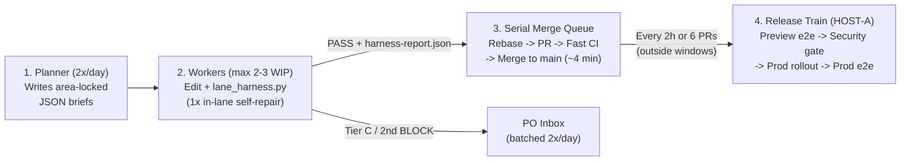

# Independent Review: Overwatch Build, Ship, Merge, and Lane Orchestration (2026-11-24)

Role: `REVIEWER` (independent, read-only).

## 10-Line Summary

1. Today's pipeline is optimized to keep 6 AI lanes busy, not to ship verified product work first-time-right.
2. On 2026-11-24, only 17 of 72 lane starts (24%) were new product work; 35% were rework (`fix` + `port`), 18% were `state-sync`, and 14% were `refill`.
3. One in four ship batches failed (18 of 72 attempts on 11-24; 40% on 11-23), and 54 production deploys/day thrash one laptop and one k3s host.
4. Root cause #1: lanes commit unchecked code and face five mismatched check gates; CI tests checks (`integration`, full `tools/tests/`, `npm run build`) that neither the lane nor the Mac pretest runs.
5. Root cause #2: uncontrolled WIP (6 parallel lanes + auto-refill) outruns a serial 20-minute deploy pipe, multiplying conflicts, batch splits, and PO interrupts.
6. Root cause #3: orchestration scripts live outside Git (`~/Codo/ops-scripts/`) and contain live bugs (broken priority regexes, silent worktree/exit-3 drops, `vitest-FAIL` bypass, unhandled post-merge API errors, model-routing overrides).
7. Target model: cap active product lanes at 2–3 with machine-enforced file/area locks, run a single version-controlled `lane_harness.py` (with 1x in-lane self-repair) before `ship-queue/`, and decouple fast PR merges from scheduled release trains (6–10 deploys/day instead of 54).
8. Checks placement: move governance, `npm run build`, and Postgres 16 schema/audit integration checks into the lane harness; strip Playwright out of GitHub `validate`; move CodeQL off PRs to push-to-main/nightly; make `dependency-scan` lockfile-only.
9. Bookkeeping: replace 13 LLM `state-sync` lanes/day with a deterministic post-release script driven by commit trailers plus 1 end-of-day narrative sync lane.
10. Offload heavy execution: keep AI CLIs and PO Git authority on the Mac; move release-train deploy/preview/e2e and heavy Gradle/Postgres integration runs to HOST-A.

---

## 1. Diagnosis: Root Causes, Lost Work, and the 2026-11-23 Council Review

### 1.1 The 5 Root Causes Behind Failure and Rework

The 2026-11-24 numbers are not random noise. Every failure class maps directly to a structural flaw in the scripts in `docs/ops-snapshot-1124/`, `tools/delivery/`, and `.github/workflows/`.

#### Root Cause 1: Zero enforced verification inside lanes, plus 5 mismatched gates
Lanes receive prose instructions in `lane-common-rules.md` (which still tells UI lanes to run only `tests/Estate*`, even though Estate work stopped on 11-23). Neither `claude_task.sh` nor `scripts/argon_task.py` runs any check after the agent finishes. Any exit-0 commit enters `ship-queue/` immediately.

Then each downstream gate runs a **different** subset of checks:
- **Lane** (`lane-common-rules.md`): optional prose commands; no `npm run build`, no `tools/tests/` governance suite, no privacy check, no Postgres integration tests.
- **Mac pretest** (`jt.sh` + `pretest_scope.py`): runs only 3 of 50+ files in `tools/tests/` (`test_live_project_governance.py`, `test_project_files_budget.py`, `test_cold_start_budget.py`). Explicitly skips `:integration-tests:test` (`-x :integration-tests:test`). Never runs `npm run build`.
- **GitHub `validate`** (`.github/workflows/validation.yml`): runs the full `tools/tests/` suite (including `test_contract_authority_status.py` and `test_live_tooling_discovery.py`) plus Playwright Chromium install.
- **GitHub `integration`** (`.github/workflows/validation.yml`): runs `:integration-tests:test` against Postgres 16 (including `AuditPresentationAllowlistMatchesLiveSchemaTest` and `AuditScreenUnclassifiedColumnIsRefusedTest`) and `npm run build`. It is a required merge check (not in `POST_MERGE_CHECKS`).
- **HOST-A preview** (`hosta_preview_e2e.sh`): builds the full container image (running `npm run build` + Gradle inside Kaniko).

**Measured impact on 11-24:** 9 of 18 ship failures (50%) came directly from this gap: 5 CI check failures (audit-coverage integration tests, contract-authority governance test), 3 unit-test failures that reached ship, and 1 preview image build failure from a removed export.

#### Root Cause 2: Open-loop WIP factory feeding a narrow serial deploy pipe
`lane-runner.sh` tries to keep 6 parallel lanes busy (`MAX=6`) and queues a `refill-*` lane whenever `lane-queue` drops below 4 briefs and `ship-queue` below 10. Each refill lane writes 3–6 more briefs. Meanwhile, `ship-runner.sh` ships at roughly 1 batch every 20 minutes, and `shipq3.sh` blocks merges across 5 daily windows (`00`, `02`, `06`, `12`, `18` plus 20-minute lead-ins — over 6 hours/day of hold time).

When supply outruns the merge/deploy pipe:
- Branches age in queues while `main` moves 54 times/day, causing rebases and `port` lanes.
- Batches of 3 fail when 1 item is bad, split into `single=1` retries, and spawn `fix` lanes (20 on 11-24).
- Every 2 shipped batches spawns a `state-sync` lane (13 on 11-24), which itself consumes a lane slot, a ship cycle, and a GitHub CI run.
- `refill-review.template` spawns *after-the-fact* review lanes on already-merged commits to queue *more* `fix-review-*` lanes (10 refills on 11-24).

Result on 2026-11-24: **only 17 of 72 lane starts (23.6%) were new product work** (`p1` 12, `frontend` 2, `ui` 1, `java` 1, `docs` 1). The rest was self-generated overhead: 25 rework (34.7%), 13 `state-sync` (18.1%), 10 `refill` (13.9%), 7 `debt` (9.7%).

#### Root Cause 3: Unversioned, live-patched bash orchestration with active bugs
All core runners live outside Git in `~/Codo/ops-scripts/` (`lane-runner.sh`, `ship-runner.sh`, `shipq3.sh`, `jt.sh`, `b-review.sh`, plus a forked `argon_task_neon.py` because repo `scripts/argon_task.py` does not even list `gemini-4-neon-` in `MODEL_FAMILIES`). Live patching has introduced real defects:

| Script & location | Verified defect | Operational effect |
|---|---|---|
| `ship-runner.sh:140` | Priority regex `grep -E '/[0-9]+-(port\|fix)-'` does not match the 11-24 naming scheme (`YYYYMMDD-HHMM-G...-D...-port-...`). | `port` and `fix` lanes lose priority, wait behind new work, and re-conflict. |
| `lane-runner.sh:117-121` | `case "$n"` checks `*-debt-*` *before* `*-port-*\|*-fix-*`, and overrides `engine=claude` unless `pin_claude=1` is set. | A `fix-...-debt-...` lane routes to Hydrogen instead of Neon/Sonnet; a `refill-p1` brief asking for `claude_model=opus` (no `pin_claude=1`) is silently downgraded to Carbon/Sonnet. |
| `jt.sh:69-71` | When vitest crashes before listing `^ FAIL  tests/...`, `$ff` is empty; the `else` branch logs `vitest-FLAKY re-run passed:` and **passes**. | Broken frontend test suites can slip past the pretest. |
| `jt.sh:17` | Diffs against `origin/main...HEAD` instead of the isolated ref `$M` (`refs/shipq/$LOG`) that `shipq3.sh` fetched. | Stale `origin/main` skips `ProjectPlanReaderTest`. |
| `standalone_orchestrate.py:168-182` | `_merge_pull_request` only checks `_pull_request_merged(url)` on 5xx/`Bad Gateway`/`Merge already in progress`. Non-5xx/EOF errors after GitHub already merged raise `SystemExit("pull request not merged")`. | **Explains 2 merge-error failures + 5 "nothing to ship" failures on 11-24:** `ship-runner.sh:75` re-queues the already-merged items, and the merged commit is **not deployed** until the next unrelated ship. |
| `standalone_orchestrate.py:1228-1232` | Acquires the global `ship.lock` (deploy lock) **before** calling `_wait_for_checks(url)` (up to 45 min timeout). | A stuck or slow GitHub check blocks the entire deploy pipeline for 45 minutes. |
| `lane-runner.sh:28-39` | `agy` permission denials return exit `3` (same code as "no commit made"). Re-queued briefs reuse the same `n2` name and log path. | Permission failures vanish unless the exact grep phrase matches; failed worktree adds move briefs to `done/*.FAILED_WORKTREE` silently. |
| `b-review.sh:52-54` | Every `BLOCK` moves straight to `ship-queue/held/` for the PO session; runs *before* `jt.sh` and outside `MAX=6`. | Reviewers burn tokens on code that fails tests; fixable defects become PO interrupts. |

#### Root Cause 4: Coupling every merge to a full HOST-A production deploy
Shipping 54 batches/day means 54 production image restamps/builds, 54 security gates, 54 rolling pod restarts, 54 preview e2es, and 54 prod e2es on one single-node k3s cluster — while also freezing merges during 5 daily collection windows. Any transient hiccup in GitHub, VPN, SSH, preview, or prod e2e triggers a full 20-minute retry or rollback cascade.

#### Root Cause 5: Single 32 GB Mac contention (Gradle daemons + 6 lanes + pretest + `main-green`)
Neither `jt.sh:23` nor `lane-common-rules.md` passes `--no-daemon` to `./gradlew`. Multiple worktrees spawn persistent Gradle daemons (3-hour idle TTL) that consume gigabytes of RAM, trigger CPU-load test flakes (such as `ScriptRunBrokerTest`), and recreate `ui2/.gradle` inside deleted worktrees (the `G521` bug in `lane-runner.sh:143`). Meanwhile `b-review.sh` and `main-green.sh` run outside `lane-runner.sh`'s concurrency cap.

---

### 1.2 Where Work Gets Lost, Duplicated, or Re-Done

- **Lost:**
  1. `lane-runner.sh:165`: a worktree-creation failure moves the brief to `done/<name>.brief.FAILED_WORKTREE` with no re-queue and no alert in `ayyas-waiter.sh` (`ayyas-waiter.sh:8` does not grep for `worktree failed`).
  2. `lane-runner.sh:30,65`: any headless `agy` failure that leaves no commit and does not print the exact string `permission was auto-denied` exits `3`, deletes its worktree, and vanishes into `done/`.
  3. `ship-runner.sh:108,191`: a `fix` or second `port` that fails sits in `ship-queue/failed/` until a human manually notices; `status.sh` does not even display the `failed/` count!
- **Duplicated:**
  1. No machine-enforced area/backlog lock: `refill-p1` and `refill-review` rely on an LLM reading brief filenames to avoid duplicates. When naming changes or two refills overlap, two lanes implement the same fix.
  2. Same checks run 3–4 times across the pipeline (`lane` -> `jt.sh` -> GitHub `validate`/`targeted-regression` -> `main-green.sh`), yet critical checks (`integration`, `npm run build`, full `tools/tests/`) are missing early.
- **Re-done:**
  1. `b-review.sh` BLOCKs (4 on 11-24, 7 on 11-23) throw the branch at the PO session instead of looping back to the lane with the defect list.
  2. Batch failures without a single-file blame match (`ship-runner.sh:84-104`) split a 3-lane batch into 3 full 20-minute single ships.
  3. Post-merge API errors (`standalone_orchestrate.py:168`) re-queue already-merged lanes, burning another batch attempt to discover "nothing to ship".

---

### 1.3 Assessment of the 2026-11-23 Council Review

`docs/ops-snapshot-1124/COUNCIL_REVIEW_2026_11_23.md` was right about production runtime hygiene (deploy freeze, k3s probes, Flyway Job, `audit_log` flood, chunk GC). On delivery process, the record is mixed:

- **Worked:** Fresh `origin/main` base in `lane-runner.sh` plus stopping Estate UI work cut `port` conflicts from **32 (11-23) to 5 (11-24)**. Adding `vitest-FAIL` and Tier B/C holds caught real defects before production.
- **Half-adopted (still broken):**
  - Item #7 asked for **declared touched files and no two lanes on one area** — never enforced in `lane-runner.sh`.
  - Item #9 asked for **flaky retry only for an explicit allowlist, never security tests** — `jt.sh` and `main-green.sh` still blindly retry any failing Java test (up to 5) or vitest file.
  - Item #10 asked to **move the ship/deploy runner off the Mac** — still running on the Mac.
- **Missed completely:**
  1. The **lane-vs-Mac-vs-CI check gap** (no inside-lane harness; `jt.sh` skipping `integration-tests`, `npm run build`, and 90% of `tools/tests/`).
  2. The **6-lane + auto-refill + 54-deploys/day + 13 `state-sync`/day feedback loop** that burns 75% of all agent runs on overhead.
  3. **Unversioned bash orchestration scripts** in `~/Codo/ops-scripts/` with zero unit tests.
  4. **Tier B review routing straight to PO `held/`** instead of a 1x automated lane self-repair loop.
  5. **GitHub CI waste** (Playwright Chromium installed inside `validate` on every PR; CodeQL and Trivy running on every PR).

---

## 2. Target Orchestration Model

### 2.1 Verdict on Today's Shape

**"6 parallel AI lanes -> batch ship runner -> PO session fixes the rest" is the wrong shape** for one PO, one laptop, and one production host.

Little's Law applies ruthlessly here: raising WIP to 6 parallel lanes when the bottleneck is human judgment + single-host deploy does not raise throughput. It raises queue wait time, staleness, conflict rate, Mac RAM pressure, and PO context-switching. Today the PO session acts as a pipeline janitor instead of a Product Owner.

### 2.2 Target Model: Pull-Based, Harness-Gated, Decoupled Release Trains

Replace the push-based 6-lane factory with four clean stages:



1. **Cap active product lanes at 2–3 (pull-based WIP limit), with larger, coherent tasks.**
   - Stop auto-refill whenever `merge-queue >= 2` or `held >= 3`. Never spawn lanes just to avoid idle slots.
   - Prefer 1 coherent feature slice (2–5 related files, 15–30 min work) over 4 micro-lanes touching the same subsystem.
   - **Machine-enforced area locks:** every brief declares `scope_paths` (e.g. `ui2/worker/src/**/inventory/**`, `ui2/frontend/src/screens/Inventory*`) and `backlog_id`. `lane-runner` refuses to start a second lane whose `scope_paths` or `backlog_id` overlaps any `started/` or `merge-queue/` item.
2. **One scheduled Planner stage (2x/day) instead of continuous `refill-*` loops.**
   - Remove the 4-way rotating `refill-*` trigger from `lane-runner.sh`.
   - Run one Planner job (e.g., 08:30 and 15:30, or on PO command) that reads `project/QUEUE.md`, `git log`, and open items, and emits a deduplicated batch of 4–6 non-overlapping briefs (JSON manifest + markdown task).
   - Drop `refill-review` completely: pre-merge Tier B review + the lane harness replace after-the-fact policing of merged commits.
3. **Strict Entry Gate (`lane_harness.py`) + 1x in-lane self-repair.**
   - No branch enters the merge queue without a valid `harness-report.json` matching its `HEAD` SHA.
   - If tests, governance, build, or Tier B review fail, the same lane gets **one** bounded repair turn with the exact failure log. Only a second failure escalates to `failed/` or `held/`.
4. **Decouple Merge Queue from Production Deploys (Release Trains).**
   - **Merge queue (continuous, serial, ~3–5 min per PR):** picks 1 verified branch (no multi-lane batch squashing/blaming needed once deploys are decoupled!), rebases onto `main` (re-running only affected harness checks if `main` moved), opens PR, waits for fast required GitHub checks (`validate` + `integration`), merges to `main`.
   - **Release train (6–10 deploys/day, scheduled outside 00/02/06/12/18 windows, or on-demand for `prio=1` hotfixes):** promotes `origin/main` -> HOST-A isolated preview e2e -> security gate -> production rollout -> production e2e -> automatic rollback on failure.
   - **Why this beats 54 deploys/day:** eliminates ~80% of preview/build/rollout/window-hold churn, eliminates batch-blame splitting, eliminates pipelined-rollback cascades, and keeps `main` clean via binary-search bisect if a train ever fails preview e2e (rare once lanes run `npm run build` + `integration` locally).
   - **Safety invariant preserved:** every commit still enters `main` via PR + required checks, preview e2e + security gate still gate every production rollout, and `AGENTS.md`'s rule separating automated validation from real-environment validation stays intact.

---

## 3. Lane Verification Harness (`tools/delivery/lane_harness.py`)

Goal: **a branch that passes the harness has a >=90% chance of passing GitHub CI and HOST-A preview on the first try.**

Check `lane_harness.py` into `tools/delivery/` with unit tests in `tools/tests/test_lane_harness.py`. Never keep it unversioned in `~/Codo/ops-scripts/`.

### 3.1 Inputs

```bash
python3 tools/delivery/lane_harness.py \
  --worktree ~/Codo/nexus-q-<id> \
  --base refs/harness/main \
  --meta ~/Codo/ops-scripts/lane-queue/started/<id>.meta.json \
  --active-dir ~/Codo/ops-scripts/lane-queue/started \
  --queue-dir ~/Codo/ops-scripts/ship-queue \
  --report ~/Codo/ops-scripts/logs/harness-<id>.json
```

Structured `.meta.json` (replaces fragile `grep`/`cut` key=value files):
- `lane_id`, `backlog_id`, `kind` (`p1`, `debt`, `bugfix`, `state-sync`, `docs`)
- `engine`, `model`, `effort`, `pin_model` (boolean; stops silent model downgrades)
- `scope_paths` (list of glob prefixes this lane is allowed to modify)
- `allow_paths` (boolean; explicit PO override for Tier C guarded paths)
- `requires_migration` (boolean; if true, `migration_version` pre-reserved by `reserve-migration.sh`)
- `max_repairs` (default `1`)

### 3.2 Ordered Steps (Cheapest First, Fail Fast)

| Step | Time | What it verifies | Failure mode caught |
|---|---|---|---|
| **1. Git & Hygiene** | 2 s | `HEAD != base`; clean working tree (no untracked `.review-*.diff` or stray build files); no merge commits; no empty commits; valid `Co-Authored-By` trailer; `Backlog-Id:` trailer present; `git diff --check` clean. | "nothing to ship", empty commits blocking rebase-merge, dirty worktrees, privacy trailer errors. |
| **2. Scope & Tier C Gate** | 2 s | Changed paths subset of `scope_paths` (unless waived); check Tier C `GUARD` regex -> if matched and `allow_paths != true`, exit `20` (`HELD_FOR_PO`) **before** spending test/review budget; check new `V*.sql` version > `main` + additive-migration lint (`DROP`/`RENAME`/`SET NOT NULL` check). | Guarded-path surprises after 20 min, scope creep, Flyway version clashes, destructive migrations. |
| **3. Conflict & Overlap Pre-Check** | 3 s | Fetch latest `main` into an isolated ref `refs/harness/<id>` (never touches `origin/main`). Run `git merge-tree --write-tree refs/harness/<id> HEAD` (read-only, zero working-tree mutation). If conflict -> exit `12` (`CONFLICT_WITH_MAIN`). Also warn/block on file overlap with `queue-dir`. | Stale-base conflicts caught inside the lane while the agent still has context. |
| **4. Privacy & Secrets Gate** | 5–15 s | `tools/privacy/repository_privacy_check.py --privacy-baseline-ref refs/harness/<id>` + `gitleaks git --redact=100 --config .gitleaks.toml --log-opts=refs/harness/<id>..HEAD .` | Raw hostnames/IPs/serials and gitleaks findings caught before push. |
| **5. Full Governance & Derived-Files Gate** | 10–25 s | Run **all** fast governance/contract/inventory tests from `tools/tests/` (excluding slow browser tests): `test_live_project_governance.py`, `test_project_files_budget.py`, `test_cold_start_budget.py`, `test_contract_authority_status.py`, `test_live_tooling_discovery.py`, `test_design_cross_references_resolve.py`, `test_migration_versions_unique.py`, `test_migration_audit_context.py`, `test_frozen_contract_shapes.py`, plus `build_history_index.py --check`, `project_queue.py check`, `successor_index.py --check`. If `tools/` changed, also run the matching `tools/tests/test_*.py`. | Eliminates **every** governance/contract failure that previously slipped past `jt.sh` and failed on GitHub `validate`. |
| **6. Scoped Build & Unit Tests** | 1–3 min | Compute scope via `pretest_scope.py --base refs/harness/<id> --branch HEAD`. **Frontend (if touched):** `npx tsc --noEmit -p .`, `npx vitest run` (fail closed if exit != 0 even when `$ff` is empty; retry ONLY tests in `tools/delivery/flaky_allowlist.json`), AND `npm run build`. **Java (if touched):** `./gradlew --no-daemon <scoped tasks> :architecture-tests:test` (`--no-daemon` mandatory; retry ONLY allowlisted non-security tests). If `project/` changed: run `:service:test --tests '*ProjectPlanReaderTest*'`. | Catches compile errors, removed-export build failures (preview failure on 11-24), DIR-10 violations, and unit failures before leaving the lane. |
| **7. Postgres 16 Integration Gate** | 1–3 min | Triggered by the **exact same path filter** as `.github/workflows/validation.yml`'s `integration` job (`ui2/` excluding `ui2/frontend/`, or `docs/operations/sql/`). Runs `./gradlew --no-daemon -PfrontendPrebuilt=true :integration-tests:test` against a persistent local Postgres 16 container on loopback (Week 1) or HOST-A integration runner (Week 2). Fast-fail option: run `*Schema*Test` + `*Audit*Test` + `MigrationLintTest` first (~30 s), then remaining integration tests. | Eliminates the #1 GitHub CI failure class (audit-coverage and schema integration tests) before push. |
| **8. Tier B Cross-Family Review** | 1–2 min | Runs **only** if steps 1–7 passed and diff touches Tier B paths (`ui2/*/src/main/` or `ui2/frontend/src/`). Single reviewer from the opposite model family (Antigravity lane -> Sonnet; Claude lane -> Neon high). Never runs on broken code. | Concrete logic/invariant defects caught cleanly; zero wasted review tokens on uncompilable code. |

### 3.3 Exit Codes & In-Lane Self-Repair Loop

| Exit code | Meaning | Action by `lane-runner` |
|---|---|---|
| `0` | `PASS` | Write `ship-queue/<id>.ship` pointing to `HEAD` SHA + `harness-report.json`. Remove worktree after merge. |
| `10` | `CHECK_FAILED` | If `repairs < 1`: re-invoke the same lane worktree with the bounded failure summary (max 80 lines) and `repairs=1`. If `repairs >= 1`: move to `failed/` with report. |
| `11` | `REVIEW_BLOCKED` | If `repairs < 1`: pass `file:line` review defects back to the lane for 1 fix pass, then re-run harness. If blocked twice: move to `held/` for PO. |
| `12` | `CONFLICT_WITH_MAIN` | If `repairs < 1`: instruct the same lane to `git rebase refs/harness/<id>`, resolve conflicts preserving main's lines, and re-run harness. |
| `20` | `HELD_FOR_PO` | Move directly to `held/` with exact guarded paths listed. Zero retries. |
| `30` | `NO_CHANGES` | Legitimate no-op (only when agent exited 0 cleanly with no permission/infra markers). Archive to `done/noop/`. |
| `40` | `AGENT_PERMISSION_DENIED` | Move to `held/` with explicit `ACTION` alert; never conflated with `30`. |
| `41` | `AGENT_INFRA_ERROR` | Quota, empty conversation id, timeout, crash. Retry once with backoff or switch engine; pause runner after 2 consecutive infra errors. |

**Where it runs:** Steps 1–6 run inside the lane worktree on the Mac via a single wrapper (`tools/delivery/run_lane.py`, replacing both `claude_task.sh` and `argon_task_neon.py`). Step 7 runs against a single shared local Postgres 16 container on the Mac in Week 1, then shifts to HOST-A's `ui2-build` integration runner in Week 2.

---

## 4. Checks Placement Matrix

Every failure should be caught **once, as early and cheaply as possible**, and never only on GitHub after a 20-minute wait.

| Check | Current placement & cost | Verdict | Target placement & concrete change |
|---|---|---|---|
| **Lane prose rules** (`lane-common-rules.md`) | Unenforced prose; stale (`Estate*` tests) | **REPLACE** | Enforced mechanically by `tools/delivery/lane_harness.py` inside `run_lane.py`. |
| **Tier B review** (`b-review.sh`) | Runs post-lane, *before* unit tests, outside `MAX=6`, routes BLOCK straight to PO `held/`, runs two serial LLMs on Claude lanes | **MOVE + SIMPLIFY** | Run as Step 8 of `lane_harness.py` (only after tests pass), 1 cross-family model only, inside worker slot, with 1x in-lane self-repair before `held/`. |
| **Mac pretest** (`jt.sh`) | Runs in `shipq3.sh` in parallel with preview; misses `integration`, `npm run build`, and 90% of `tools/tests/`; blind flaky retries | **MERGE** | Merge into `lane_harness.py`. At merge time, the merge queue skips re-running if `HEAD` was already harness-verified against current `main`, or re-runs only Steps 3–7 after a rebase. |
| **GitHub `validate`** (`.github/workflows/validation.yml`) | Required on every PR + push; installs Playwright Chromium (`3–10 min`) even when no dashboard file changed | **KEEP + SPLIT** | Keep as required PR check (privacy + governance + non-browser `tools/tests/` -> ~45 s). Move `test_orchestrator_dashboard_browser.py` + Playwright install to a path-filtered job (`orchestrator-browser`) that runs only when `tools/delivery/orchestrator_dashboard*` or `dashboard_assets/` changes. |
| **GitHub `integration`** (`.github/workflows/validation.yml`) | Required on every Java/SQL PR (~10–20 min); causes surprise failures because Mac pretest skips it | **KEEP + SHIFT LEFT** | Keep as required PR safety net on GitHub, **and** run the exact same `:integration-tests:test` in `lane_harness.py` Step 7 so PRs arrive already green. |
| **GitHub `regression-scope` + `targeted-regression`** | Runs on PRs; `targeted-regression` is in `POST_MERGE_CHECKS` and duplicates Java/vitest already run locally | **DROP** (on PRs) | Move the 4 fast Python routing/privacy tests from `targeted-regression` into `validate`; drop `targeted-regression` and `regression-scope` from PR runs (saves runner congestion and timeout risk). |
| **GitHub `full-regression`** | Moving to nightly tonight | **KEEP (nightly)** | Nightly schedule + manual `workflow_dispatch` only. Remove from `push: main` (54 runs/day is waste once PRs are harness-gated). |
| **GitHub `codeql`** (`.github/workflows/codeql.yml`) | Runs full `--no-build-cache` Java compile + JS analysis on every PR AND every push to `main` (non-blocking) | **MOVE** | Remove `pull_request` trigger. Run on `schedule` (nightly) + `workflow_dispatch` (or once per release train tag). Cuts GitHub runner burn by >50%. |
| **GitHub `dependency-scan`** (`.github/workflows/validation.yml`) | Runs Trivy on every PR + push to `main` (rate-limited, 30 s sleep retries) | **MOVE (path-filter)** | Run on PR/push **only** when lockfiles or build files change (`requirements*.txt`, `package-lock.json`, `gradle/**`, `**/build.gradle.kts`) + nightly schedule. |
| **GitHub `po-scope-check`** | Only runs on `gov/po-*` branches | **KEEP** | Already zero-cost on normal PRs. |
| **`main-green.sh`** (launchd, 2 min) | Polls `main` on Mac and re-runs `tools`, `tsc`, `vitest` after every merge | **DOWNGRADE / MERGE** | With a strict serial merge queue that gates every merge on `lane_harness.py` + `validate`, `main` cannot go red silently. Replace with a lightweight check of GitHub's latest `main` status (no local `vitest` / `tsc` CPU burn on the Mac). |
| **HOST-A Preview e2e** (`hosta_preview_e2e.sh`) | Runs per batch (54+ times/day plus retries), 8–12 min each | **MOVE to Release Train** | Run once per **release train** (every 2 hours or 6–8 merged PRs, plus immediately for `prio=1`). Cuts preview runs from 54+/day to 6–10/day. Reuse the verified preview image (`hosta_restamp_image.py`) directly for the train's prod deploy. |
| **HOST-A Security gate** (`security_host.py`) | Runs in `run_build.sh` per prod deploy | **KEEP (Release Train)** | Runs once per release train on the exact digest being rolled out. Never weakened. |
| **HOST-A Prod e2e + module e2e** (`hosta_e2e.sh`) | Runs per prod deploy (54/day) | **KEEP (Release Train)** | Runs once per release train (6–10/day) + nightly `--full`. Auto-rollback reverts the train cleanly on failure. |

---

## 5. State and Bookkeeping (Fixing the 18% `state-sync` Tax)

Running **13 Claude Sonnet lanes/day (18% of all lanes)** just to keep `project/*.json` and `CURRENT_STATE.md` synced is not needed and actively harms throughput. Each `state-sync` lane consumes a worker slot, creates a PR, triggers GitHub Actions, triggers `main-green.sh`, risks `test_project_files_budget.py` failures, and does not even update the live Project Plan UI until the next code deploy (`standalone_orchestrate.py:544`).

### Cheaper, Reliable Replacement (2 parts)

1. **Deterministic release ledger (0 LLM tokens, runs automatically per release train):**
   - Require a `Backlog-Id: <id>` (or `Backlog-Id: none`) commit trailer in `lane_harness.py` Step 1.
   - Add `tools/delivery/record_release.py`: after a release train passes prod e2e, it deterministically reads the merged commits since the last release tag, calls `tools/delivery/project_queue.py` to append/update the release entry and status notes, runs `build_history_index.py` and `successor_index.py render`, verifies `test_live_project_governance.py` and `test_project_files_budget.py`, and commits directly as a single docs-only PR (or bundles into the next train).
   - No LLM touches JSON syntax, size budgets, or index regeneration.

2. **One daily narrative digest lane (1 LLM lane/day instead of 13):**
   - Run one scheduled Sonnet lane at end of day (e.g. 22:00) strictly for judgment tasks a script cannot do: verifying acceptance criteria before moving a backlog item to `DONE`, updating the 6-line hot summary in `CURRENT_STATE.md`, and archiving older build-history rows.
   - Delete the `if [ "$c" -ge 2 ]` `state-sync` trigger in `ship-runner.sh:59-64`.

**Effect:** Cuts `state-sync` from **13 lanes/day (18%) to 1 lane/day (<2%)**, eliminating ~12 PRs/day and ~12 CI runs/day while keeping project records accurate and governance-clean.

---

## 6. Execution Placement: Mac vs HOST-A vs GitHub

Bank rules impose two hard constraints: **operational/live data stays inside the bank network (HOST-A)**, and **the PO controls Git push/PR/merge**.

| Workload | Where it runs today | Target host | Rationale |
|---|---|---|---|
| **PO session, approvals, Tier C review** | Mac | **Stay on Mac** | Human judgment and PO-held Git/GitHub authority stay under PO control. |
| **AI worker CLIs (`claude -p`, `agy -p`)** | Mac | **Stay on Mac** | External LLM CLIs must run only on synthetic/masked local worktrees with zero network access to HOST-A or production data. |
| **Fast lane checks** (`git`, privacy, `gitleaks`, governance pytest, `tsc`, `vitest`, `npm run build`, scoped Java unit tests with `--no-daemon`) | Mac | **Stay on Mac** | Seconds to ~2 min; zero network; gives immediate feedback for in-lane self-repair. |
| **Postgres 16 integration tests** (`:integration-tests:test`) | GitHub only | **Week 1: Mac local Postgres 16 container; Week 2: HOST-A `ui2-build` Job** | Week 1 closes the CI failure gap immediately (1 local container, `Ui2PostgresFixture` isolates DBs). Week 2 offloads heavy JVM/DB CPU off the 32 GB laptop to HOST-A's `hosta_integration.sh` (synthetic data only, isolated namespace). |
| **Release-train runner** (preview e2e, image build/restamp, security gate, module rollout, prod e2e, rollback, window holds) | Mac (`ship-runner.sh` + `shipq3.sh` over SSH/VPN) | **Move to HOST-A** (host-side systemd timer/service under `nexus` deploy account) | Eliminates VPN drops, laptop sleep, SSH timeouts, and Mac resource contention. Mac pushes merged `main` to `/opt/nexus.git` (or HOST-A pulls from `/opt/nexus.git` only when an explicit PO/merge-queue signed release tag `release/YYYYMMDD-NN` is pushed). |
| **Merge queue & GitHub PR actions** (`gh pr create`, `gh pr merge`, `git push origin`) | Mac (`standalone_orchestrate.py`) | **Stay on Mac** (lightweight Python daemon `merge_queue.py`) | Satisfies "PO controls Git" without putting GitHub credentials on HOST-A (`hosta_deploy.sh:77` explicitly prohibits GitHub credentials on HOST-A!). |
| **Required PR safety net & nightly heavy checks** (`validate`, `integration`, nightly `full-regression`, nightly `codeql`, lockfile `dependency-scan`) | GitHub Actions | **Stay on GitHub Actions** | Public/synthetic repo checks only; enforces branch protection independently of the Mac. |

---

## 7. Ranked Proposals & 2-Week Improvement Plan

Proposals are ranked by **expected impact on verified throughput and first-time-right rate**.

### Ranked Proposal Catalog

| Rank | Proposal | What changes (file / script) | Cost | Risk | Failures removed (from 11-24 list) | How we measure it |
|---|---|---|---|---|---|---|
| **P1** | **Build `lane_harness.py` + `run_lane.py` with 1x in-lane self-repair** (governance, `npm run build`, fixed `vitest-FAIL`, `--no-daemon`, local Postgres 16 integration, distinct exit codes `30`/`40`/`41`, post-test Tier B review) | NEW `tools/delivery/lane_harness.py`, `tools/delivery/run_lane.py`, `tools/delivery/flaky_allowlist.json`, `tools/tests/test_lane_harness.py`; deprecate `claude_task.sh`, `argon_task_neon.py`, `jt.sh` | **M** | Low (additive gate; strict exit codes) | CI check failed (5), unit tests (3), preview image build failed (1), silent `agy` exit-3 drops, Gradle worktree recreation, Tier B PO interrupts (4) | Lane first-time-right rate (target **>=85%**); `fix` lane share (**28% -> <8%**); zero silent drops |
| **P2** | **Fix live orchestration bugs & move all runner scripts into Git** (`tools/delivery/ops/`) | Move `~/Codo/ops-scripts/*.sh` into `tools/delivery/ops/`; fix `standalone_orchestrate.py:168` (always check `_pull_request_merged()` on ANY merge error) & `:1228` (wait for CI *before* taking `ship.lock`); fix `ship-runner.sh:140` regex, `lane-runner.sh:112-121` `pin_claude`/case order, `jt.sh:71` empty `$ff` | **S** | Low (pure bug fixes + unit tests) | Merge API error after merge (2), "nothing to ship" (5), 45-min deploy lock stall, lost port/fix priority, silent Opus downgrades | Merge-error re-queues (**2 -> 0**); "nothing to ship" (**5 -> 0**); `ship-runner` bug regressions covered by pytest |
| **P3** | **Cap WIP to 2–3 lanes, enforce area/backlog locks, replace auto-refill with 2x/day Planner** | `tools/delivery/ops/lane_runner.py` (replaces `lane-runner.sh`), structured `.meta.json`, `tools/delivery/planner_brief.md`; delete `refill-review.template` & continuous refill loop | **M** | Low (reversible config cap) | Duplicate lanes doing same fix, naming-scheme drift, `port` conflicts, 32 GB Mac thrashing, 10 `refill` lanes/day | Active WIP <=3; duplicate-lane incidents (**0/week**); `port` share (**<3%**); product-work share (**24% -> >=75%**) |
| **P4** | **Decouple Merge Queue from HOST-A Release Trains (6–10 deploys/day)** | NEW `tools/delivery/merge_queue.py` (serial 1-PR merge, no 3-lane batching/blaming) + `tools/delivery/release_train.py` (runs preview -> security gate -> deploy -> prod e2e outside 00/02/06/12/18 windows, or immediately for `prio=1`) | **M** | Medium (a failing preview train needs bisect over 4–8 PRs; mitigated by P1 catching build/unit/integration bugs pre-merge) | Eliminates 80% of 54/day deploy/preview/window-hold cycles, batch-split retries, pipelined-rollback wastes | Deploys/day (**54 -> 6–10**); ship/train failure rate (**25% -> <5%**); worst-case window hold impact; median PR merge time (**<6 min**) |
| **P5** | **Optimize GitHub Actions & retire redundant `main-green.sh` local runs** | `.github/workflows/validation.yml` (split Playwright browser test out of `validate`, drop PR `targeted-regression`, path-filter `dependency-scan`, nightly-only `full-regression`); `.github/workflows/codeql.yml` (drop `pull_request` trigger); `main-green.sh` (poll GH status only) | **S** | Low (no check weakened; nightly still runs full suite + CodeQL) | CI pending timeouts (2), 3–10 min `validate` waits on Playwright apt, GitHub runner queue backlog | `validate` p90 runtime (**<90 s**); CI pending timeouts (**2/day -> 0/week**); GitHub Actions minutes (**-60%**) |
| **P6** | **Replace 13/day LLM `state-sync` lanes with deterministic `record_release.py` + 1 daily digest** | NEW `tools/delivery/record_release.py`; remove `state-sync` counter in `ship-runner.sh:59-64`; add 1x/day launchd/cron trigger for narrative digest | **S** | Low (uses existing `project_queue.py` & governance tests) | 13 `state-sync` lanes/day (18% of all starts) + their PR/CI churn | `state-sync` share (**18% -> <2%**); governance test pass rate (**100%**) |
| **P7** | **Move Release Train execution + heavy integration runner to HOST-A** | Systemd service/timer on HOST-A watching signed `release/*` tags in `/opt/nexus.git` to execute preview -> `run_build.sh` -> `hosta_e2e.sh` -> auto-rollback; wire `lane_harness.py` Step 7 to optional `hosta_integration.sh` | **L** | Medium (needs PO/bank ops sign-off on host service account & tag-triggered deploy boundary; never puts GitHub creds on HOST-A) | VPN/SSH mid-deploy disconnects, laptop-sleep stalls, Mac CPU/RAM exhaustion | Deploy infra failures (**-> <1%**); PO-session minutes per shipped change (**-70%**) |

---

### 2-Week Execution Roadmap

#### Week 1: Stop the Bleeding, Fix Bugs, Ship the Harness (Days 1–5)

- **Day 1 — Immediate bug fixes & WIP brake (P2 + P3 brake):**
  - Lower `lane-runner.sh` from `MAX=6` to `MAX=3`, create `lane-queue/NO_REFILL` (manual/2x-day refill only), disable `ship-runner.sh`'s every-2-batches `state-sync` trigger.
  - Fix the 5 live bugs in `standalone_orchestrate.py` (post-merge check on all errors; `_wait_for_checks` before `_acquire_deploy_lock`), `jt.sh` (empty `$ff` fail-closed; `--no-daemon`; use `$M` ref; add `test_contract_authority_status.py` and `npm run build`), `ship-runner.sh` (priority regex), and `lane-runner.sh` (`pin_claude` + case order + alert on `FAILED_WORKTREE`).
  - **Day 1 target:** Zero "nothing to ship" errors; zero post-merge undeployed commits; Mac RAM stays below 75%.
- **Day 2 — GitHub Actions fast-lane cleanup (P5):**
  - Split Playwright browser test out of `validate`, drop PR `targeted-regression`, path-filter `dependency-scan`, move `codeql` off `pull_request`, downgrade `main-green.sh` to status-only.
  - **Day 2 target:** `validate` p90 < 90 s; zero 45-min CI timeouts.
- **Days 3–4 — Build and enforce `lane_harness.py` + `run_lane.py` (P1):**
  - Stand up one persistent local `postgres:16` Docker container on the Mac (`127.0.0.1:5432`, trust auth, loopback only — identical to `.github/workflows/validation.yml:487`).
  - Implement `tools/delivery/lane_harness.py` (Steps 1–8), `flaky_allowlist.json` (explicitly excluding security tests), and `run_lane.py` with the 1x in-lane self-repair loop and strict exit codes (`0/10/11/12/20/30/40/41`).
  - Check all ops scripts into `tools/delivery/ops/` and symlink `~/Codo/ops-scripts/` to the repo copy.
  - **Day 4 target:** Every new lane passes all governance, build, unit, integration, and Tier B checks *before* touching `ship-queue/`. Lane first-time-right rate >= 75%.
- **Day 5 — Deterministic state recording (P6) + Week 1 measurement:**
  - Ship `tools/delivery/record_release.py` and schedule 1x/day end-of-day narrative digest lane.
  - Review Week 1 logs against baseline (`11-24`: 25% ship fail, 35% rework, 18% state-sync).

#### Week 2: Change the Delivery Shape & Offload to HOST-A (Days 6–10)

- **Days 6–7 — Structured Planner + Area Locks (P3):**
  - Replace free-form brief files with `.meta.json` (`scope_paths`, `backlog_id`, `tier`, `pin_model`).
  - Enforce zero overlap across `started/` and `merge-queue/` in `lane_runner.py`.
  - Schedule the 2x/day Planner (08:30 / 15:30) and delete `refill-review.template`.
  - **Day 7 target:** Zero duplicate lanes; `port` conflicts < 3% of lanes; product-work share >= 70%.
- **Days 8–9 — Decouple Merge Queue from Release Trains (P4):**
  - Deploy `merge_queue.py`: serial 1-PR rebase/check/merge to `main` (no 3-lane batching or blame heuristics).
  - Deploy `release_train.py`: cuts a train every 2 hours outside `00/02/06/12/18` windows (or immediately on `prio=1`), running HOST-A preview e2e -> restamp -> security gate -> rollout -> prod e2e -> `record_release.py`.
  - **Day 9 target:** 6–10 deploys/day (down from 54); train failure rate < 5%; median PR merge < 6 min.
- **Day 10 — Move Release Train runner to HOST-A (P7, pending PO/ops sign-off):**
  - Install host-side systemd unit under the `nexus` deploy account watching signed `release/*` tags pushed to `/opt/nexus.git`.
  - Mac only merges on GitHub and pushes `main` + `release/<id>` tag to HOST-A; HOST-A executes preview, build, gate, rollout, e2e, and rollback locally with zero SSH/VPN fragility.

---

### Measurable Success Targets (Baseline 2026-11-24 vs End of Week 2)

| Metric | 2026-11-24 Baseline | End of Week 1 | End of Week 2 |
|---|---|---|---|
| **Lane first-time-right rate** (passes harness & merges without PO fix/port) | ~50–55% (est. from 25 rework / 72 starts) | >= 75% | **>= 85%** |
| **Ship / release-train failure rate** | 25% (18/72; 40% on 11-23) | < 10% | **< 5%** |
| **Rework share** (`fix` + `port` of total lane starts) | 34.7% (25/72) | < 15% | **< 10%** |
| **Bookkeeping + refill share** (`state-sync` + `refill`) | 31.9% (23/72) | < 10% | **< 8%** |
| **New product-work share** of lane starts | 23.6% (17/72) | >= 60% | **>= 75%** |
| **Silent drops / post-merge undeployed commits** | 7+ (5 "nothing to ship" + 2 merge errors + `agy` exit-3) | **0** | **0** |
| **Production deploys / day** | 54 | 15–25 | **6–10 (release trains)** |
| **PO-session minutes per shipped product change** | Majority of PO session | -50% | **-70%+** (PO handles Tier C + 2x/day product decisions only) |

### PO Decisions Needed Before Week 2 Execution

1. **Release-train cadence (P4):** Approve decoupling fast PR merge-to-`main` from scheduled production trains (proposed: every 2 hours outside 00/02/06/12/18 windows, plus immediate `prio=1` fast-track), with preview e2e running per train instead of per PR.
2. **GitHub Actions cleanup (P5):** Approve removing `codeql` from `pull_request` (keeping nightly + release train) and dropping PR `targeted-regression` (keeping `validate`, `integration`, and nightly `full-regression`).
3. **HOST-A release-train daemon (P7):** Approve running the release-train service under the host-side `nexus` account triggered by a signed `release/*` tag pushed to `/opt/nexus.git` (keeping GitHub credentials strictly on the Mac).
