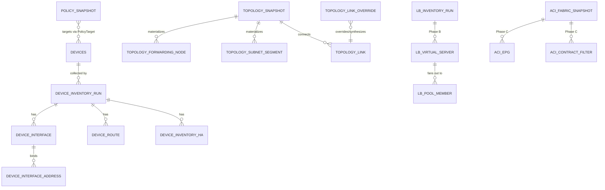

<!-- Argon design artifact, copied unaltered from the agy brain directory referenced in PATH_ANALYSIS_DESIGN_ARGON.md, 2026-11-03 -->
<!-- Privacy-gate edit 2026-11-03 (only change to the unaltered output): example address literals (class-E masking range, private-range examples) replaced by 240/4 notation, a masked-address placeholder, and RFC 5737 documentation ranges. Text otherwise unaltered. -->

# Architecture Design: Network Topology & Source-to-Destination Path Analysis (Argon Track)

- **Document ID**: `NXS-DESIGN-PATH-ANALYSIS-ARGON-2026-11-03`
- **Status**: `DRAFT — DO NOT FREEZE` (Design session input, 2026-11-03; produced independently for cross-review, merge, and PO Decision Council adjudication)
- **Product Principle**: `SEE → VERIFY → TRACE → RECOVER → OPERATE` ([AGENTS.md](file:///Users/OzanDur/Codo/wt-pathanalysis-design/AGENTS.md))
- **Authority Alignment**: Governed by [AGENTS.md](file:///Users/OzanDur/Codo/wt-pathanalysis-design/AGENTS.md) (Level 1), active schema migrations through [V171__pan_firewall_command_retirement.sql](file:///Users/OzanDur/Codo/wt-pathanalysis-design/ui2/service/src/main/resources/db/migration/V171__pan_firewall_command_retirement.sql) (`origin/main` baseline V167 per [CURRENT_STATE.md](file:///Users/OzanDur/Codo/wt-pathanalysis-design/CURRENT_STATE.md)), and repository implementation reality (Level 5).

> [!IMPORTANT]
> **Executive Thesis (Argon Track)**: A source-to-destination path simulator in a high-assurance security product must never be a "best-effort graph guesser." Under the neXus Constitution ([AGENTS.md](file:///Users/OzanDur/Codo/wt-pathanalysis-design/AGENTS.md)), configuration intent is not runtime truth, an uncollected hop is not an allowed hop, and vendor packet-processing order (Palo Alto pre-NAT zone/route lookup + post-DNAT zone/route re-lookup vs. Check Point pre-NAT access evaluation + top-down manual/auto NAT + post-DNAT route lookup) is load-bearing law. This design builds Phase A by **extending neXus's already-deployed runtime inventory (`device_interface`, `device_route`, `device_inventory_ha`) and policy engine (`PolicySnapshot`, `PolicyLookup`)** rather than creating parallel collection pipelines, while defining clean, immutable SPI boundaries (`ForwardHopEvaluator`, `ForwardPacketTransformation`, `FabricContractEvaluator`) so Phase B (F5 BIG-IP), Phase C (Cisco ACI), and Phase D (Routers/Multi-VRF/Change Design) plug into the exact same hop state machine without rewriting Phase A.

---

## 0. Codebase Audit: What neXus Actually Has vs. Architectural Gaps

Prompt §2 instructs: *"read the code; do not assume."* A direct audit of the codebase reveals that neXus has **substantially more foundation** than the brief's high-level summary assumes, alongside **9 concrete semantic gaps** that Phase A must close before path claims can be proven.

### 0.1 Foundation Already Implemented in Code (Verified)

1. **Runtime Interface, Subnet, HA Role, and Routing Table Persistence ([V13__device_inventory.sql](file:///Users/OzanDur/Codo/wt-pathanalysis-design/ui2/service/src/main/resources/db/migration/V13__device_inventory.sql), [V20__device_inventory_ha_and_vip.sql](file:///Users/OzanDur/Codo/wt-pathanalysis-design/ui2/service/src/main/resources/db/migration/V20__device_inventory_ha_and_vip.sql), [V127__global_ip_search_indexes.sql](file:///Users/OzanDur/Codo/wt-pathanalysis-design/ui2/service/src/main/resources/db/migration/V127__global_ip_search_indexes.sql), [V148__interface_mac_and_zone.sql](file:///Users/OzanDur/Codo/wt-pathanalysis-design/ui2/service/src/main/resources/db/migration/V148__interface_mac_and_zone.sql))**:
   - Contrary to the brief's summary that neXus lacks runtime routing tables or an interface/zone model, PostgreSQL already persists:
     - `device_inventory_run(run_id, device_id, job_id, collected_at, context_count, created_at, virtual_systems, not_collected)`
     - `device_interface(interface_id, run_id, context, name, parent, kind, state, vlan_id, mac_address, zone)`
     - `device_interface_address(address_id, interface_id, address, family, role)` where `role IN ('member', 'cluster_virtual')`, indexed by GiST `inet_ops` via `search_inet(address)` ([V127__global_ip_search_indexes.sql](file:///Users/OzanDur/Codo/wt-pathanalysis-design/ui2/service/src/main/resources/db/migration/V127__global_ip_search_indexes.sql#L19-L41)).
     - `device_route(route_id, run_id, context, destination, next_hop, interface, protocol, route_table)`, also GiST-indexed on `network(search_inet(destination))` ([V127__global_ip_search_indexes.sql](file:///Users/OzanDur/Codo/wt-pathanalysis-design/ui2/service/src/main/resources/db/migration/V127__global_ip_search_indexes.sql#L43-L46)).
     - `device_inventory_ha(ha_id, run_id, context, role, cluster_mode, source)`.
   - [`InventoryCapabilityExecutor`](file:///Users/OzanDur/Codo/wt-pathanalysis-design/ui2/worker/src/main/java/com/securityexpert/nexus/ui2/worker/inventory/InventoryCapabilityExecutor.java#L60-L430) and [`InventoryReadPlan`](file:///Users/OzanDur/Codo/wt-pathanalysis-design/ui2/worker/src/main/java/com/securityexpert/nexus/ui2/worker/inventory/InventoryReadPlan.java#L41-L216) already collect and parse interfaces, ClusterXL VIPs, HA roles, and routing tables for Check Point (`cp_inventory_collect`), Palo Alto (`pan_inventory_collect`), FortiGate (`fgt_inventory_collect`), Cisco ASA (`asa_inventory_collect`), and HTTPS grid devices (`https_inventory_collect`, per [`InventoryCapabilityIds`](file:///Users/OzanDur/Codo/wt-pathanalysis-design/ui2/job-engine/src/main/java/com/securityexpert/nexus/ui2/jobs/admission/InventoryCapabilityIds.java#L16-L36)).
2. **Management-Plane NAT Rule Collection & Normalization ([CheckPointPolicyMapper.java](file:///Users/OzanDur/Codo/wt-pathanalysis-design/ui2/worker/src/main/java/com/securityexpert/nexus/ui2/worker/policy/CheckPointPolicyMapper.java#L170-L246), [PanoramaPolicyMapper.java](file:///Users/OzanDur/Codo/wt-pathanalysis-design/ui2/platform-core/src/main/java/com/securityexpert/nexus/ui2/policy/PanoramaPolicyMapper.java#L69-L90))**:
   - [`CheckPointPolicyCollector`](file:///Users/OzanDur/Codo/wt-pathanalysis-design/ui2/worker/src/main/java/com/securityexpert/nexus/ui2/worker/policy/CheckPointPolicyCollector.java#L298-L320) already invokes `show-nat-rulebase` (paginated by 500) and [`CheckPointPolicyMapper.mapNatRulebase`](file:///Users/OzanDur/Codo/wt-pathanalysis-design/ui2/worker/src/main/java/com/securityexpert/nexus/ui2/worker/policy/CheckPointPolicyMapper.java#L170-L246) stores a section titled `"CP NAT rulebase"` inside [`PolicySnapshot`](file:///Users/OzanDur/Codo/wt-pathanalysis-design/ui2/platform-core/src/main/java/com/securityexpert/nexus/ui2/policy/PolicySnapshot.java#L15-L214) with `original-source`, `original-destination`, `original-service` mapped to `source`/`destination`/`service` cells, and `method`, `auto-generated`, `translated-source`, `translated-destination`, `translated-service`, `install-on` stored in `rule.extras()`.
   - [`PanoramaPolicyMapper`](file:///Users/OzanDur/Codo/wt-pathanalysis-design/ui2/platform-core/src/main/java/com/securityexpert/nexus/ui2/policy/PanoramaPolicyMapper.java#L75-L83) already parses Panorama `"Pre NAT rules"` and `"Post NAT rules"` into [`PolicySnapshot`](file:///Users/OzanDur/Codo/wt-pathanalysis-design/ui2/platform-core/src/main/java/com/securityexpert/nexus/ui2/policy/PolicySnapshot.java) with `from`, `to`, `to-interface`, `service`, `nat-type`, `source-translation`, `destination-translation`, `dynamic-destination-translation`, and `target-selectors` in `rule.extras()` ([PanoramaPolicyMapper.java](file:///Users/OzanDur/Codo/wt-pathanalysis-design/ui2/platform-core/src/main/java/com/securityexpert/nexus/ui2/policy/PanoramaPolicyMapper.java#L345-L450)).
3. **Rule Lookup Engine with Interval Disjoint Partitioning ([PolicyLookup.java](file:///Users/OzanDur/Codo/wt-pathanalysis-design/ui2/service/src/main/java/com/securityexpert/nexus/ui2/service/policy/PolicyLookup.java#L9-L245), [PolicyNormalization.java](file:///Users/OzanDur/Codo/wt-pathanalysis-design/ui2/service/src/main/java/com/securityexpert/nexus/ui2/service/policy/PolicyNormalization.java#L12-L260))**:
   - [`PolicyLookup`](file:///Users/OzanDur/Codo/wt-pathanalysis-design/ui2/service/src/main/java/com/securityexpert/nexus/ui2/service/policy/PolicyLookup.java#L103-L234) already resolves IPv4/IPv6 ranges (`IpInterval`) and protocol/port intervals (`ServiceAtom`), handles negated cells (`cell.negated()`), traverses Check Point `Ordered Layers` and inline layers (`inlineLayerId` with implicit cleanup action), and computes exact first-match coverage across disjoint multi-dimensional partitions (`coveredIntervals`) so rules that jointly cover a query CIDR are evaluated without false residue.
4. **Packet Analysis Hop & Policy Correlation ([PacketAnalysisCorrelationService.java](file:///Users/OzanDur/Codo/wt-pathanalysis-design/ui2/service/src/main/java/com/securityexpert/nexus/ui2/service/packetanalysis/PacketAnalysisCorrelationService.java#L68-L1300)) and ReactFlow Canvas ([PacketTopologyTab.tsx](file:///Users/OzanDur/Codo/wt-pathanalysis-design/ui2/frontend/src/screens/packetanalysis/PacketTopologyTab.tsx#L1-L160))**:
   - neXus already ships `@xyflow/react` (`ReactFlow`) in the frontend and correlates capture hops against `DeviceInventoryRepository` and `PolicyQueryService`.

### 0.2 Nine Concrete Gaps Uncovered by Code Inspection

| # | Subsystem | File / Symbol | Concrete Gap & Impact on Path Analysis |
|---|---|---|---|
| **G1** | PAN Route Parser (RIB vs. FIB) | [`PaloAltoRouteParser.parse`](file:///Users/OzanDur/Codo/wt-pathanalysis-design/ui2/worker/src/main/java/com/securityexpert/nexus/ui2/worker/inventory/pan/PaloAltoRouteParser.java#L52-L120) | `<show><routing><route/></show>` returns the full RIB (both active `A`-flagged FIB routes and inactive backup routes). Line 113 strips `A` and `E` flags (`"A" (active), "E" (ecmp) ... are qualifiers -- fall through`) and persists inactive routes alongside active routes without `is_active`, `is_ecmp`, `metric`, or `next_hop_kind` (`ip`, `connected`, `vr`, `discard`). |
| **G2** | PAN Interface-to-VR Persistence | [`PaloAltoInterfaceParser`](file:///Users/OzanDur/Codo/wt-pathanalysis-design/ui2/worker/src/main/java/com/securityexpert/nexus/ui2/worker/inventory/pan/PaloAltoInterfaceParser.java#L96-L103), [`JooqDeviceInventoryRepository`](file:///Users/OzanDur/Codo/wt-pathanalysis-design/ui2/persistence/src/main/java/com/securityexpert/nexus/ui2/persistence/device/inventory/JooqDeviceInventoryRepository.java#L168-L214) | `PaloAltoInterfaceParser` parses `<fwd>vr:...</fwd>` into an in-memory map `interfaceNameToVirtualRouter`, and [`InventoryCapabilityExecutor`](file:///Users/OzanDur/Codo/wt-pathanalysis-design/ui2/worker/src/main/java/com/securityexpert/nexus/ui2/worker/inventory/InventoryCapabilityExecutor.java#L417-L426) copies routes into the `vsys` context, but `device_interface` does not persist `route_table` (the Virtual Router / Logical Router name). If one `vsys` spans two VRs, interfaces cannot be mapped back to their VR from DB state alone. |
| **G3** | PAN Local Firewall NAT & Default Rules | [`PanoramaPolicyMapper.local`](file:///Users/OzanDur/Codo/wt-pathanalysis-design/ui2/platform-core/src/main/java/com/securityexpert/nexus/ui2/policy/PanoramaPolicyMapper.java#L91-L131) | `PanoramaPolicyMapper.fromRunningConfig(...)` maps `"Pre NAT rules"`, `"Post NAT rules"`, `"Pre default rules"`, and `"Post default rules"` for Panorama policies, but `PanoramaPolicyMapper.local(...)` (used for unmanaged/local firewalls) maps **only** `rulebase/security/rules` and omits local NAT rules (`rulebase/nat/rules`) and default rules! |
| **G4** | PAN-OS 12+ Config-Derived Interfaces | [`V171__pan_firewall_command_retirement.sql`](file:///Users/OzanDur/Codo/wt-pathanalysis-design/ui2/service/src/main/resources/db/migration/V171__pan_firewall_command_retirement.sql#L1-L58), [`PaloAltoConfiguredInterfaceParser`](file:///Users/OzanDur/Codo/wt-pathanalysis-design/ui2/worker/src/main/java/com/securityexpert/nexus/ui2/worker/inventory/pan/PaloAltoConfiguredInterfaceParser.java#L31-L65) | On PAN-OS 12+, `show interface all` is retired (`V171`). Non-HA interface addresses and zones come from `show config running` (`Grade C` config intent; runtime link state is `'unknown'` and MAC is absent). Path engine must record an evidence-grade caveat (`CONFIG_DERIVED_INTERFACE`) on hops traversing PAN-OS 12+ interfaces. |
| **G5** | CP VSX Cluster Member Prefixes & VIP Subnets | [`InventoryCapabilityExecutor`](file:///Users/OzanDur/Codo/wt-pathanalysis-design/ui2/worker/src/main/java/com/securityexpert/nexus/ui2/worker/inventory/InventoryCapabilityExecutor.java#L370-L388), [`mergeVirtualAddresses`](file:///Users/OzanDur/Codo/wt-pathanalysis-design/ui2/worker/src/main/java/com/securityexpert/nexus/ui2/worker/inventory/InventoryCapabilityExecutor.java#L818-L838) | On a Check Point VSX cluster member, per-VSID interfaces come from `cphaprob -a if` (`toParsedInterfaces`), which emits bare IPv4s without `/prefix` and **omits** `applyConnectedRoutePrefixes(...)` (which Spark/MDS call at lines 280/331). Also, `cluster_virtual` addresses are stored as bare IPs (`192.0.2.1`) and need to inherit the subnet mask of the co-located `member` address or `connected` route on that interface. |
| **G6** | CP Multipath ECMP & `blackhole` Routes | [`CheckPointIpRouteParser.parse`](file:///Users/OzanDur/Codo/wt-pathanalysis-design/ui2/worker/src/main/java/com/securityexpert/nexus/ui2/worker/inventory/cp/CheckPointIpRouteParser.java#L41-L115) | (1) `blackhole 198.51.100.0/24` has its `blackhole` token stripped (line 60) and is stored with `next_hop = null, interface = null, protocol = null`, indistinguishable from an unparsed route. (2) Multi-line Linux iproute2 ECMP routes (`nexthop via X dev Y weight Z` on continuation lines) have their continuation lines skipped because token 0 is `nexthop`, not a CIDR. |
| **G7** | CP Security Zones & Rule `install-on` Target Filtering | [`CpObjectTypes.DYNAMIC_TYPES`](file:///Users/OzanDur/Codo/wt-pathanalysis-design/ui2/platform-core/src/main/java/com/securityexpert/nexus/ui2/policy/CpObjectTypes.java#L39-L51), [`PolicyLookup`](file:///Users/OzanDur/Codo/wt-pathanalysis-design/ui2/service/src/main/java/com/securityexpert/nexus/ui2/service/policy/PolicyLookup.java#L103-L169) | (1) Check Point `security-zone` is in `DYNAMIC_TYPES`, causing `PolicyNormalization` to yield `Unknown("unresolved object")`. (2) Neither `PolicyLookup` nor `PacketAnalysisCorrelationService` checks `rule.installOn()` against the specific gateway being traversed—Wait: in a multi-gateway Check Point policy package, a rule with `install-on = [FW-BRAVO-02]` does **not** apply to `FW-TANGO-04`! |
| **G8** | Rule Zone Matching & NAT Evaluation Engine | [`PolicyLookup`](file:///Users/OzanDur/Codo/wt-pathanalysis-design/ui2/service/src/main/java/com/securityexpert/nexus/ui2/service/policy/PolicyLookup.java#L60-L65), [`PacketAnalysisCorrelationService.zoneMatches`](file:///Users/OzanDur/Codo/wt-pathanalysis-design/ui2/service/src/main/java/com/securityexpert/nexus/ui2/service/packetanalysis/PacketAnalysisCorrelationService.java#L1217-L1226) | (1) `PolicyLookup` ignores `rule.extras().get("from")` / `("to")` zones and skips NAT sections (`PolicySnapshot.outsideSecurityEvaluation`). (2) `PacketAnalysisCorrelationService.zoneMatches` permissively returns `true` when `flowZone == null`, violating fail-closed law if a rule restricts zones and the hop zone is unknown. |
| **G9** | AIView Subnet Masking vs. LPM Containment | [`SubnetPreservingIpMasker.maskIpString`](file:///Users/OzanDur/Codo/wt-pathanalysis-design/ui2/service/src/main/java/com/securityexpert/nexus/ui2/service/privacy/SubnetPreservingIpMasker.java#L106-L148) | `SubnetPreservingIpMasker` hashes `netAddressStr + "/" + prefixLen` via HMAC-SHA256 into `240/4`. Because `/16` and `/24` hash different strings, `mask("198.51.100.0/24")` does **not** contain `mask("198.51.100.0/25")`. Path computation **must** execute on canonical data and support reverse token lookup (`unmaskIpOrCidr`, `unmaskHostname`) so `aiview` users can query by masked pseudonyms (`FW-TANGO-04`, `240.x.y.z`). |

---

## 1. Data Model

### 1.1 Architectural Separation: Evidence Entities vs. Operational Forwarding Nodes

Per [AGENTS.md](file:///Users/OzanDur/Codo/wt-pathanalysis-design/AGENTS.md) (**Evidence laws**: *"Evidence identity != operational identity. A physical/evidence entity (a device, a member) is not the same thing as the operational unit (a cluster, an HA pair, a Virtual System) it participates in"*), the data model separates:

1. **Collected Evidence Layer (PostgreSQL relational tables + `PolicySnapshot` JSON)**: Immutable per-collection-run observations tied to a physical `device_id` (`device_inventory_run`, `device_interface`, `device_interface_address`, `device_route`, `device_inventory_ha`, `policy_snapshot`).
2. **Derived Topology & Forwarding Graph Layer (`topology_snapshot` + in-memory `CompiledTopologyGraph`)**: Constructed deterministically from a pinned set of evidence runs. In this layer, the unit of L3 routing and policy enforcement is a **Forwarding Context (`RoutingContextNode`)**—which represents a single Virtual System / Virtual Router on either a standalone gateway or a corroborated HA Pair / ClusterXL Operational Unit.



### 1.2 Phase A Relational Schema Extensions (Additive Flyway Migration `V172`)

Phase A reuses `device_inventory_run`, `device_interface`, `device_interface_address`, `device_route`, and `device_inventory_ha` from [V13__device_inventory.sql](file:///Users/OzanDur/Codo/wt-pathanalysis-design/ui2/service/src/main/resources/db/migration/V13__device_inventory.sql), adding only the missing FIB/VR columns identified in §0.2 and the topology snapshot / manual override tables:

```sql
-- 1. Extend device_interface with Virtual Router / routing table binding (Gap G2)
--    and evidence grade ('RUNTIME_VERIFIED' vs 'CONFIG_DERIVED' for PAN-OS 12+ V171, Gap G4).
ALTER TABLE device_interface
    ADD COLUMN IF NOT EXISTS route_table    TEXT,
    ADD COLUMN IF NOT EXISTS evidence_grade TEXT NOT NULL DEFAULT 'RUNTIME_VERIFIED'
        CHECK (evidence_grade IN ('RUNTIME_VERIFIED', 'CONFIG_DERIVED', 'UNKNOWN'));

-- 2. Extend device_route with active FIB flag, ECMP flag, metric/preference, and next_hop_kind (Gaps G1, G6).
ALTER TABLE device_route
    ADD COLUMN IF NOT EXISTS is_active      BOOLEAN NOT NULL DEFAULT TRUE,
    ADD COLUMN IF NOT EXISTS is_ecmp        BOOLEAN NOT NULL DEFAULT FALSE,
    ADD COLUMN IF NOT EXISTS metric         INTEGER,
    ADD COLUMN IF NOT EXISTS next_hop_kind  TEXT NOT NULL DEFAULT 'IP'
        CHECK (next_hop_kind IN ('IP', 'CONNECTED', 'DISCARD', 'NEXT_VR', 'UNKNOWN'));

CREATE INDEX IF NOT EXISTS idx_device_route_active_run
    ON device_route (run_id, context, is_active);

-- 3. Manual link overrides (human-curated L2/L3 adjacency or tunnel links where intermediate L2/WAN is uncollected).
CREATE TABLE IF NOT EXISTS topology_link_override (
    override_id         TEXT PRIMARY KEY,
    left_device_id      TEXT NOT NULL REFERENCES devices(device_id) ON DELETE CASCADE,
    left_context        TEXT NOT NULL DEFAULT 'physical',
    left_interface_name TEXT NOT NULL,
    right_device_id     TEXT NOT NULL REFERENCES devices(device_id) ON DELETE CASCADE,
    right_context       TEXT NOT NULL DEFAULT 'physical',
    right_interface_name TEXT NOT NULL,
    override_action     TEXT NOT NULL CHECK (override_action IN ('FORCE_LINK', 'SUPPRESS_LINK')),
    link_kind           TEXT NOT NULL DEFAULT 'STATIC_L3'
        CHECK (link_kind IN ('STATIC_L3', 'IPSEC_TUNNEL', 'L2_TRUNK', 'MPLS_WAN')),
    assumed_subnet      TEXT,
    rationale           TEXT NOT NULL,
    created_by          TEXT NOT NULL,
    created_at          TIMESTAMPTZ NOT NULL DEFAULT NOW(),
    updated_at          TIMESTAMPTZ NOT NULL DEFAULT NOW(),
    UNIQUE (left_device_id, left_context, left_interface_name, right_device_id, right_context, right_interface_name)
);

-- 4. Materialized Topology Snapshot header (pins exact inventory_run_id & policy_snapshot_id per device).
CREATE TABLE IF NOT EXISTS topology_snapshot (
    topology_id         TEXT PRIMARY KEY,
    built_at            TIMESTAMPTZ NOT NULL DEFAULT NOW(),
    input_fingerprint   TEXT NOT NULL, -- SHA-256 of sorted (device_id, run_id, policy_id, override_id, updated_at)
    node_count          INTEGER NOT NULL,
    segment_count       INTEGER NOT NULL,
    link_count          INTEGER NOT NULL,
    conflict_count      INTEGER NOT NULL,
    manifest_json       JSONB NOT NULL, -- Pinned {device_id -> {inventory_run_id, collected_at, policy_id, policy_collected_at}}
    graph_json          JSONB NOT NULL  -- Serialized TopologyGraph (nodes, segments, links, conflicts)
);

CREATE INDEX IF NOT EXISTS idx_topology_snapshot_built_at
    ON topology_snapshot (built_at DESC);
```

### 1.3 Core Phase A Domain Records (`com.securityexpert.nexus.ui2.topology`)

All domain objects in `ui2/platform-core` or `ui2/service` are immutable Java records:

```java
/**
 * Operational forwarding unit: either a single device context or a corroborated HA/ClusterXL pair context.
 * Preserves full traceability to underlying physical member evidence runs (AGENTS.md Evidence Law).
 */
public record RoutingContextNode(
    String nodeId,                       // Deterministic opaque ID: "rc:" + sha256(operationalUnitKey + ":" + context + ":" + routeTable)
    String operationalUnitId,            // Cluster/HA group ID if corroborated pair, else physical deviceId
    String displayName,                  // Canonical hostname/cluster name (masked via TopologyNamePseudonymizer for aiview)
    String vendor,                       // "CHECK_POINT" | "PALO_ALTO" | "FORTINET" | "CISCO_ASA" | "F5_BIGIP" | "CISCO_ACI"
    String context,                      // "physical", VSID ("0", "1", ...), or "vsys1"
    String routeTable,                   // "main" / "default" / VR name ("vr:trust-vr")
    OperationalMode operationalMode,     // STANDALONE, HA_ACTIVE_PASSIVE, HA_ACTIVE_ACTIVE, CLUSTER_UNCORROBORATED
    List<MemberEvidenceRef> members,     // Each member's (deviceId, hostname, inventoryRunId, collectedAt, haRole, freshness)
    Optional<PolicyBindingRef> policy,   // Bound PolicySnapshot (policyId, policyName, collectedAt, syncStatus, freshness)
    List<BoundInterface> interfaces,     // Logical interfaces with member IPs, cluster_virtual VIPs, zone, vlanId, evidenceGrade
    List<NormalizedRoute> activeRoutes   // Active FIB routes in this routing context
) {}

public record BoundInterface(
    String logicalInterfaceName,         // e.g. "eth0", "ae1.100", "wrp128"
    Optional<String> zone,               // PAN security zone ("trust"), CP zone if resolved, else Optional.empty()
    Optional<Integer> vlanId,
    String state,                        // "up", "down", "unknown"
    String evidenceGrade,                // "RUNTIME_VERIFIED" | "CONFIG_DERIVED"
    List<InterfaceIpBinding> addresses   // Both role="member" and role="cluster_virtual" with resolved prefix length
) {}

public record InterfaceIpBinding(
    String hostIp,                       // e.g. "192.0.2.1"
    String networkCidr,                  // e.g. "192.0.2.0/24" (inherited from member/connected route for cluster_virtual VIPs)
    int prefixLength,                    // e.g. 24
    String family,                       // "ipv4" | "ipv6"
    String role,                         // "member" | "cluster_virtual" | "snat_pool" | "lb_vip" | "aci_bd_gateway"
    String ownerDeviceId                 // Physical member deviceId (or cluster operationalUnitId for VIP)
) {}

public record NormalizedRoute(
    String destinationCidr,              // "0.0.0.0/0" or "198.51.100.0/24"
    IpInterval destinationInterval,      // Pre-parsed 32-bit or 128-bit range for Patricia/Radix LPM lookup
    int prefixLength,
    NextHopKind nextHopKind,             // CONNECTED, IP, DISCARD, NEXT_VR, UNKNOWN
    Optional<String> nextHopIp,          // Next-hop gateway IP when nextHopKind == IP
    Optional<String> egressInterface,    // Egress interface name ("eth1", "ae1.200")
    Optional<String> targetRouteTable,   // Target VR/context when nextHopKind == NEXT_VR (e.g. PAN inter-VR or CP VSX wrp)
    String protocol,                     // "connected", "static", "bgp", "ospf"
    Optional<Integer> metric,
    boolean isActive,
    boolean isEcmp
) {}
```

### 1.4 Normalized NAT Rule Model (In-Memory Projection over `PolicySnapshot`)

Rather than duplicating NAT rules into new SQL tables in Phase A, we normalize NAT sections already stored inside [`PolicySnapshot`](file:///Users/OzanDur/Codo/wt-pathanalysis-design/ui2/platform-core/src/main/java/com/securityexpert/nexus/ui2/policy/PolicySnapshot.java) (`"CP NAT rulebase"`, `"Pre NAT rules"`, `"Post NAT rules"`, plus `"Local NAT rules"` after fixing Gap G3) into a vendor-neutral `NormalizedNatRule` list inside `PolicyLookup.Prepared`:

```java
public record NormalizedNatRule(
    String sectionId,
    String sectionName,                  // "Pre NAT rules", "Post NAT rules", "CP NAT rulebase"
    String ruleId,
    int ruleNumber,
    String ruleName,
    NatStage stage,                      // PAN_PRE_NAT, PAN_POST_NAT, CP_UNIFIED_NAT
    NatMethod method,                    // STATIC, HIDE_DYNAMIC_IP_AND_PORT, DYNAMIC_IP, NO_NAT, UNKNOWN
    boolean autoGenerated,               // true for Check Point object-level automatic NAT rules
    // Match predicates
    Set<String> fromZones,               // Empty = any (PAN 'from')
    Set<String> toZones,                 // Empty = any (PAN 'to' -- matched against pre-NAT route lookup egress zone!)
    Optional<String> toInterface,        // PAN 'to-interface'
    Set<String> installOnDeviceIds,      // CP 'install-on' or PAN 'target-selectors' (empty = all targets in snapshot)
    NormalizedCell originalSource,       // Disjoint IpIntervals + unresolved status
    NormalizedCell originalDestination,
    NormalizedServiceCell originalService,
    // Translation actions
    AddressTranslation sourceTranslation,      // NONE, OVERLOAD_INTERFACE(iface), TRANSLATED_INTERVALS(List<IpInterval>)
    AddressTranslation destinationTranslation, // NONE, STATIC_1_TO_1(IpInterval), POOL_OR_DYNAMIC(List<IpInterval>, distribution)
    PortTranslation serviceTranslation         // NONE, STATIC_PORT(int portRangeStart, int portRangeEnd)
) {}
```

### 1.5 How Phase B (Load Balancers), Phase C (Cisco ACI), and Phase D Plug Into the Model

To guarantee Phase A is **never thrown away**, the graph and path engine use three polymorphic interfaces from Day 1:

1. **`TopologyNode`**: `RoutingContextNode` (Phase A/D), `SubnetSegmentNode` (Phase A), `CloudSegmentNode` (Phase A), `LoadBalancerContextNode` (Phase B), `AciBridgeDomainNode` / `AciVrfContextNode` (Phase C).
2. **`ForwardPacketTransformation`**: Models any mid-path packet header rewrite or 1-to-$N$ path fan-out.
   - In **Phase A**, firewall NAT produces 1-to-1 packet rewrites (`preNatTuple -> postNatTuple`).
   - In **Phase B (F5 BIG-IP reference)**, a Virtual Server (`VIP:vport`) is modeled as an `InterfaceIpBinding(role = "lb_vip")` on the `LoadBalancerContextNode` (so Phase A's subnet link inference automatically connects the upstream firewall's egress subnet to the F5's self-IP/VIP subnet!). When the path engine reaches the `LoadBalancerContextNode` with `dstIp == VIP && dport == vport`, the LB evaluator emits a **1-to-$N$ `PathBranchFork`**—one child branch per active/enabled `LbPoolMember(memberIp, memberPort, monitorState, adminState)`, simultaneously applying the Virtual Server's SNAT policy (`NONE`, `AUTOMAP` $\rightarrow$ egress self-IP/floating self-IP, or `SNAT_POOL` $\rightarrow$ pool IP range).
3. **`PolicyEnforcementHook`**:
   - In **Phase A**, invokes `FirewallPolicyAndNatEvaluator` (`PolicyLookup` + `PolicyNatEvaluator`).
   - In **Phase C (Cisco ACI via APIC)**, an ACI fabric is **not** modeled as 200 individual spine/leaf OSPF routers (which would drown the user in meaningless underlay hops). Instead, it is modeled at the **overlay policy plane** that Tufin users actually care about:
     - `aci_fabric_snapshot(snapshot_id, apic_device_id, collected_at)`
     - `aci_vrf(vrf_dn, tenant_name, vrf_name, pc_enf_pref, pc_enf_dir)` (`pc_enf_pref` $\in$ `enforced` | `unenforced`)
     - `aci_bridge_domain(bd_dn, vrf_dn, unicast_route, subnets[])` — each BD pervasive gateway (`192.0.2.254/24`) registers as an `InterfaceIpBinding(role = "aci_bd_gateway")` on the `AciVrfContextNode`.
     - `aci_epg(epg_dn, bd_dn, app_profile, epg_name, pc_tag, static_subnets[], learned_endpoint_cidrs[])`
     - `aci_l3out(l3out_dn, vrf_dn, ext_epg_dn, ext_subnets[], ospf_bgp_peer_ips[])` — connects ACI L3Out interfaces to Phase A perimeter/core firewalls via shared subnet link inference!
     - `aci_contract_binding(consumer_epg_dn, provider_epg_dn, contract_dn, scope, vz_any_flag)` + `aci_filter_entry(contract_dn, subject_name, ether_type, ip_proto, d_from_port, d_to_port, s_from_port, s_to_port, stateful, action, directives)`.
     - During path traversal, an ACI hop classifies `(srcIp, ingressInterface) -> Ingress EPG / L3Out ExtEPG` and `(dstIp, egressRoute) -> Egress EPG / L3Out ExtEPG`, checks if `vrf.pcEnfPref == "unenforced"` (immediate `ALLOW` with note `VRF_UNENFORCED`), otherwise evaluates `Consumer EPG -> Provider EPG` (and `vzAny`) contracts and filter entries!
   - In **Phase D (Routers/L3 Switches, Multi-VRF, Change Design)**:
     - Multi-VRF is **already accommodated in Phase A's key structure**: every route, interface, and node is keyed by `(device_id, context, route_table)`. Phase A evaluates single-VRF per device (plus existing VSX/vsys contexts); Phase D simply enables `NextHopKind.NEXT_VR` transitions across VRFs (route-leaking / BGP VPNv4 import/export / Palo Alto `next-vr` / Check Point VSX `wrp` Virtual Switch hops) and adds Cisco IOS-XE / NX-OS / Arista EOS `inventory_collect` parsers + ACL evaluators.

### 1.6 Versioning, Snapshot Pinning & Per-Source Freshness

Every path analysis query executes against an immutable **`TopologySnapshotManifest`** that pins the exact `(inventory_run_id, collected_at)` and `(policy_id, policy_collected_at)` per device:

| Source Type | Fresh (`LIVE`) | Warning (`AGING`) | Stale (`STALE`) | Impact of `STALE` or `MISSING` on Path Verdict |
|---|---|---|---|---|
| **Runtime Inventory** (`device_inventory_run`) | $\le 24\text{h}$ | $24\text{h} - 72\text{h}$ | $> 72\text{h}$ | Hop evaluates with `freshnessWarning = STALE_INVENTORY`; if `missing`, hop fails closed to `UNKNOWN (MISSING_INVENTORY)`. |
| **Firewall Policy & NAT** (`policy_snapshot`) | $\le 24\text{h}$ and `syncStatus == OK` | $24\text{h} - 7\text{d}$ (`POLICY_STALE_THRESHOLD` in [`PacketAnalysisCorrelationService`](file:///Users/OzanDur/Codo/wt-pathanalysis-design/ui2/service/src/main/java/com/securityexpert/nexus/ui2/service/packetanalysis/PacketAnalysisCorrelationService.java#L81)) | $> 7\text{d}$ or `syncStatus IN (STALE, OUT_OF_SYNC)` | Hop rule evaluation returns candidate rule as informational context, but overall hop verdict is downgraded to `UNKNOWN (STALE_OR_OUT_OF_SYNC_POLICY)` unless user explicitly toggles *"Simulate against last collected policy intent"* (clearly badged `INTENT_ONLY`). |

---

## 2. Collection Architecture (Phase A: Check Point & Palo Alto)

### 2.1 Zero New Credential Boundaries & Maximal Reuse of `InventoryReadPlan`

Per [AGENTS.md](file:///Users/OzanDur/Codo/wt-pathanalysis-design/AGENTS.md) **Diagnostic-path law** and **Vendor semantics law**, Phase A introduces **zero new credential boundaries** and **zero unapproved device commands** for basic interface, route, HA, and NAT collection. Instead, it reuses the existing `CLASS_0` capabilities and fixes the parser/mapper gaps identified in §0.2.

### 2.2 Check Point Collection (Gateways, ClusterXL, VSX, Management)

| Target | Transport | Existing Capability / Collector | Exact Read-Only Commands / API Calls (Already Approved in Gate Registry) | Phase A Parser / Mapper Enhancements Required |
|---|---|---|---|---|
| **Gaia Standalone / ClusterXL Member** (`physical`) | SSH (`DeviceTransport`) | `cp_inventory_collect` ([`InventoryReadPlan.checkPointPlan`](file:///Users/OzanDur/Codo/wt-pathanalysis-design/ui2/worker/src/main/java/com/securityexpert/nexus/ui2/worker/inventory/InventoryReadPlan.java#L60-L92)) | 1. `fw vsx stat -v` (`cp.ssh.fw_vsx_stat_v`)<br>2. `fw getifs` (`cp.ssh.fw_getifs`)<br>3. `ip -4 route show table all` (`cp.ssh.ip_route_v4_all`)<br>4. `ip -6 route show table all` (`cp.ssh.ip_route_v6_all`)<br>5. `cphaprob state` (`cp.ssh.cphaprob_state`)<br>6. `cphaprob -a if` (`cp.ssh.cphaprob_a_if`)<br>7. `ip -o link show` (`cp.ssh.ip_o_link_show`) | - [`CheckPointIpRouteParser`](file:///Users/OzanDur/Codo/wt-pathanalysis-design/ui2/worker/src/main/java/com/securityexpert/nexus/ui2/worker/inventory/cp/CheckPointIpRouteParser.java): Preserve `blackhole`/`unreachable`/`prohibit` as `next_hop_kind = 'DISCARD'` instead of stripping token 0 (Gap G6).<br>- Parse iproute2 multi-line ECMP (`\tnexthop via <ip> dev <iface> weight <w>`) into multiple `ParsedRoute` rows with `is_ecmp = true` (Gap G6).<br>- [`InventoryCapabilityExecutor.mergeVirtualAddresses`](file:///Users/OzanDur/Codo/wt-pathanalysis-design/ui2/worker/src/main/java/com/securityexpert/nexus/ui2/worker/inventory/InventoryCapabilityExecutor.java#L818-L838): Copy `/prefix` from the interface's `member` address (or `connected` route) onto `cluster_virtual` VIP addresses so VIPs have exact subnet masks (Gap G5). |
| **Check Point VSX Virtual Systems** (`vsid 0..N`) | SSH (`DeviceTransport`) | `cp_inventory_collect` ([`InventoryReadPlan.checkPointVsxPerVsReads`](file:///Users/OzanDur/Codo/wt-pathanalysis-design/ui2/worker/src/main/java/com/securityexpert/nexus/ui2/worker/inventory/InventoryReadPlan.java#L102-L129)) | Per discovered VSID:<br>1. `ip netns exec CTX0000<vsid> ip -4 route show table all` (`cp.ssh.vsx_netns_route_v4`)<br>2. `ip netns exec CTX0000<vsid> ip -6 route show table all` (`cp.ssh.vsx_netns_route_v6`)<br>3. `cphaprob -vs <vsid> state` (`cp.ssh.vsx_cphaprob_state`)<br>4. `cphaprob -vs <vsid> -a if` (`cp.ssh.vsx_cphaprob_a_if`) | - [`InventoryCapabilityExecutor`](file:///Users/OzanDur/Codo/wt-pathanalysis-design/ui2/worker/src/main/java/com/securityexpert/nexus/ui2/worker/inventory/InventoryCapabilityExecutor.java#L375-L388): Call `applyConnectedRoutePrefixes(vsInterfaces, vsRoutes)` for VSX cluster members just as Spark/MDS already do at lines 280 and 331! Without this 1-line fix, `cphaprob -vs <N> -a if` interfaces lack `/prefix` masks (Gap G5).<br>- Classify `wrp*` (warp) interfaces connecting a VS to a VSX Virtual Switch / Virtual Router with `next_hop_kind = 'NEXT_VR'` when next-hop points to another VS's warp IP. |
| **Check Point Management / MDS** (Access + NAT + Objects + Gateway Topology) | HTTPS Web Services API | Policy collection ([`CheckPointPolicyCollector`](file:///Users/OzanDur/Codo/wt-pathanalysis-design/ui2/worker/src/main/java/com/securityexpert/nexus/ui2/worker/policy/CheckPointPolicyCollector.java#L118-L350)) | 1. `show-packages` / `show-package`<br>2. `show-access-rulebase` (`use-object-dictionary=true`, `details-level=standard`, `limit=500`)<br>3. `show-nat-rulebase` (`use-object-dictionary=true`, `details-level=standard`, `limit=500`)<br>4. `show-gateways-and-servers` (`details-level=full`) | - [`CheckPointPolicyMapper`](file:///Users/OzanDur/Codo/wt-pathanalysis-design/ui2/worker/src/main/java/com/securityexpert/nexus/ui2/worker/policy/CheckPointPolicyMapper.java): Already maps `"CP NAT rulebase"`! Enhance object mapping of `simple-gateway` / `CpmiGatewayCluster` / `CpmiVsxClusterNetobj` objects returned in the dictionary (or `show-gateways-and-servers`) to extract gateway `interfaces[].topology` / `security-zone` names so `security-zone` objects referenced in access rules can be resolved to gateway interface names (closing Gap G7). |

> [!NOTE]
> **Check Point Implied Rules Caveat (`ASSUMPTION` / Explicit Boundary)**: Check Point's management API (`show-access-rulebase`) returns explicit and inline layers, and `show-nat-rulebase` returns both manual and object-generated automatic NAT rules (`auto-generated: true`) in exact evaluation order. However, Check Point global "Implied Rules" (e.g., Accept Control Connections, ping, orike/IKE before First/Before Last/After Last) are controlled by `show-global-properties` and gateway inspection settings. In Phase A, if a query matches management plane traffic (`tcp/257`, `tcp/18190`, `udp/500`, `icmp`) that is not matched by an explicit rule before cleanup, the hop verdict includes an informational note `CP_IMPLIED_RULES_NOT_MODELED` rather than guessing global property settings.

### 2.3 Palo Alto Collection (PAN-OS Firewalls, HA Pairs, `vsys`, Virtual Routers, Panorama)

| Target | Transport | Existing Capability / Collector | Exact Read-Only API Calls (Already Approved in Gate Registry) | Phase A Parser / Mapper Enhancements Required |
|---|---|---|---|---|
| **PAN-OS < 12.0 Firewall / HA Member** | HTTPS XML API (`type=op`, `type=config`) | `pan_inventory_collect` ([`InventoryReadPlan.paloAltoPlan`](file:///Users/OzanDur/Codo/wt-pathanalysis-design/ui2/worker/src/main/java/com/securityexpert/nexus/ui2/worker/inventory/InventoryReadPlan.java#L171-L185)) | 1. `<show><system><info/></system></show>` (`pan.xmlapi.show_system_info`)<br>2. `<show><interface>all</interface></show>` (`pan.xmlapi.show_interface_all`)<br>3. `<show><routing><route/></routing></show>` (`pan.xmlapi.show_routing_route`)<br>4. `<show><high-availability><state/></high-availability></show>` (`pan.xmlapi.show_ha_state`) | - [`PaloAltoRouteParser`](file:///Users/OzanDur/Codo/wt-pathanalysis-design/ui2/worker/src/main/java/com/securityexpert/nexus/ui2/worker/inventory/pan/PaloAltoRouteParser.java): Inspect `<flags>`: set `isActive = flags.contains("A")`, `isEcmp = flags.contains("E")`, parse `<metric>`, and detect discard routes (`flags` or `<interface>` indicating discard) and inter-VR routes (`next-vr`) (Gap G1).<br>- [`PaloAltoInterfaceParser`](file:///Users/OzanDur/Codo/wt-pathanalysis-design/ui2/worker/src/main/java/com/securityexpert/nexus/ui2/worker/inventory/pan/PaloAltoInterfaceParser.java): Persist `<fwd>vr:...</fwd>` into `device_interface.route_table` (Gap G2). |
| **PAN-OS $\ge$ 12.0 Firewall** (`V171` retirement of `show interface all`) | HTTPS XML API | `pan_inventory_collect` ([`InventoryReadPlan.paloAltoPlan`](file:///Users/OzanDur/Codo/wt-pathanalysis-design/ui2/worker/src/main/java/com/securityexpert/nexus/ui2/worker/inventory/InventoryReadPlan.java#L187-L202)) | 1. `<show><system><info/></system></show>`<br>2. `<show><high-availability><interface>ha1</interface></high-availability></show>` (+ `ha1-backup`, `ha2`, `ha2-backup`, `ha3`)<br>3. `<show><config><running/></config></show>` (`pan.xmlapi.show_config_running`)<br>4. `<show><routing><route/></routing></show>` | - [`PaloAltoConfiguredInterfaceParser`](file:///Users/OzanDur/Codo/wt-pathanalysis-design/ui2/worker/src/main/java/com/securityexpert/nexus/ui2/worker/inventory/pan/PaloAltoConfiguredInterfaceParser.java): Set `evidence_grade = 'CONFIG_DERIVED'` on non-HA interfaces parsed from `<config><devices>...<network><interface>` and extract Virtual Router membership from `<network><virtual-router><entry name="..."><interface><member>` so `device_interface.route_table` is populated on PAN-OS 12+ as well (Gaps G2, G4). |
| **Panorama & Local PAN-OS Policy** | HTTPS XML API | Policy collection ([`PanoramaPolicyMapper`](file:///Users/OzanDur/Codo/wt-pathanalysis-design/ui2/platform-core/src/main/java/com/securityexpert/nexus/ui2/policy/PanoramaPolicyMapper.java#L69-L131)) | `<show><config><running/></config></show>` (or device-group / shared / local `vsys` config trees) | - [`PanoramaPolicyMapper.local`](file:///Users/OzanDur/Codo/wt-pathanalysis-design/ui2/platform-core/src/main/java/com/securityexpert/nexus/ui2/policy/PanoramaPolicyMapper.java#L91-L131): Add `natSection(metadata, localScope, "rulebase", "Local NAT rules", firstChild(rulebase, "nat"), objects, rules)` and `defaultSection(...)` so standalone/unmanaged PAN-OS firewalls have their NAT and default rules mapped identically to Panorama-managed firewalls (Gap G3). |

### 2.4 Job Engine Admission, Rate Limits, and Cadence

Per [AGENTS.md](file:///Users/OzanDur/Codo/wt-pathanalysis-design/AGENTS.md) (*"Stability is more important than collection speed. Do not increase polling/concurrency until the relevant vendor interaction-safety gate permits it"*) and [`JobAdmissionService`](file:///Users/OzanDur/Codo/wt-pathanalysis-design/ui2/job-engine/src/main/java/com/securityexpert/nexus/ui2/jobs/admission/JobAdmissionService.java#L43-L132):

- **Admission Gate**: All collection jobs run through [`JobAdmissionService.submit`](file:///Users/OzanDur/Codo/wt-pathanalysis-design/ui2/job-engine/src/main/java/com/securityexpert/nexus/ui2/jobs/admission/JobAdmissionService.java#L74-L132) (`CAPABILITY_NOT_EXECUTION_ELIGIBLE` fail-closed check against `gate_registry`, `DEVICE_NOT_ELIGIBLE` refusing `DRAFT` or `disabled` devices, and `clientIdempotencyKey` deduplication).
- **Per-Device Concurrency & Rate Limits**: Preserved unchanged—at most **1 active SSH/API collection job per target `device_id`**, with existing worker claim loops and per-device cooldowns.
- **Collection Cadence**:
  - **Scheduled Background Collection**: Aligns with the existing 6-hour job window (`00:00`, `06:00`, `12:00`, `18:00` `Europe/Istanbul`) for enrolled devices.
  - **On-Demand Refresh**: An authorized user (`security_admin`, `operation_admin`, `operator`, or `aiview` per PO decisions 2026-10-04 and 2026-10-20) may trigger an on-demand `cp_inventory_collect` / `pan_inventory_collect` or policy collection job outside scheduled windows when a path hop reports `STALE_INVENTORY` or `STALE_POLICY`. The Path Analysis engine itself **never synchronously SSHes to a device during a path query**; it evaluates strictly against the latest committed snapshot in PostgreSQL/memory.

---

## 3. Topology Construction

### 3.1 Five-Stage Deterministic Topology Builder (`TopologyBuilderService`)

Topology construction is a pure, deterministic function:
$$\text{TopologyGraph} = f(\text{Devices}, \text{LatestInventoryRuns}, \text{LatestPolicySnapshots}, \text{ManualLinkOverrides})$$

#### Stage 1: HA / ClusterXL Corroboration & Operational Node Collapse
Before inferring subnet links, physical devices that form an HA pair or ClusterXL cluster are grouped into `RoutingContextNode` operational units while adhering strictly to [AGENTS.md](file:///Users/OzanDur/Codo/wt-pathanalysis-design/AGENTS.md) (**Evidence law**: *"A member's report about its peer != independent peer observation"*):
1. **Cluster / HA Pairing**: Devices sharing a management-verified cluster membership or matching `(cluster_virtual VIP, context, interface_name)` across `device_interface_address` where `role = 'cluster_virtual'` are candidate peers.
2. **Bidirectional Corroboration Check**:
   - If both members have fresh `device_inventory_ha` runs (e.g., Member A reports `ACTIVE` and Member B reports `STANDBY` or `ACTIVE`), the operational node is marked `HA_ACTIVE_PASSIVE` (or `HA_ACTIVE_ACTIVE`), and its active routing table is sourced from the `ACTIVE` member (with the `STANDBY` member's routes compared locally to flag `HA_ROUTE_DRIFT` if active/standby FIBs diverge!).
   - If only one member has a collected inventory run, the node is still usable for path traversal via the collected active member, but its `operationalMode` is flagged `CLUSTER_UNCORROBORATED` (surfacing a warning badge on the hop).

#### Stage 2: Interface Prefix Normalization & VIP Subnet Inheritance
For every `BoundInterface` on every `RoutingContextNode`:
1. **`member` addresses**: Parsed into `(hostIp, networkCidr, prefixLength)`. If `prefixLength` is missing on a raw interface address (e.g. legacy run prior to the Gap G5 fix), the builder checks `device_route` in the same `(run_id, context)` for a `protocol = 'connected'` route on the same `interface` whose `destination` network contains `hostIp`.
2. **`cluster_virtual` VIP addresses**: Inherit the `networkCidr` and `prefixLength` of the co-located `member` address on the same `(run_id, context, interface_name)`.
3. **Subinterfaces & VLANs**: `eth0.100` or `ae1.100` (`vlan_id = 100`) is a distinct L3 interface from `eth0.200` (`vlan_id = 200`).

#### Stage 3: Shared-Subnet Link Inference (`SubnetSegmentNode`)
Instead of creating $O(N^2)$ clique edges when 6 routers/firewalls share a transit VLAN (e.g., `192.0.2.0/24`), the topology graph uses a **bipartite L3 attachment model**:
- Every unique L3 broadcast domain `(networkCidr, vlanId_or_any, vrfDomain)` becomes a **`SubnetSegmentNode`** (a transit pseudonode, just like an OSPF Type-2 network LSA).
- Each `BoundInterface` attaches to its `SubnetSegmentNode` via a **`TopologyLink`** carrying `(interfaceName, hostIp, vipIp, zone, vlanId, evidenceGrade)`.
- Point-to-point `/30` or `/31` subnets with exactly 2 attached `RoutingContextNode`s are rendered in the UI as a direct device-to-device edge (annotated with the `/30` or `/31` CIDR), while multi-access subnets ($\ge 3$ attached nodes or stub subnets) render with a compact subnet pill node.

#### Stage 4: Unknown Segments ("Clouds") Discovery
When a `RoutingContextNode` has an active route `destination -> nextHopIp via egressInterface` where `nextHopIp` falls inside the `egressInterface`'s connected `SubnetSegmentNode` (e.g., `198.51.100.0/24`), **and** `nextHopIp` (say `198.51.100.254`) does **not** match any `hostIp` or `cluster_virtual` VIP of any enrolled device in neXus:
- The builder synthesizes an **`UnknownCloudNode`** (`cloud:198.51.100.254`) attached to that `SubnetSegmentNode`, recording `unmanagedNextHopIp = 198.51.100.254` and the list of route prefixes that point into it.
- If two firewalls in different sites route toward each other across an uncollected MPLS/WAN core (`Cloud`), the topology explicitly shows `FW-TANGO-04 -> [Subnet 198.51.100.0/24] -> [Unmanaged Next-Hop 198.51.100.254 (Cloud)]` unless linked by a manual override.

#### Stage 5: Manual Link Overrides & Conflict Detection
1. **Manual Link Overrides (`topology_link_override`)**:
   - `FORCE_LINK`: Connects `(left_device_id, left_context, left_interface_name)` to `(right_device_id, right_context, right_interface_name)` (e.g., across an uncollected IPsec tunnel, L2 switch, or MPLS WAN), allowing an `UnknownCloudNode` next-hop on the left to resolve deterministically to the right device's ingress interface. Every hop traversing a manual override is badged `MANUAL_OVERRIDE_LINK` (never silently claimed as runtime-discovered).
   - `SUPPRESS_LINK`: Prevents two interfaces with overlapping RFC1918 subnets in different isolated labs/VRFs from being merged into the same `SubnetSegmentNode`.
2. **Conflict Detection (`TopologyConflict`)**:
   - **Duplicate IP Conflict (`DUPLICATE_IP_ON_SEGMENT`)**: Two different non-HA-peer devices report the exact same `hostIp` on the same subnet (or two clusters claim the same `cluster_virtual` VIP without being peers).
   - **Overlapping Subnet Conflict (`OVERLAPPING_CIDR_CONFLICT`)**: Interface A has `192.0.2.1/24` and Interface B has `192.0.2.129/25` on the same VLAN/domain.
   - **Ambiguous RFC1918 Reuse (`AMBIGUOUS_SUBNET_REUSE`)**: Multiple unrelated interfaces use `203.0.113.0/24` with no corroborating MAC/ARP/LLDP or manual override. When a path query enters an ambiguous segment, the path engine fails closed to `AMBIGUOUS_TOPOLOGY_HOP` and lists the candidate devices.

---

## 4. Path Engine: Hop-by-Hop Algorithm

### 4.1 Formal Hop State Machine & Flow Range Splitting

A user may query either a single 5-tuple (`192.0.2.10 -> 203.0.113.50 : tcp/443`) or a subnet/port range (`192.0.2.0/24 -> 203.0.113.0/24 : tcp/80-443`).
Because a `/24` query may be split by a `/25` route or a `/26` firewall rule or a multi-member Load Balancer pool, the path engine operates on an **`ActiveFlowSlice`**:

```java
public record FlowHeader5Tuple(
    IpInterval srcIp,
    IpInterval dstIp,
    int ipProtocol,              // 6 (TCP), 17 (UDP), 1 (ICMP), etc.
    PortInterval srcPort,        // Default [1024..65535] when unspecified
    PortInterval dstPort         // e.g. [443..443]
) {}

public record PathBranchState(
    String branchId,
    FlowHeader5Tuple initialTuple,       // Original query slice at origin
    FlowHeader5Tuple currentTuple,       // Current packet header at this hop (after prior hops' NAT / LB rewrites)
    RoutingContextNode currentNode,
    Optional<BoundInterface> ingressInterface,
    List<EvaluatedHop> hopHistory,
    Set<VisitedStateKey> visitedStates   // Cycle / loop detection set
) {}
```

```mermaid
flowchart TD
    Start(["Query: (Src, Dst, Proto, Port, Optional Origin Device)"]) --> ResolveOrigin["Step 1: Origin & First-Hop Ingress Resolution"]
    ResolveOrigin -->|Unique Ingress Context| HopLoop["Step 2: Enter RoutingContextNode Hop"]
    ResolveOrigin -->|Multiple Unrelated Subnets Match Src| AmbiguousOrigin["Terminate: AMBIGUOUS_ORIGIN"]
    ResolveOrigin -->|No Connected Subnet Matches Src| NoOrigin["Terminate: UNKNOWN (SOURCE_SUBNET_NOT_FOUND)"]

    HopLoop --> LoopCheck{"Visited (nodeId, currentTuple)?"}
    LoopCheck -->|Yes| LoopTerm["Terminate Branch: ROUTING_LOOP_DETECTED"]
    LoopCheck -->|No| VendorDispatch{"Node Vendor / Type?"}

    VendorDispatch -->|Palo Alto| PanFlow["PAN Packet Flow:<br/>1. Ingress Zone from Ingress Iface<br/>2. Pre-NAT LPM Route Lookup -> Pre-NAT Egress Zone<br/>3. Evaluate Pre/Post NAT Rules (DNAT)<br/>4. If Dst IP Translated: Re-run LPM Route Lookup -> Post-NAT Egress Zone<br/>5. Security Rulebase Eval (Pre-NAT Src/Dst IP, Post-NAT Zones, Pre-NAT Service)<br/>6. Apply SNAT Rewrite"]
    VendorDispatch -->|Check Point| CpFlow["Check Point Packet Flow:<br/>1. Ingress Iface & Anti-Spoofing/Zone Check<br/>2. Security Access Rulebase + Inline Layers Eval (Pre-NAT 5-Tuple, install-on filter)<br/>3. NAT Rulebase First-Match Eval (Manual & Auto NAT, install-on filter)<br/>4. Apply DNAT/SNAT Rewrite<br/>5. Post-DNAT LPM Route Lookup in Context"]
    VendorDispatch -->|Phase B: F5 BIG-IP| LbFlow["LB Packet Flow:<br/>Match VIP:vport -> Fork 1-to-N Active Pool Members + Apply SNAT"]
    VendorDispatch -->|Phase C: Cisco ACI| AciFlow["ACI Fabric Flow:<br/>Classify Ingress EPG -> Check VRF Enforcement -> Eval Contract/Filter -> Egress EPG/L3Out"]

    PanFlow --> VerdictCheck{"Hop Security Verdict?"}
    CpFlow --> VerdictCheck
    LbFlow --> NextHopStep
    AciFlow --> VerdictCheck

    VerdictCheck -->|DENY / DROP / REJECT| BlockedTerm["Terminate Branch: BLOCKED_BY_POLICY (Record Deciding Rule)"]
    VerdictCheck -->|UNKNOWN / INCOMPLETE| UnknownHop["Mark Branch Tainted: UNKNOWN (Continue Routing if Route Known)"]
    VerdictCheck -->|ALLOW| NextHopStep{"Egress Route NextHopKind?"}
    UnknownHop --> NextHopStep

    NextHopStep -->|DISCARD / BLACKHOLE| BlackholeTerm["Terminate Branch: DROPPED_BY_ROUTE_BLACKHOLE"]
    NextHopStep -->|CONNECTED (Dst in Egress Subnet)| DeliveredTerm["Terminate Forward Branch: DELIVERED_TO_DESTINATION_SUBNET"]
    NextHopStep -->|NEXT_VR (Inter-VS / Inter-VR)| InterVrHop["Transition to Target RoutingContextNode on Same Device"]
    NextHopStep -->|IP (Next-Hop Gateway)| ResolveNextDevice{"Resolve Next-Hop IP on Egress SubnetSegment"}

    InterVrHop --> HopLoop
    ResolveNextDevice -->|Matches Enrolled Node IP/VIP| HopLoop
    ResolveNextDevice -->|Unowned IP in Connected Subnet| CloudHop["Check Manual Link Override;<br/>If None -> Terminate: UNMANAGED_CLOUD_HOP (UNKNOWN)"]
```

### 4.2 Step-by-Step Hop Execution & Vendor Packet-Flow Fidelity

#### Step 1: Source Origin & First-Hop Ingress Resolution
1. If the user specifies `originDeviceId` (and optional `originContext`), start at that `RoutingContextNode`. Determine `ingressInterface` by checking which `BoundInterface` subnet directly contains `srcIp`; if none directly contains `srcIp`, perform an LPM route lookup for `srcIp` (reverse-path check) to identify which interface faces `srcIp`.
2. If the user supplies only `srcIp`, search the compiled IP-to-Subnet index across all `SubnetSegmentNode`s for the longest-prefix `BoundInterface` subnet containing `srcIp`:
   - If `srcIp` is owned by an interface itself, that node is the self-originating node (`ingressInterface = empty`).
   - If exactly one `SubnetSegmentNode` contains `srcIp` and has one default gateway (`RoutingContextNode`) or routes toward `dstIp`, that interface is the first-hop `ingressInterface`.
   - If multiple unrelated `SubnetSegmentNode`s match `srcIp` (e.g., overlapping RFC1918 in two labs with no VRF/site filter specified), return `AMBIGUOUS_ORIGIN` with the candidate starting nodes so the user can click the intended origin.

#### Step 2A: Palo Alto (PAN-OS) Exact Packet-Processing Order
Per official PAN-OS Day-in-the-Life-of-a-Packet semantics (and [AGENTS.md](file:///Users/OzanDur/Codo/wt-pathanalysis-design/AGENTS.md) **Vendor semantics law**):
1. **Ingress Zone Attribution**: Look up `ingressZone = ingressInterface.zone()`. If `ingressZone` is empty, fail closed: any rule constraining `from` to a non-`any` zone yields `UNKNOWN (MISSING_INGRESS_ZONE)`.
2. **Pre-NAT LPM Route Lookup**: Query the `RoutingContextNode`'s Radix/Patricia Trie of active (`is_active == true`) routes for `preNatTuple.dstIp`:
   - If no route matches $\rightarrow$ verdict `DROPPED_NO_ROUTE`.
   - If matched route has `nextHopKind == DISCARD` $\rightarrow$ verdict `DROPPED_BY_ROUTE_BLACKHOLE`.
   - Resolve `preNatEgressInterface` from the matched route (if `nextHopIp` is present and `interface` is blank, resolve the connected interface whose subnet contains `nextHopIp`).
   - Look up `preNatDestinationZone = preNatEgressInterface.zone()`.
3. **NAT Rulebase Evaluation (`Pre NAT rules` $\rightarrow$ `Local NAT rules` $\rightarrow$ `Post NAT rules`)**:
   - Evaluate top-down first-match against:
     - `fromZones` contains `ingressZone` (or `any`)
     - `toZones` contains **`preNatDestinationZone`** (or `any`) — *crucial PAN-OS rule: NAT `to` zone is always the pre-NAT route lookup zone!*
     - `toInterface` matches `preNatEgressInterface` (or `any`)
     - `target-selectors` includes this firewall/vsys (or empty)
     - `originalSource` contains `preNatTuple.srcIp`, `originalDestination` contains `preNatTuple.dstIp`, `originalService` contains `(proto, preNatTuple.dstPort)`.
   - If a NAT rule matches and defines `destinationTranslation` (or `dynamic-destination-translation`), compute `postNatDstIp` and `postNatDstPort`.
   - **Second (Post-DNAT) LPM Route Lookup**: If `postNatDstIp != preNatTuple.dstIp`, perform a **second LPM route lookup** in the active routing table for `postNatDstIp`. This determines the actual `finalEgressInterface` and **`postNatDestinationZone = finalEgressInterface.zone()`**!
4. **Security Policy Evaluation (`Pre security rules` $\rightarrow$ `Security rules` $\rightarrow$ `Post security rules` $\rightarrow$ `Pre default rules` $\rightarrow$ `Post default rules`)**:
   - Evaluate top-down first-match using [`PolicyLookup`](file:///Users/OzanDur/Codo/wt-pathanalysis-design/ui2/service/src/main/java/com/securityexpert/nexus/ui2/service/policy/PolicyLookup.java) extended with zone and target constraints against the **PAN-OS Security Evaluation Tuple**:
     - **Source Zone**: `ingressZone`
     - **Destination Zone**: **`postNatDestinationZone`** (after DNAT route re-lookup!)
     - **Source IP**: **`preNatTuple.srcIp`** (Pre-NAT!)
     - **Destination IP**: **`preNatTuple.dstIp`** (Pre-NAT! PAN-OS security rules match pre-NAT destination IP alongside post-NAT destination zone!)
     - **Service (Proto/Port)**: **`(proto, preNatTuple.dstPort)`** (Pre-NAT! Note: if a matching rule has `application != ["any"]` and `service == ["application-default"]`, we evaluate well-known port mappings where known or attach an `APP_ID_CAVEAT` badge indicating L7 App-ID cannot be proven by 5-tuple alone).
   - If no explicit rule matches and default rules (`intrazone-default` = allow when `ingressZone == postNatDestinationZone`, `interzone-default` = deny) are not in the snapshot, apply PAN-OS architectural defaults ONLY if the snapshot is complete (`failures().isEmpty()`); otherwise return `UNKNOWN (INCOMPLETE_POLICY_SNAPSHOT)`.
5. **Source NAT Rewrite (Egress Header Construction)**:
   - If the Security verdict is `ALLOW` (or `UNKNOWN` taint), apply the matched NAT rule's `sourceTranslation` (`dynamic-ip-and-port` interface address $\rightarrow$ `finalEgressInterface.hostIp` or `cluster_virtual` VIP; `translated-address` $\rightarrow$ translated IP pool) and `destinationTranslation` (`postNatDstIp`, `postNatDstPort`) to produce `postNatTuple` for the next hop.

#### Step 2B: Check Point (Gaia / R80.x–R81.x / ClusterXL / VSX) Exact Packet-Processing Order
1. **Target & Package Selection**: Select the latest `PolicySnapshot` whose `metadata.targets()` contains `deviceId` (or cluster member sibling).
2. **Access Control Evaluation (`Ordered Layers` + Inline Layers)**:
   - In Check Point R80.x/R81.x, Access Control layers are evaluated against the **Pre-NAT 5-tuple** (`preNatTuple.srcIp`, `preNatTuple.dstIp`, `proto`, `preNatTuple.dstPort`), filtering out any rule whose `installOn()` cell does not include `Policy installation targets` / `any` or this gateway's object/name (closing Gap G7).
   - **Ordered Layers (Multiple Layers in a Package)**: Per Check Point semantics already implemented in [`PolicyLookup.locate`](file:///Users/OzanDur/Codo/wt-pathanalysis-design/ui2/service/src/main/java/com/securityexpert/nexus/ui2/service/policy/PolicyLookup.java#L103-L169), a packet must be **accepted by every ordered layer in sequence** (e.g., Network layer AND Application layer); if any ordered layer drops it, the packet is dropped immediately.
   - **Inline Layers**: When a rule has `action = "Apply Layer"` and `inlineLayerId != null`, traversal enters the inline sub-layer; if no sub-rule matches, the inline layer's `implicitCleanupAction` (`Drop` or `Accept`) decides.
   - **Security Zones**: If an access rule references a Check Point `security-zone` object, resolve it via the gateway's topology mapping (if collected from `show-gateways-and-servers`); if unresolved (`DYNAMIC`), [`PolicyNormalization`](file:///Users/OzanDur/Codo/wt-pathanalysis-design/ui2/service/src/main/java/com/securityexpert/nexus/ui2/service/policy/PolicyNormalization.java#L63-L68) yields `Unknown`, and the hop fails closed to `UNKNOWN (UNRESOLVED_CP_SECURITY_ZONE)`.
3. **NAT Rulebase Evaluation (`"CP NAT rulebase"`)**:
   - Evaluate top-down first-match across `"CP NAT rulebase"` (which contains manual NAT rules and Check Point's `auto-generated: true` Static/Hide object NAT rules in exact management evaluation order):
     - Filter by `install-on` (`extras.get("install-on")`) matching this gateway/cluster or `All` / `Policy Targets`.
     - Match `original-source` against `preNatTuple.srcIp`, `original-destination` against `preNatTuple.dstIp`, and `original-service` against `(proto, preNatTuple.dstPort)`.
   - Compute `postNatTuple`:
     - If `translated-source` is `"Original"` (`any`), keep `preNatTuple.srcIp`. If `method == "hide"` and `translated-source` is the gateway/cluster object or `"Hiding Address"`, rewrite `postNatTuple.srcIp` to the `finalEgressInterface` IP (after step 4 route lookup) or the hide IP object.
     - If `translated-destination` is not `"Original"`, rewrite `postNatTuple.dstIp` (and `postNatTuple.dstPort` if `translated-service` is not `"Original"`).
4. **Post-DNAT LPM Route Lookup**:
   - Query the `RoutingContextNode`'s active routing table (`physical` or `CTX0000<vsid>`) for **`postNatTuple.dstIp`** (Longest Prefix Match).
   - If the matched route is a `wrp*` (VSX warp interface) pointing to another VSID on the same VSX chassis, emit an internal `NEXT_VR` transition to the target VSID's `RoutingContextNode` on the same physical/cluster unit.

#### Step 3: Next-Hop Resolution, ECMP, Loops & `UNKNOWN` Propagation
- **ECMP Fan-Out**: If the LPM lookup returns $k > 1$ active routes with identical longest prefix length and metric (`is_ecmp == true`), the path engine forks up to `MAX_ECMP_BRANCHES = 8` parallel `PathBranchState` instances (if $k > 8$, the first 8 are traced and `ecmpTruncated = true` is flagged).
- **Loop Detection**: Before entering a hop, check if `VisitedStateKey(nodeId, currentTuple)` is already in `visitedStates` (or if `hopHistory.size() >= MAX_HOPS = 32`). If so, terminate that branch with `ROUTING_LOOP_DETECTED` and highlight the cycle edge in the UI.
- **`UNKNOWN` Propagation (Fail-Closed Law)**:
  - If a hop's policy evaluation yields `UNKNOWN` (e.g., `STALE_POLICY`, `UNRESOLVED_DYNAMIC_OBJECT`, `MISSING_ZONE`), **do not stop routing if the routing table is known and valid**! Mark the branch's security verdict as tainted (`UNKNOWN`), record the exact reason on the hop, and continue tracing the remaining hops to the destination. Why? Because if Hop 1 is `UNKNOWN` (e.g. a dynamic object) and Hop 3 **explicitly `DENY`s** the packet, or if the user wants to see the full 5-hop topology path and fix all blocking/unknown hops in one pass, continuing the trace while capping the overall path verdict at `UNKNOWN` (or `BLOCKED` if a downstream hop deterministically drops it, with caveat) is vastly more useful to the engineer than aborting at Hop 1!
  - Overall Path Verdict Lattice:
    $$\text{ALLOW} \sqsubset \text{UNKNOWN} \sqsubset \text{BLOCKED\_BY\_POLICY / DROPPED\_BY\_ROUTE}$$
    Wait: if Hop 1 is `UNKNOWN` (could have been NATted differently or dropped) and Hop 2 is `ALLOW`, the overall verdict is **`UNKNOWN`**, never `ALLOW`.

#### Step 4: Return Path & Asymmetric Routing Verification
When `includeReturnPath = true` (default in UI):
1. For each forward branch that reaches `DELIVERED_TO_DESTINATION_SUBNET` with final tuple `T_final = (src', dst', proto, sport', dport')`:
2. Construct the reverse packet header at the destination subnet: `T_return_0 = (src = dst', dst = src', proto, sport = dport', dport = sport')`.
3. Trace `T_return_0` hop-by-hop from the destination `SubnetSegmentNode` back toward `src'`:
   - **Stateful Session Table Recognition**: At each firewall / LB hop $H_r$ encountered on the return path:
     - Check if $H_r$ is the **same operational `RoutingContextNode`** (same standalone firewall or same corroborated ClusterXL / PAN HA pair) that the forward branch traversed at some hop $H_f$, **and** the reverse ingress/egress interfaces match $H_f$'s forward egress/ingress zones/interfaces!
     - If **yes**: In stateful inspection (Check Point / PAN-OS / F5), return packets of an established session match the **stateful session/connections table**, automatically reversing `H_f`'s NAT translation (`dst':dport' -> preNatSrc:preNatSport`, `src':sport' -> preNatDst:preNatDport`) without requiring a separate reverse security rule! The return hop is marked `STATEFUL_SESSION_RETURN_MATCH`.
     - If **no** (the return route takes a **different firewall** or enters a **different VSYS/zone** not sharing state with $H_f$): Flag **`ASYMMETRIC_ROUTING_DETECTED`**! On a stateful firewall that never saw the forward `SYN`, a return `SYN-ACK` is dropped as an out-of-state TCP packet (and any NAT applied by $H_f$ will not be reversed!). The hop verdict is marked `BLOCKED_ASYMMETRIC_STATEFUL_DROP` (or `UNKNOWN_ASYMMETRIC_STATELESS_BYPASS` if inspection bypass might be configured).

### 4.3 Path Engine JSON Output Contract (`PathAnalysisResponse`)

```json
{
  "query_id": "pa-9f4e2a10",
  "evaluated_at": "2026-11-03T12:30:00Z",
  "topology_snapshot_id": "topo-20261103-120000",
  "query": {
    "source": "192.0.2.10/32",
    "destination": "203.0.113.50/32",
    "protocol": "tcp",
    "destination_port": "443",
    "include_return_path": true
  },
  "overall_verdict": "BLOCKED",
  "executive_summary": {
    "headline": "Traffic is BLOCKED at Hop 2 (FW-JULIET-06, context vsys1) by rule #42 'Block-DMZ-to-PCI'",
    "blocking_hop_indices": [2],
    "unknown_hop_indices": [],
    "asymmetry_detected": false,
    "ecmp_branch_count": 1,
    "freshness_status": "LIVE"
  },
  "branches": [
    {
      "branch_id": "br-1",
      " slice": { "src": "192.0.2.10/32", "dst": "203.0.113.50/32", "proto": 6, "dport": "443" },
      "forward_verdict": "BLOCKED",
      "return_verdict": "NOT_REACHED",
      "forward_hops": [
        {
          "hop_index": 1,
          "node_id": "rc:8a3f...",
          "operational_unit_name": "CLS-ROMEO-01",
          "vendor": "CHECK_POINT",
          "context": "0",
          "route_table": "main",
          "operational_mode": "HA_ACTIVE_PASSIVE",
          "members": [
            { "device_id": "dev-101", "hostname": "FW-TANGO-04", "ha_role": "ACTIVE", "inventory_run_id": "run-881", "collected_at": "2026-11-03T12:00:12Z" },
            { "device_id": "dev-102", "hostname": "FW-BRAVO-02", "ha_role": "STANDBY", "inventory_run_id": "run-882", "collected_at": "2026-11-03T12:00:15Z" }
          ],
          "ingress": {
            "interface_name": "eth1",
            "zone": null,
            "address": "192.0.2.1/24",
            "role": "cluster_virtual",
            "evidence_grade": "RUNTIME_VERIFIED"
          },
          "egress": {
            "interface_name": "eth2",
            "zone": null,
            "address": "198.51.100.1/30",
            "role": "cluster_virtual",
            "evidence_grade": "RUNTIME_VERIFIED",
            "route_matched": { "destination": "203.0.113.0/24", "next_hop": "198.51.100.2", "protocol": "ospf", "metric": 10 }
          },
          "pre_nat_tuple": { "src": "192.0.2.10", "dst": "203.0.113.50", "proto": "tcp", "dport": 443 },
          "post_nat_tuple": { "src": "198.51.100.1", "dst": "203.0.113.50", "proto": "tcp", "dport": 443 },
          "security_decision": {
            "verdict": "ALLOW",
            "policy_id": "pol-cp-prod",
            "policy_name": "Corp-Standard",
            "section_name": "Network",
            "rule_id": "rule-uuid-11",
            "rule_number": 14,
            "rule_name": "Allow-App-to-DMZ",
            "action": "Accept",
            "matched_sources": ["Net_192.0.2.0_24"],
            "matched_destinations": ["Grp_PCI_Servers"],
            "matched_services": ["https"]
          },
          "nat_decision": {
            "matched": true,
            "section_name": "CP NAT rulebase",
            "rule_id": "nat-uuid-05",
            "rule_number": 5,
            "method": "hide",
            "auto_generated": false,
            "translated_source": "198.51.100.1",
            "translated_destination": "Original",
            "translated_service": "Original"
          },
          "caveats": []
        },
        {
          "hop_index": 2,
          "node_id": "rc:4c1d...",
          "operational_unit_name": "FW-JULIET-06",
          "vendor": "PALO_ALTO",
          "context": "vsys1",
          "route_table": "vr:default",
          "operational_mode": "STANDALONE",
          "ingress": {
            "interface_name": "ethernet1/1",
            "zone": "dmz-transit",
            "address": "198.51.100.2/30",
            "role": "member",
            "evidence_grade": "RUNTIME_VERIFIED"
          },
          "egress": {
            "interface_name": "ethernet1/2",
            "zone": "pci-zone",
            "address": "203.0.113.1/24",
            "role": "member",
            "evidence_grade": "RUNTIME_VERIFIED",
            "route_matched": { "destination": "203.0.113.0/24", "next_hop": null, "protocol": "connected", "metric": 0 }
          },
          "pre_nat_tuple": { "src": "198.51.100.1", "dst": "203.0.113.50", "proto": "tcp", "dport": 443 },
          "post_nat_tuple": { "src": "198.51.100.1", "dst": "203.0.113.50", "proto": "tcp", "dport": 443 },
          "security_decision": {
            "verdict": "DENY",
            "policy_id": "pol-pan-dc1",
            "policy_name": "DC1-Perimeter",
            "section_name": "Pre security rules",
            "rule_id": "Block-DMZ-to-PCI",
            "rule_number": 42,
            "rule_name": "Block-DMZ-to-PCI",
            "action": "deny",
            "matched_sources": ["any"],
            "matched_destinations": ["PCI_Subnet_203.0.113.0"],
            "matched_services": ["application-default"],
            "matched_from_zone": "dmz-transit",
            "matched_to_zone": "pci-zone"
          },
          "nat_decision": { "matched": false },
          "caveats": []
        }
      ],
      "return_hops": []
    }
  ]
}
```

---

## 5. User Experience (UX) & Enterprise-Scale Topology Visualization

### 5.1 Screen Placement & Query Experience (`PathAnalysisScreen.tsx`)

The new capability integrates into `ui2/frontend/src/screens/` alongside [`PolicyLookupTab.tsx`](file:///Users/OzanDur/Codo/wt-pathanalysis-design/ui2/frontend/src/screens/PolicyLookupTab.tsx#L1-L160) and [`PacketTopologyTab.tsx`](file:///Users/OzanDur/Codo/wt-pathanalysis-design/ui2/frontend/src/screens/packetanalysis/PacketTopologyTab.tsx#L1-L160) as a top-level **"Path & Topology"** workspace with two synchronized modes: **Path Trace Mode** (default) and **Estate Topology Explorer Mode**.

1. **Structured Query Bar**:
   - **Source**: Accepts an IPv4/IPv6 address (`192.0.2.10`), CIDR (`192.0.2.0/24`), policy object name (`Net_App_Tier` via autocomplete against [`CpObjectInventory`](file:///Users/OzanDur/Codo/wt-pathanalysis-design/ui2/platform-core/src/main/java/com/securityexpert/nexus/ui2/policy/CpObjectInventory.java)), or in `aiview` mode a masked pseudonym/synthetic IP (`<masked 240/4 address>`).
   - **Origin Context (Optional)**: Auto-detected by longest-prefix match against `SubnetSegmentNode`s; user can override via dropdown (`Auto-detect` $\mid$ `CLS-ROMEO-01 / VS 0`).
   - **Destination**: Accepts IP, CIDR, Load Balancer VIP (Phase B), or object name.
   - **Service (Protocol / Port)**: Accepts `tcp/443`, `udp/53`, `icmp`, port range `tcp/8080-8090`, or named service (`https`).
   - **Options Toggle**: `[x] Trace Return Path & Check Asymmetry` (on by default), `[ ] Allow Simulation Over Stale Snapshots (Intent Mode)`.

### 5.2 "Who Blocks This?" Executive Verdict Banner & Split-Pane Inspector

Immediately below the query bar sits the **"Who Blocks This?" Verdict Banner**:
- **`BLOCKED` (Red Banner)**: Names the exact blocking device(s), hop index, Virtual System, policy package, section, rule number/name, and action (e.g., *"BLOCKED at Hop 2 (`FW-JULIET-06` / `vsys1`) by Pre-Security Rule #42 `Block-DMZ-to-PCI` (`action: deny`)"*), with a 1-click **"Open Rule in Policy Lookup"** button that deep-links to [`PolicyLookupTab.tsx`](file:///Users/OzanDur/Codo/wt-pathanalysis-design/ui2/frontend/src/screens/PolicyLookupTab.tsx) pre-filtered to that snapshot and rule.
- **`ALLOWED` (Green Banner)**: Confirms end-to-end forward and return reachability, listing total hops, NAT translations applied (`192.0.2.10 -> 198.51.100.1`), and LB/ACI transformations.
- **`UNKNOWN / PARTIAL` (Amber Banner)**: States the exact fail-closed reason at the offending hop (e.g., *"Hop 2 (`FW-TANGO-04`) is `UNKNOWN`: Policy snapshot `Corp-Standard` is `OUT_OF_SYNC`"*, or *"Hop 3 enters Unmanaged Next-Hop `198.51.100.254` (Cloud)"*) with an action button (**"Collect Fresh Policy"** or **"Add Manual Link Override"**).

Below the banner is a **resizable split-pane view**:
- **Top / Left Pane — Interactive Path Topology Canvas (`@xyflow/react`)**:
  - Uses the existing `@xyflow/react` library already wired in [`PacketTopologyTab.tsx`](file:///Users/OzanDur/Codo/wt-pathanalysis-design/ui2/frontend/src/screens/packetanalysis/PacketTopologyTab.tsx#L1-L25) with deterministic Dagre/ELK left-to-right (`LR`) layout.
  - **Hop Nodes**: Render vendor badge (`CP`, `PAN`, `F5`, `ACI`), operational unit name (`CLS-ROMEO-01`), active/standby member pills (`FW-TANGO-04 [ACTIVE]`, `FW-BRAVO-02 [STANDBY]`), context/VR badge (`VS 0 / main`), ingress interface/zone pill on the left handle, egress interface/zone pill on the right handle, a color-coded verdict badge (`ALLOW` green, `DENY` red, `UNKNOWN` amber), and a `NAT` transformation badge (`SNAT` / `DNAT`) when packet headers are rewritten at that hop.
  - **Edges**: Animated forward path (solid blue/green, turning red dashed at a `DENY` hop) and return path (dotted purple below the forward edge, highlighting `ASYMMETRIC_ROUTING_DETECTED` in orange if return traffic takes a different firewall).
- **Bottom / Right Pane — Hop-by-Hop Packet & Rule Inspector Drawer**:
  - Clicking any hop node opens a 4-stage pipeline card showing exact vendor packet order at that hop:
    1. **Ingress Packet**: `192.0.2.10:* -> 203.0.113.50:443 (tcp)` entering `ethernet1/1` (`zone: dmz-transit`).
    2. **NAT Evaluation**: Matched Rule `#5` (`hide` / `dynamic-ip-and-port`), showing `Pre-NAT Tuple` $\rightarrow$ `Post-NAT Tuple` diff highlighted in yellow.
    3. **Security Rule Evaluation**: Matched Rule `#42` (`Block-DMZ-to-PCI`), listing matched source/destination/service objects, section name, and policy freshness timestamp.
    4. **Egress Route Lookup (FIB)**: Matched route `203.0.113.0/24 via 198.51.100.2 dev ethernet1/2 (ospf, metric 10, active=true)`.

### 5.3 Rendering Topology at Enterprise Scale (Thousands of Devices)

Drawing 2,000 firewalls/routers and 15,000 subnets simultaneously as flat DOM nodes in ReactFlow will freeze the browser. We solve enterprise scale through **three architectural tiers**:

1. **Path-First Subgraph Focus (Default in Path Trace Mode)**:
   - A path query only renders the **active path subgraph** (typically 2 to 15 hops across ECMP/LB branches) plus an optional toggle for **1-Hop Neighbor Context** (collapsed badge showing `+14 other subnets on CLS-ROMEO-01`). This keeps DOM node count under 50 regardless of whether the estate has 50 or 5,000 devices.
2. **3-Level Semantic Zoom & Hierarchical Compound Grouping (Estate Topology Explorer Mode)**:
   - Follow the pattern established in [`EstateMap.tsx`](file:///Users/OzanDur/Codo/wt-pathanalysis-design/ui2/frontend/src/screens/overview/EstateMap.tsx#L1-L120):
     - **Zoom Level 0 (Estate / Management Domain Summary, < 0.4x zoom)**: Groups devices into **Management / Site Super-Nodes** (e.g., `Panorama-DC1 (48 HA pairs)`, `MDS-EMEA-CMA1 (62 Gateways)`, `APIC-Fabric-01`) connected by aggregated inter-domain transit links (`12 L3 links, 3 Clouds`).
     - **Zoom Level 1 (Operational Units & Transit Subnets, 0.4x–0.9x zoom)**: Expands a super-node into collapsed `RoutingContextNode` cards and `SubnetSegmentNode` pills; stub leaf subnets (subnets with only 1 attached firewall interface and no downstream device) are collapsed into a single `Stub Subnets (23)` badge on the firewall node until clicked.
     - **Zoom Level 2 (Interface / VSYS / HA Member Detail, > 0.9x zoom)**: Expands individual subinterfaces, VLAN IDs, member IPs vs. ClusterXL VIPs, and VR-to-VR internal links.
3. **Viewport Virtualization (`onlyRenderVisibleElements`)**:
   - Enable ReactFlow's `onlyRenderVisibleElements={true}` and compute hierarchical layout coordinates server-side (or in a Web Worker) cached per `topology_snapshot_id`.

### 5.4 Mandatory `aiview` (`role:replay_viewer`) Masked Experience

Per [AGENTS.md](file:///Users/OzanDur/Codo/wt-pathanalysis-design/AGENTS.md) **Mandatory AIView inspection & post-parsing masking law**:
- **Output Masking**: Every REST endpoint under `/api/v1/topology/**` and `/api/v1/path-analysis/**` passes through [`PrivacyMaskingResponseBodyAdvice`](file:///Users/OzanDur/Codo/wt-pathanalysis-design/ui2/service/src/main/java/com/securityexpert/nexus/ui2/service/privacy/PrivacyMaskingResponseBodyAdvice.java#L25-L95) and [`PolicyPrivacy`](file:///Users/OzanDur/Codo/wt-pathanalysis-design/ui2/service/src/main/java/com/securityexpert/nexus/ui2/service/policy/PolicyPrivacy.java#L24-L90):
  - Device and cluster hostnames $\rightarrow$ [`TopologyNamePseudonymizer.maskHostname`](file:///Users/OzanDur/Codo/wt-pathanalysis-design/ui2/service/src/main/java/com/securityexpert/nexus/ui2/service/privacy/TopologyNamePseudonymizer.java#L41-L120) (`FW-TANGO-04`, `CLS-ROMEO-01`).
  - Interface names $\rightarrow$ [`TopologyNamePseudonymizer.maskInterfaceName`](file:///Users/OzanDur/Codo/wt-pathanalysis-design/ui2/service/src/main/java/com/securityexpert/nexus/ui2/service/privacy/TopologyNamePseudonymizer.java) (preserving vendor structural prefixes or pseudonymized consistently).
  - Security zones, VR names, policy names, rule names, object names $\rightarrow$ deterministic pseudonyms (`ZONE-BRAVO-02`, `RULE-ALPHA-14`, `OBJ-DELTA-09`) via [`PolicyPrivacy`](file:///Users/OzanDur/Codo/wt-pathanalysis-design/ui2/service/src/main/java/com/securityexpert/nexus/ui2/service/policy/PolicyPrivacy.java).
  - IPv4/IPv6 addresses and CIDRs $\rightarrow$ [`SubnetPreservingIpMasker`](file:///Users/OzanDur/Codo/wt-pathanalysis-design/ui2/service/src/main/java/com/securityexpert/nexus/ui2/service/privacy/SubnetPreservingIpMasker.java#L106-L148) (`240.x.y.z/prefix`).
- **Bidirectional Query De-Pseudonymization for `aiview` (Closing Gap G9)**:
  - Because `aiview` users only ever see masked IPs (`<masked 240/4 address>`) and masked hostnames (`FW-TANGO-04`), when an `aiview` user types `source = <masked 240/4 address>` or selects `origin = FW-TANGO-04` in the Path Analysis query bar, the backend controller invokes a bounded, in-memory **Reverse Pseudonym Resolver** (`SubnetPreservingIpMasker.unmaskKnownIp(maskedInput)` and `TopologyNamePseudonymizer.unmaskKnownHostname(maskedInput)`) populated as [`SubnetPreservingIpMasker`](file:///Users/OzanDur/Codo/wt-pathanalysis-design/ui2/service/src/main/java/com/securityexpert/nexus/ui2/service/privacy/SubnetPreservingIpMasker.java) masks the active topology snapshot's IPs/subnets!
  - The path engine then executes its LPM Radix Trie lookups and [`PolicyLookup`](file:///Users/OzanDur/Codo/wt-pathanalysis-design/ui2/service/src/main/java/com/securityexpert/nexus/ui2/service/policy/PolicyLookup.java) interval mathematics on canonical data in memory, and masks the resulting `PathAnalysisResponse` before it leaves the controller. Raw IPs and hostnames **never** leave the server or enter the `aiview` response payload.

---

## 6. Privacy, Raw-Evidence Law Reconciliation (PO Decision Proposal) & RBAC

### 6.1 Constitutional Tension & Codebase Precedent (§3 of Brief)

[AGENTS.md](file:///Users/OzanDur/Codo/wt-pathanalysis-design/AGENTS.md) **Raw-evidence law** states:
> *"Do not persist raw vendor responses merely to make debugging easier. Preferred lifecycle: response in memory → parse the minimum required semantics → safe enums/counters/tokens/relationships → discard the raw response."*

At the same time, **path analysis mathematically requires** comparing 32-bit/128-bit IP intervals (`srcIp`, `dstIp`, `interface.address/prefix`, `route.destination`, `route.next_hop`, `nat.original/translated`, `lb.vip/pool_member`, `aci.bd_subnet/epg_subnet`) for Longest Prefix Match and CIDR subset containment.

**Crucial Codebase Fact**: As verified in §0.1, neXus **already resolved this boundary for firewall inventory and policy snapshots**:
- Raw CLI/XML outputs (`fw getifs`, `ip -4 route show`, `<show><routing><route/></show>`) are parsed in memory by [`InventoryCapabilityExecutor`](file:///Users/OzanDur/Codo/wt-pathanalysis-design/ui2/worker/src/main/java/com/securityexpert/nexus/ui2/worker/inventory/InventoryCapabilityExecutor.java) and **discarded** (satisfying the Raw-Evidence Law: no raw vendor CLI text or XML blobs are stored).
- The **minimum parsed semantic values** (`device_interface_address.address`, `device_route.destination`, `device_route.next_hop` in [V13__device_inventory.sql](file:///Users/OzanDur/Codo/wt-pathanalysis-design/ui2/service/src/main/resources/db/migration/V13__device_inventory.sql), and `PolicyObject.value` in [`PolicySnapshot`](file:///Users/OzanDur/Codo/wt-pathanalysis-design/ui2/platform-core/src/main/java/com/securityexpert/nexus/ui2/policy/PolicySnapshot.java)) ARE persisted in PostgreSQL, classified as **Tier-2 sensitive columns** in `audit_redaction_policy` ([V153__audit_classification_of_later_columns.sql](file:///Users/OzanDur/Codo/wt-pathanalysis-design/ui2/service/src/main/resources/db/migration/V153__audit_classification_of_later_columns.sql#L52-L85)), and masked at HTTP egress for `aiview` by [`PrivacyMaskingResponseBodyAdvice`](file:///Users/OzanDur/Codo/wt-pathanalysis-design/ui2/service/src/main/java/com/securityexpert/nexus/ui2/service/privacy/PrivacyMaskingResponseBodyAdvice.java#L29).

### 6.2 Three Concrete Options for the Product Owner (PO Decision Required)

Because extending this persistence model to `topology_snapshot`, `topology_link_override`, Phase B Load Balancer VIP/pool member tables, and Phase C ACI BD/EPG subnet tables is a constitutional governance decision, we present three explicit options for the PO Decision Council:

| Dimension | **Option A (Recommended): Canonical Parsed Semantics in PostgreSQL + Tier-2 Audit Redaction + Egress AIView Masking** | **Option B: Vault-Encrypted / Tokenized Persistence (`data_sanitizer` V156 Pattern)** | **Option C: Hybrid — Persistent Firewall Inventory (Existing V13) + Ephemeral In-Memory Topology/LB/ACI Graph** |
|---|---|---|---|
| **What is persisted in PostgreSQL?** | Raw CLI/XML responses are discarded in memory. Only parsed semantic fields (`address`, `destination`, `next_hop`, `vip_ip`, `pool_member_ip`, `bd_subnet`, and `topology_snapshot.graph_json`) are stored in PostgreSQL, identical to `device_interface_address` and `device_route` in `V13`. | Application tables store only opaque tokens (`IP_TOKEN_<hmac>`) and encrypted ciphertext blobs; plaintext IP intervals live only in the restricted `data_sanitizer` vault (`V156`) and in worker/service heap during graph compilation. | Firewall interfaces/routes stay in `V13` tables; `topology_snapshot` and Phase B/C LB pool member / ACI endpoint tables are kept **in-memory only** (or encrypted temp cache) and rebuilt on service startup/collection. |
| **Audit & Support Bundle Safety** | All new address/hostname columns in `topology_*`, `lb_*`, and `aci_*` are registered in `audit_redaction_policy` (`Tier 2` redacted in audit logs & support bundles, matching [V153](file:///Users/OzanDur/Codo/wt-pathanalysis-design/ui2/service/src/main/resources/db/migration/V153__audit_classification_of_later_columns.sql)). | Plaintext IPs never appear in standard application tables even if a DBA inspects `topology_snapshot`. | Zero new persistent IP columns in PostgreSQL beyond existing `V13`. |
| **Impact on GiST Indexing & Global IP Search** | Full compatibility with existing PostgreSQL `inet_ops` GiST indexes ([V127](file:///Users/OzanDur/Codo/wt-pathanalysis-design/ui2/service/src/main/resources/db/migration/V127__global_ip_search_indexes.sql)) and [`IpInventorySearch`](file:///Users/OzanDur/Codo/wt-pathanalysis-design/ui2/service/src/main/java/com/securityexpert/nexus/ui2/service/search/IpInventorySearch.java) (can immediately extend Global IP Search to search F5 VIPs/pool members and ACI subnets!). | Breaks SQL `inet` containment (`<<=`) and GiST indexing on new tables; requires loading and decrypting the entire vault into JVM heap on startup. | Cold restart requires re-running topology synthesis (fast, ~1s) and re-collecting LB/ACI state before LB/ACI hops can be evaluated. |
| **Argon Recommendation** | **Recommended for Phase A–D**: Aligns 100% with the existing `V13`/`V127`/`V153` architecture and [`PrivacyMaskingResponseBodyAdvice`](file:///Users/OzanDur/Codo/wt-pathanalysis-design/ui2/service/src/main/java/com/securityexpert/nexus/ui2/service/privacy/PrivacyMaskingResponseBodyAdvice.java), preserves Global IP Search integration, and strictly discards raw CLI/XML responses in memory. | Over-engineered unless regulatory rules forbid plaintext IPs in the main PostgreSQL schema (which `V13` already stores). | Viable fallback if PO wishes to avoid persisting dynamic ACI learned endpoint IPs or LB pool member IPs on disk. |

### 6.3 Role-Based Access Control (RBAC) Matrix

Integrating with [`RbacEvaluator.java`](file:///Users/OzanDur/Codo/wt-pathanalysis-design/ui2/service/src/main/java/com/securityexpert/nexus/ui2/service/security/RbacEvaluator.java#L1-L120):

| Capability / Action | Permission Token | `security_admin` | `operation_admin` | `operator` | `aiview` (`replay_viewer`) |
|---|---|---|---|---|---|
| View Topology Map & Run Path Analysis (Read-Only Simulation) | `TOPOLOGY_PATH_READ` | Allowed (Canonical View) | Allowed (Canonical View) | Allowed (Canonical View) | **Allowed (Strictly Masked Projection)** |
| Trigger On-Demand `CLASS_0` Inventory / Policy Refresh from Path Hop | `INVENTORY_COLLECT_RUN` / `POLICY_COLLECT_RUN` | Allowed | Allowed | Allowed | **Allowed** (per PO decision 2026-10-04; output masked) |
| Create / Edit / Delete Manual Link Overrides (`topology_link_override`) | `TOPOLOGY_OVERRIDE_WRITE` | Allowed | Allowed | Denied | **Denied** (Read-only persona) |
| Export Path Analysis Report (JSON / PDF) | `TOPOLOGY_PATH_EXPORT` | Allowed (Canonical or Masked choice) | Allowed (Canonical or Masked choice) | Allowed (Masked by default) | **Allowed (Masked Only)** |

---

## 7. Scale, Performance, Caching & Recomputation Triggers

### 7.1 Target Scale Envelope
- **Devices**: 500–2,000 physical firewalls/routers/virtual contexts (`RoutingContextNode`s).
- **Interfaces & Subnets**: 20,000–50,000 interfaces across 15,000 `SubnetSegmentNode`s.
- **Routes**: 500,000–2,000,000 total routes across all devices (up to 50,000 BGP/OSPF routes on a core firewall/router context).
- **Policies**: 200+ `PolicySnapshot`s, including enterprise rulebases with **16,000+ rules** and **50,000+ objects** per package.

### 7.2 Two-Tier In-Memory Compilation (`CompiledTopologyEngine`)

Evaluating a 10-hop path across 16,000-rule policies by re-parsing JSON snapshots or issuing per-hop SQL queries would take $5\text{–}15\text{ seconds}$ per query. Instead, we compile an immutable, lock-free in-memory index structure that answers a 10-hop path query (including return path and ECMP) in **$< 50\text{ ms}$** ($p_{99} < 200\text{ ms}$):

1. **Per-Context Compressed Radix / Patricia Trie (`RoutingTableTrie`)**:
   - Each `RoutingContextNode`'s active IPv4 and IPv6 routes are compiled into a compact binary Patricia Trie.
   - Longest Prefix Match (LPM) lookup takes $O(W)$ bit comparisons ($W = 32$ for IPv4, $128$ for IPv6) $\approx 150\text{ nanoseconds}$ per hop, even for a 100,000-route table.
   - Global origin subnet lookup uses a single estate-wide `SubnetRadixTrie` mapping any IP/CIDR to its owning `SubnetSegmentNode`(s) in $O(32)$.
2. **Pre-Normalized Policy & NAT Index (`CompiledPolicyIndex` extending [`PolicyLookup.Prepared`](file:///Users/OzanDur/Codo/wt-pathanalysis-design/ui2/service/src/main/java/com/securityexpert/nexus/ui2/service/policy/PolicyLookup.java#L44-L82))**:
   - Today, [`PolicyLookup.prepare(PolicySnapshot)`](file:///Users/OzanDur/Codo/wt-pathanalysis-design/ui2/service/src/main/java/com/securityexpert/nexus/ui2/service/policy/PolicyLookup.java#L44-L82) resolves object groups recursively on every call. Calling `PolicyLookup.prepare` on a 16,000-rule snapshot takes $\sim 120\text{ ms}$.
   - We cache `CompiledPolicyIndex` in a bounded Caffeine/LRU cache keyed by `policy_snapshot.id` (since `PolicySnapshot` is immutable once collected!).
   - Inside `CompiledPolicyIndex`, we add a **BitSet Rule Accelerator** for large rulebases ($> 1,000$ rules):
     - Partition source IP space, destination IP space, and port space into elementary intervals (or a 2-level prefix bucket on `/8` + `/16`), storing a `RoaringBitmap` (or `long[]` BitSet) of candidate rule indices per bucket.
     - For a single-IP or narrow-CIDR hop evaluation, bitwise AND of `(srcBucketBits & dstBucketBits & portBucketBits & zoneBits & targetDeviceBits)` immediately yields the exact first matching rule index (or the 3–5 rules that partially cover a range query) without linearly scanning 16,000 rules!
3. **Heap Memory Budget**:
   - 2,000 `RoutingContextNode`s $\times$ 5,000 routes avg $\times$ 48 bytes/node $\approx 48\text{ MiB}$.
   - 50 active `CompiledPolicyIndex` instances (including 10 $\times$ 16k-rule policies) $\approx 65\text{ MiB}$.
   - Total steady-state JVM heap footprint: **$< 120\text{ MiB}$**, updated via atomic `AtomicReference<CompiledTopologyGraph>` swap.

### 7.3 Recomputation Triggers & Debouncing
- **Event-Driven Invalidation**: When `JooqDeviceInventoryRepository.saveRun(...)` commits a new `device_inventory_run`, when a `PolicySnapshot` is saved, or when an admin mutates `topology_link_override`, a lightweight Spring application event (`TopologyInputChangedEvent`) marks the current `input_fingerprint` dirty.
- **Debounced Background Rebuild**: Because a scheduled collection window (`00:00`, `06:00`, `12:00`, `18:00`) may complete 50 device inventory jobs within 2 minutes, topology graph rebuilds are **debounced with a 5-second quiet window (max 30-second coalescing cap)**. During rebuild, queries continue serving against the previous immutable `CompiledTopologyGraph` with zero lock contention.

---

## 8. Testing Strategy: Proving Vendor-Semantic Correctness

Per [AGENTS.md](file:///Users/OzanDur/Codo/wt-pathanalysis-design/AGENTS.md) (**Evidence laws**: *"Collection success != semantic correctness... Automated validation != real-environment validation"*), no path verdict may be shown to users until proven across four testing tiers:

### 8.1 Tier 1: Parser & Normalization Unit Tests
- **`PaloAltoRouteParserTest`**: Golden XML fixtures from PAN-OS 10.x, 11.x, and 12.x verifying that inactive RIB routes (missing the `A` flag) are marked `isActive = false` and never selected over active lower-prefix routes; verifying ECMP (`A E`) routes, `<metric>`, `discard` routes, and inter-VR routes.
- **`CheckPointIpRouteParserTest` & `InventoryCapabilityExecutorTest`**: Golden Gaia & VSX outputs verifying `blackhole` route preservation (`nextHopKind = DISCARD`), multi-line iproute2 `nexthop via ...` ECMP parsing, VSX cluster member `cphaprob -vs <N> -a if` subnet prefix attachment via `applyConnectedRoutePrefixes`, and `cluster_virtual` VIP subnet mask inheritance.
- **`PanoramaPolicyMapperLocalNatTest`**: Proving that `PanoramaPolicyMapper.local(...)` extracts local NAT rules (`rulebase/nat/rules`) and default rules on unmanaged PAN-OS firewalls.

### 8.2 Tier 2: Vendor-Semantic Golden Packet-Flow Suite (`PathEngineVendorGoldenTest`)
A parameterized JUnit 5 golden suite (`ui2/service/src/test/resources/pathanalysis/golden/`) with self-contained JSON/YAML topology + policy fixtures proving subtle vendor packet-flow invariants:
1. **PAN-OS DNAT Zone-Shift Case (`pan_dnat_zone_shift.json`)**: Packet enters `untrust` toward public VIP `203.0.113.10`. Pre-NAT route lookup for `203.0.113.10` points to `untrust` (loopback/interface). DNAT rule (matching `from: untrust, to: untrust`) translates destination to `192.0.2.50` (in `dmz` zone). Proves that Security Policy evaluation matches `from: untrust, to: dmz` (post-NAT zone!) with `destination: 203.0.113.10` (pre-NAT IP!).
2. **PAN-OS Panorama Pre-NAT vs. Post-NAT Precedence (`pan_pre_post_nat_order.json`)**: Proves `Pre NAT rules` take precedence over `Post NAT rules` and `target-selectors` restrict rules to designated firewalls/vsys.
3. **Check Point Manual vs. Automatic Object NAT & Pre-NAT Access Rule (`cp_nat_and_ordered_layers.json`)**: Packet matches an Access Control rule on Pre-NAT destination IP, traverses an Inline Layer with implicit cleanup `Accept`, then matches an `auto-generated: true` Static NAT rule in `"CP NAT rulebase"`, then routes out the interface determined by Post-DNAT destination IP.
4. **Check Point Per-Gateway `install-on` Filtering (`cp_install_on_target_filter.json`)**: Single policy package shared by `FW-TANGO-04` and `FW-JULIET-06`. Rule #1 (`Drop`, `install-on: [FW-JULIET-06]`) is skipped on Hop 1 (`FW-TANGO-04`) and enforced on Hop 2 (`FW-JULIET-06`).
5. **ClusterXL & PAN HA Active/Standby Collapse + Uncorroborated Peer Warning (`ha_cluster_collapse.json`)**.
6. **Return Path Stateful NAT Reversal vs. Asymmetric Stateful Drop (`asymmetric_return_drop.json`)**: Forward path goes `Host A -> FW-TANGO-04 (SNAT) -> Host B`; return route on `Host B`'s subnet points to `FW-BRAVO-99` (a different firewall not in the HA cluster). Proves the engine flags `BLOCKED_ASYMMETRIC_STATEFUL_DROP` on the return path.
7. **Fail-Closed `UNKNOWN` Matrix (`fail_closed_unknown_matrix.json`)**: Proves that missing inventory, stale/out-of-sync policy, unresolved Check Point `security-zone` / dynamic objects, or unknown ingress zones produce `UNKNOWN` with exact reason codes—never `ALLOW` or `DENY`.

### 8.3 Tier 3: Cross-Validation Against `PacketAnalysisCorrelationService`
- For every real or synthetic pcap case in Packet Analysis where multi-point captures observed a packet traversing neXus-enrolled firewalls ([`PacketAnalysisCorrelationService`](file:///Users/OzanDur/Codo/wt-pathanalysis-design/ui2/service/src/main/java/com/securityexpert/nexus/ui2/service/packetanalysis/PacketAnalysisCorrelationService.java)), run the Path Engine on the flow's initial 5-tuple and verify that the simulated path's hops, NAT translations, and deciding rules agree with the observed capture correlation!

### 8.4 Tier 4: AIView Privacy & Zero-Leakage Gate
- Automated integration test (`PathAnalysisPrivacyMaskingTest`) executing under `@WithMockUser(roles = "replay_viewer")` (`aiview`):
  - Queries `/api/v1/path-analysis/trace` and `/api/v1/topology/graph` using both masked IPs (`240.x.y.z`) and masked hostnames (`FW-TANGO-04`).
  - Asserts that the serialized JSON response contains **zero occurrences** of any canonical fixture IP, CIDR, hostname, interface MAC, policy name, rule name, or object name.

---

## 9. Risks, Open Questions & Phase A Stage Plan

### 9.1 Key Risks & Mitigations

| # | Risk | Severity | Mitigation in This Design |
|---|---|---|---|
| **R1** | **Inactive RIB routes polluting LPM routing decisions on Palo Alto** (`Gap G1`) | High | `PaloAltoRouteParser` is updated in Stage A1 to parse `<flags>` and set `is_active = flags.contains("A")`; the path engine's `RoutingTableTrie` indexes **only** `is_active == true` routes. |
| **R2** | **PAN-OS 12+ retirement of `show interface all` (`V171`) means non-HA interfaces are config-derived (`Grade C`)** (`Gap G4`) | Medium | `PaloAltoConfiguredInterfaceParser` marks interfaces `evidence_grade = 'CONFIG_DERIVED'` and extracts VR bindings from `<network><virtual-router>`. Hops using config-derived interfaces carry an explicit `CONFIG_DERIVED_INTERFACE` caveat badge. |
| **R3** | **Check Point rules using `security-zone` objects or Implied Rules** (`Gap G7`) | Medium | Stage A2 resolves Check Point gateway interface topology from `show-gateways-and-servers` where available, and fails closed to `UNKNOWN (UNRESOLVED_CP_SECURITY_ZONE)` when dynamic. Implied rules are surfaced via `CP_IMPLIED_RULES_NOT_MODELED` note. |
| **R4** | **Uncollected intermediate L2/L3 hops (MPLS WAN, core switches, IPsec tunnels) breaking multi-hop chains** | High | Stage A3 models unowned next-hop IPs as explicit `UnknownCloudNode` segments and provides `topology_link_override` (`FORCE_LINK` / `SUPPRESS_LINK`) with RBAC audit logging so admins can bridge known WAN/tunnel links without faking discovery evidence. |
| **R5** | **Phase B (F5 BIG-IP) & Phase C (Cisco ACI) New Credential & Command Gates** | Medium | Both F5 iControl REST (`/mgmt/tm/ltm/virtual`, `/mgmt/tm/ltm/pool`, `/mgmt/tm/ltm/snatpool`, `/mgmt/tm/net/self`, `/mgmt/tm/net/route`) and Cisco APIC REST (`/api/node/class/fvTenant.json`, `fvCtx`, `fvBD`, `fvAEPg`, `vzBrCP`, `vzFilter`, `l3extOut`) require separate `CLASS_0` capability gate registrations and vendor security reviews before Phase B/C implementation begins. |

### 9.2 Open Questions Requiring Product Owner (PO) Decisions

1. **PO Decision 1 — Persistence & Privacy Option (§6.2)**: Does the PO approve **Option A** (persisting parsed semantic topology/LB/ACI addresses in PostgreSQL with `V153` Tier-2 audit redaction and egress `PrivacyMaskingResponseBodyAdvice` for `aiview`, matching `V13` `device_interface_address` and `device_route`), or prefer **Option B** (Vault tokenization) / **Option C** (Hybrid ephemeral memory for LB/ACI)?
2. **PO Decision 2 — Stale Policy Evaluation Mode (§1.6)**: When a firewall's `PolicySnapshot` is older than 7 days or `syncStatus == OUT_OF_SYNC`, should the default path verdict fail closed to `UNKNOWN (STALE_POLICY)` while still displaying the matching rule from the last snapshot as `"Last Known Intent"`, or should operators be required to toggle `"Intent Simulation Mode"` explicitly?
3. **PO Decision 3 — Check Point Gateway-Level Implied Rules**: Is management-plane explicit + inline + automatic NAT rulebase evaluation sufficient for Phase A, or does the PO want an optional `CLASS_0` read of `show-global-properties` on Check Point management servers to model implied control rules (IKE/ping/control)?
4. **PO Decision 4 — Phase B Load Balancer Vendor Confirmation**: Confirm whether **F5 BIG-IP (iControl REST)** is the sole Phase B target or whether Radware Alteon / Citrix NetScaler / AVI should be prioritized alongside it (noting neXus already has `HTTPS_INVENTORY_COLLECT` for Radware Cyber Controller in [`InventoryCapabilityIds`](file:///Users/OzanDur/Codo/wt-pathanalysis-design/ui2/job-engine/src/main/java/com/securityexpert/nexus/ui2/jobs/admission/InventoryCapabilityIds.java#L20-L22)).

### 9.3 Phase A Implementation Stage Plan & Sizing

| Stage | Scope & Concrete Deliverables | Key Files Touched | Rough Size | Verification Gate |
|---|---|---|---|---|
| **Stage A1: Inventory & Route Parser Hardening + Schema `V172`** | - Flyway migration `V172__topology_and_route_fib_metadata.sql` (`device_interface.route_table`, `evidence_grade`; `device_route.is_active`, `is_ecmp`, `metric`, `next_hop_kind`; `topology_link_override`; `topology_snapshot`).<br>- Fix Gaps G1, G2, G4, G5, G6 in [`PaloAltoRouteParser`](file:///Users/OzanDur/Codo/wt-pathanalysis-design/ui2/worker/src/main/java/com/securityexpert/nexus/ui2/worker/inventory/pan/PaloAltoRouteParser.java), [`PaloAltoInterfaceParser`](file:///Users/OzanDur/Codo/wt-pathanalysis-design/ui2/worker/src/main/java/com/securityexpert/nexus/ui2/worker/inventory/pan/PaloAltoInterfaceParser.java), [`PaloAltoConfiguredInterfaceParser`](file:///Users/OzanDur/Codo/wt-pathanalysis-design/ui2/worker/src/main/java/com/securityexpert/nexus/ui2/worker/inventory/pan/PaloAltoConfiguredInterfaceParser.java), [`CheckPointIpRouteParser`](file:///Users/OzanDur/Codo/wt-pathanalysis-design/ui2/worker/src/main/java/com/securityexpert/nexus/ui2/worker/inventory/cp/CheckPointIpRouteParser.java), and [`InventoryCapabilityExecutor`](file:///Users/OzanDur/Codo/wt-pathanalysis-design/ui2/worker/src/main/java/com/securityexpert/nexus/ui2/worker/inventory/InventoryCapabilityExecutor.java).<br>- Register new columns in `audit_redaction_policy` (`Tier 2`). | `V172__*.sql`, `PaloAltoRouteParser.java`, `CheckPointIpRouteParser.java`, `InventoryCapabilityExecutor.java`, `JooqDeviceInventoryRepository.java` | **M** (~3–4 days) | Parser unit tests + schema migration test (`GlobalIpSearchMigrationTest` pattern) + privacy audit gate. |
| **Stage A2: Policy & NAT Engine Extensions (`PolicyNatEvaluator` + Zone/Target Filtering)** | - Fix Gap G3 in [`PanoramaPolicyMapper.local`](file:///Users/OzanDur/Codo/wt-pathanalysis-design/ui2/platform-core/src/main/java/com/securityexpert/nexus/ui2/policy/PanoramaPolicyMapper.java#L91-L131) to map local NAT & default rules.<br>- Build `PolicyNatEvaluator` normalizing `"CP NAT rulebase"`, `"Pre NAT rules"`, `"Post NAT rules"`, `"Local NAT rules"`.<br>- Extend [`PolicyLookup`](file:///Users/OzanDur/Codo/wt-pathanalysis-design/ui2/service/src/main/java/com/securityexpert/nexus/ui2/service/policy/PolicyLookup.java) with fail-closed zone matching (`from`/`to`), Check Point `install-on` / Panorama `target-selectors` per-device filtering, and cached `CompiledPolicyIndex`. | `PanoramaPolicyMapper.java`, `CheckPointPolicyMapper.java`, `PolicyLookup.java`, new `PolicyNatEvaluator.java` | **M–L** (~4–5 days) | Golden unit tests for CP manual/auto/hide NAT, PAN pre/post NAT, DNAT zone shift, and 16k-rule benchmark ($< 10\text{ ms}$ per lookup). |
| **Stage A3: Deterministic Topology Builder & Manual Override Service** | - Implement `TopologyBuilderService`: HA/ClusterXL corroboration & collapse (`RoutingContextNode`), VIP prefix inheritance, shared-subnet link inference (`SubnetSegmentNode`), `UnknownCloudNode` synthesis, conflict detection, and `topology_link_override` CRUD.<br>- Compile in-memory `RoutingTableTrie` (Patricia Trie) and `CompiledTopologyGraph` with event-driven debounced rebuild. | New package `com.securityexpert.nexus.ui2.service.topology.*`, `JooqTopologyRepository.java` | **M** (~4 days) | Topology synthesis unit & integration tests (clusters, VSX, clouds, overrides, RFC1918 conflicts). |
| **Stage A4: Hop-by-Hop Path Analysis Engine & Return-Path Simulator** | - Implement `PathAnalysisEngine`: origin resolution, vendor-accurate PAN & CP hop pipelines, range splitting, ECMP fan-out ($\le 8$ branches), loop detection, stateful return-path & asymmetry analyzer, and Phase B/C SPI hooks (`ForwardPacketTransformation`, `PolicyEnforcementHook`). | New package `com.securityexpert.nexus.ui2.service.pathanalysis.*` | **L** (~5–6 days) | `PathEngineVendorGoldenTest` suite + cross-validation against `PacketAnalysisCorrelationService` fixtures. |
| **Stage A5: REST Controllers, Bidirectional `aiview` Masking & RBAC** | - Expose `/api/v1/topology/graph`, `/api/v1/topology/overrides`, and `/api/v1/path-analysis/trace`.<br>- Add reverse token lookup in [`SubnetPreservingIpMasker`](file:///Users/OzanDur/Codo/wt-pathanalysis-design/ui2/service/src/main/java/com/securityexpert/nexus/ui2/service/privacy/SubnetPreservingIpMasker.java) and [`TopologyNamePseudonymizer`](file:///Users/OzanDur/Codo/wt-pathanalysis-design/ui2/service/src/main/java/com/securityexpert/nexus/ui2/service/privacy/TopologyNamePseudonymizer.java) so `aiview` can query using masked pseudonyms (`FW-TANGO-04`, `240.x.y.z`) and receive 100% masked responses. | `TopologyController.java`, `PathAnalysisController.java`, `SubnetPreservingIpMasker.java`, `TopologyNamePseudonymizer.java`, `RbacEvaluator.java` | **S–M** (~3 days) | `PathAnalysisPrivacyMaskingTest` (`aiview` zero-leakage gate) + RBAC matrix tests. |
| **Stage A6: React Frontend (`PathAnalysisScreen.tsx` & Enterprise Topology Canvas)** | - Build `PathAnalysisScreen.tsx`: query bar with object autocomplete, *"Who Blocks This?"* verdict banner, `@xyflow/react` path subgraph canvas + 3-level semantic zoom estate map, and 4-stage hop packet/NAT/rule/route inspector drawer with deep links to [`PolicyLookupTab.tsx`](file:///Users/OzanDur/Codo/wt-pathanalysis-design/ui2/frontend/src/screens/PolicyLookupTab.tsx). | `ui2/frontend/src/screens/pathanalysis/PathAnalysisScreen.tsx`, `TopologyCanvas.tsx`, `HopInspectorDrawer.tsx` | **M–L** (~5 days) | Frontend Vitest component tests + visual inspection exclusively under `aiview` persona per [AGENTS.md](file:///Users/OzanDur/Codo/wt-pathanalysis-design/AGENTS.md). |

---
*Recommended next movement after PO/council review of Fable + Argon designs: `ARCHITECTURE` (cross-review & merge into a single FROZEN Phase A contract) at **Medium/High** reasoning tier.*
