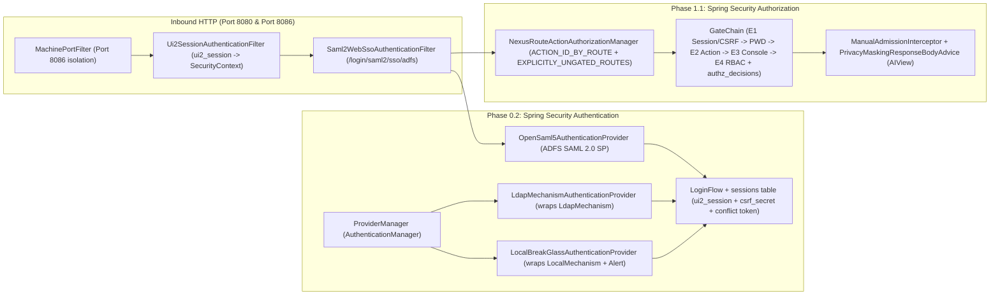

# Spring Security Migration — Measured Plan (`spring_boot_4_spring_security_migration`)

**Status:** `DRAFT` — measured design and migration plan; not implementation authority until frozen by the Product Owner.
**Backlog item:** `spring_boot_4_spring_security_migration` (`docs/history/backlog/spring_boot_4_spring_security_migration.md:1-13`, P1, size L)
**Governing decision records:**
- `docs/design/PO_DECISION_RECORD_2026_11_10_ENTERPRISE_STACK_ALIGNMENT.md:16-21,30,41,51,95` (A5 SAML IdP is ADFS; A10 local break-glass administrator beside SAML is allowed; A12 Spring Security is first in the large rewrite order; Phase 0.2 authentication; Phase 1.1 authorization; Q18 ADFS group claims)
- `docs/design/ENTERPRISE_STACK_COMPARISON_2026_11_10.md:38,68,77,151-157,197,210,248-250`

---

## 0. Scope, Constitutional Invariants, and Non-Negotiable Constraints

Spring Boot `4.0.8` and Spring Framework `7.0.9` with Tomcat `11.0.27` are already live in `ui2` (`ui2/gradle/libs.versions.toml:11-12,16`, `ui2/service/build.gradle.kts:7,28-37`). Today, authentication and authorization in `ui2` are implemented without `spring-boot-starter-security` or `spring-security-*` on the classpath (`ui2/gradle/libs.versions.toml:1-63`, `ui2/service/build.gradle.kts:10-69`).

Per `docs/design/PO_DECISION_RECORD_2026_11_10_ENTERPRISE_STACK_ALIGNMENT.md:30,41,51`, the migration splits into two major phases broken down into shippable increments:
1. **Phase 0.2 — Authentication (`ui2-service`):** Introduce Spring Security 7 authentication supporting (a) SAML 2.0 Service Provider for ADFS, (b) the existing Active Directory LDAP service-bind mechanism, and (c) local break-glass administrator authentication (audited, alerting on use) plus `aiview` / `aiview-e2e` verification accounts, all ending in the existing `sessions` / `ui2_session` session model.
2. **Phase 1.1 — Authorization (`ui2-service`):** Move the closed route-to-action authorization map (`SecurityWebMvcConfig.ACTION_ID_BY_ROUTE`) and `GateChain` (`E1`–`E6`) into Spring Security authorization managers while preserving deny-by-default (`ACTION_MAPPING_REQUIRED`), append-only decision auditing (`authz_decisions`), ArchUnit fences, AIView response masking, and port `8086` machine-session isolation.

Every step in this plan obeys the following invariants:
- **No lockout:** Existing local accounts (`nexusadmin`, `claudeadmin`, `aiview`, `aiview-e2e`), existing LDAP logins (`mechanism_id = "ldap"`), and internal port `8086` machine sessions (`POST /internal/machine-session` for `e2e` and `probe` tokens) remain functional after every single step.
- **Deny-by-default:** Any route absent from both the route-to-action map and the explicit ungated route set continues to return HTTP `403 {"error": "ACTION_MAPPING_REQUIRED"}` (`ui2/service/src/main/java/com/securityexpert/nexus/ui2/service/security/GateChainInterceptor.java:112-120`).
- **AIView & Raw-Evidence Laws (`AGENTS.md`):** `role:replay_viewer` remains read-only except for explicitly approved `CLASS_0` diagnostic/collection actions enforced by `AiviewDiagnosticReadOnlyTest` (`ui2/service/src/test/java/com/securityexpert/nexus/ui2/service/security/AiviewDiagnosticReadOnlyTest.java:15-96`), never receives raw views, and defaults fail-closed to masked (`GateChainInterceptor.java:166-169`). No raw credentials, SAML assertions, or unencrypted directory identifiers are persisted to database or audit tables.

---

## 1. Inventory of Today's Authentication and Authorization in `ui2`

### 1.1 Build and Dependency Baseline

| Component | Path & Lines | Current State |
|---|---|---|
| Version catalog | `ui2/gradle/libs.versions.toml:11-16` | `spring-boot = "4.0.8"`, `spring-framework = "7.0.9"`, `tomcat = "11.0.27"`, `bouncycastle = "1.79"`, `unboundid = "7.0.1"`. No `spring-security` entries. |
| Service module build | `ui2/service/build.gradle.kts:28-55` | Depends on `spring-boot-starter-web`, `spring-boot-starter-jdbc`, `flyway-core`, `jooq`, `bcpkix-jdk18on`, `:platform-core`, `:ldap-adapter`, `:persistence-jooq`. |
| Platform core build | `ui2/platform-core/build.gradle.kts:1-25` | Houses `Mechanism`, `AttemptOutcome`, `PrincipalFingerprint`, `Argon2PasswordHasher`, `GroupReferenceCipher`, `CredentialStoreCipher`. |
| LDAP adapter build | `ui2/ldap-adapter/build.gradle.kts:1-30` | Uses UnboundID LDAP SDK (`com.unboundid:unboundid-ldapsdk:7.0.1`). |

### 1.2 Login Flow, Mechanism Dispatch, Conflict Takeover, and Throttling

| Responsibility | Path & Lines | Behavior Today |
|---|---|---|
| Mechanism contract | `ui2/platform-core/src/main/java/com/securityexpert/nexus/ui2/platform/Mechanism.java:10-24` | `Mechanism` interface with `id()` and `attempt(String username, char[] password, Instant now)` returning `AttemptOutcome`. |
| Attempt outcome model | `ui2/platform-core/src/main/java/com/securityexpert/nexus/ui2/platform/AttemptOutcome.java:9-36` | Sealed interface: `Success(PrincipalFingerprint resolvedActorFingerprint, DirectoryObservation directoryObservation)`, `Refused(String reasonCode)`, `MechanismUnavailable(String reasonCode)`. |
| Mechanism registry | `ui2/service/src/main/java/com/securityexpert/nexus/ui2/service/security/MechanismRegistry.java:24-51` | Constructor (`:28-36`) requires `LocalMechanism` as a mandatory first argument (C3A AC-2 structural non-removability) plus `List<Mechanism> additional`. Wired in `LocalAuthenticationConfiguration.java:139-142`. |
| Login HTTP endpoint | `ui2/service/src/main/java/com/securityexpert/nexus/ui2/service/api/LoginController.java:33-113` | `POST /login` (`:55`). Reads `{username, password, mechanism_id}` (`:35`). Defaults blank `mechanism_id` to `"local"` (`:63`). Applies `LoginAttemptThrottle` when `"ldap".equals(mechanismId)` (`:69-72`). Calls `mechanism.attempt` (`:74`): returns `503 {"error": "DIRECTORY_UNAVAILABLE"}` on `MechanismUnavailable` (`:76-78`), `401 {"error": "INVALID_CREDENTIALS"}` with identical body for all `Refused` outcomes (`:79-83`), `409 {"error": "LOGIN_CONFLICT", "conflict_token", "prior_session"}` on active-session conflict (`:91-93`, `LoginFlow.java:240-249`), or writes `ui2_session` cookie and returns `200 {"ok": true}` (`:94-98`). Zeroes `char[] pw` in `finally` (`:99-101`). |
| LDAP login throttle | `ui2/service/src/main/java/com/securityexpert/nexus/ui2/service/security/LoginAttemptThrottle.java:12-43` | Bounded sliding-window throttle: max `10` attempts / `60s` per source IP SHA-256 (`:14-15`) and max `5` attempts / `300s` per identity SHA-256 (`:16-17`), cap `10_000` entries (`:18`). |
| Session creation & conflict state | `ui2/service/src/main/java/com/securityexpert/nexus/ui2/service/security/LoginFlow.java:24-250` | `completeAfterMechanismSuccess` (`:73-163`): for directory observations (`:94-124`), encrypts principal DN under `GroupReferenceCipher` (`:101-102`) and executes inside `bindings.directoryMutation` table lock (`:106-121`), checking local/directory binding compatibility (`:126-136`) and upserting `actor_authz_state` (`:116`). Checks `sessions.findActiveByActor` (`:138`): if an active session exists, stores an in-memory `PendingConflict` with 2-minute TTL (`CONFLICT_TOKEN_BOUND = Duration.ofMinutes(2)`, `:29,65,149-152`) and returns `ConflictPending`. Otherwise inserts `ACTIVE` session and returns `Established(rawCookieValue)` (`:154-162`). |
| Conflict resolution endpoint | `ui2/service/src/main/java/com/securityexpert/nexus/ui2/service/api/LoginResolveController.java:22-52` | `POST /login/resolve` (`:35`) with `{conflict_token, decision}`. Delegates to `LoginFlow.resolve` (`LoginFlow.java:178-232`). Only `"takeover"` supersedes the prior session (`ACTIVE -> SUPERSEDED`, `end_reason = 'login_elsewhere'`, `JooqSessionRepository.java:108-118`) and issues a new cookie (`:37-39`). Any other decision or expired token refuses with `409 {"error": "LOGIN_REFUSED_ACTIVE_SESSION"}` (`:40-45`). |
| Frontend login & auth gate | `ui2/frontend/src/auth/LoginScreen.tsx:23-249`, `ui2/frontend/src/auth/AuthGate.tsx:33-134` | `LoginScreen.tsx` renders radio buttons for `"local"` and `"ldap"` (`:157-177`), posts to `/login` (`:27`) and `/login/resolve` (`:102`). `AuthGate.tsx` polls `GET /session/status` (`:33-48`), renders `LoginScreen` when unauthenticated (`:74-76`), `PasswordChangeScreen` when `mustChangePassword` is true (`:78-79,123-128`), and sets the CSRF token via `setCsrfToken(state.csrfToken)` (`:81`). |

### 1.3 Server-Side Sessions, Cookies, CSRF, Status, Logout, and Expiry

| Responsibility | Path & Lines | Behavior Today |
|---|---|---|
| `sessions` schema & audit trigger | `ui2/service/src/main/resources/db/migration/V2__identity_sessions_rbac.sql:55-73,126-128`, `V99__machine_sessions.sql:1` | `sessions` table keyed by `session_id` (64-hex SHA-256 of cookie), `actor_fingerprint` (12-hex), `state IN ('ACTIVE','SUPERSEDED','EXPIRED','REVOKED')`, `csrf_secret` (64-hex), `idle_deadline_at`, `absolute_deadline_at`, `end_reason IN ('login_elsewhere','idle_timeout','absolute_lifetime','revoked_by_admin','access_group_lost')`, `machine BOOLEAN NOT NULL DEFAULT FALSE`. Partial unique index `ux_sessions_one_active_per_actor ON sessions(actor_fingerprint) WHERE state = 'ACTIVE'` (`V2:70-71`). DB trigger `trg_audit_sessions` writes state transitions to `audit_events` (`V2:126-128`). |
| Cookie generation & hashing | `ui2/service/src/main/java/com/securityexpert/nexus/ui2/service/security/LoginFlow.java:234-238`, `SessionHasher.java:12-31`, `SessionCookieWriter.java:27-67` | Raw cookie value is 32 random bytes base64url-encoded without padding (`LoginFlow.java:234-238`). `SessionHasher.sha256Hex` hashes the UTF-8 cookie into the 64-char hex `session_id` (`SessionHasher.java:17-30`). `SessionCookieWriter` writes cookie `ui2_session` (`:29`) with `HttpOnly=true`, `SameSite=Strict`, `Path=/`, and `Secure=${ui2.session.cookie.secure:true}` (`:33,56-66`). |
| Session timeouts & `aiview` idle exemption | `ui2/service/src/main/java/com/securityexpert/nexus/ui2/service/boot/LocalAuthenticationConfiguration.java:56-57,151-155`, `LoginFlow.java:42-56` | `IDLE_TIMEOUT = Duration.ofMinutes(30)`, `ABSOLUTE_LIFETIME = Duration.ofHours(10)` (`LocalAuthenticationConfiguration.java:56-57`). Actors holding `RoleToken.REPLAY_VIEWER` (`aiview`) receive `idleFor = ABSOLUTE_LIFETIME` (10h idle exemption, `LoginFlow.java:51-55`). |
| Session heartbeat & background reconciliation | `ui2/service/src/main/java/com/securityexpert/nexus/ui2/service/security/GateChain.java:114-116`, `JooqSessionRepository.java:149-192`, `SessionReconciler.java:17-40` | `GateChain` extends `last_seen_at` and `idle_deadline_at` at most once every 30 seconds (`GateChain.java:114-116`). Read-time expiry in `JooqSessionRepository.findById` (`:181-192`) and scheduled `SessionReconciler` (`:29-39`) transition overdue `ACTIVE` sessions to `EXPIRED` (`idle_timeout` or `absolute_lifetime`) under `system:session_reconciler`. |
| Session status endpoint | `ui2/service/src/main/java/com/securityexpert/nexus/ui2/service/api/SessionStatusController.java:41-244` | `GET /session/status` (`:94`): returns `{authenticated: false}` when cookie is missing/inactive (`:97-118`). When active, triggers `DirectoryAuthorizationRefresh.refreshIfNeeded` (`:121-125`), resolves display name (`local_credentials.username` or `actor_authz_state.directory_display_name`, `:149-165`), checks `must_change_password` / password expiry (`:127-146`), and returns `csrf_token`, `role_tokens`, `can_read_administration`, and UI plane `permissions` (`:167-218`). |
| Self-logout & admin session revocation | `ui2/service/src/main/java/com/securityexpert/nexus/ui2/service/api/SessionLogoutController.java:28-75`, `SessionSelfLogoutService.java:34-62`, `SessionAdminController.java:31-89` | `POST /session/logout` verifies `X-CSRF-Token` + `Origin`, clears `ui2_session`, and marks the session `REVOKED` with audit action `session_logout_self`. `GET /sessions` and `POST /sessions/revoke` (`SessionAdminController.java:46,62`) allow `role:security_admin` (`ActionRegistry.SESSION_REVOKE`) to list safe session projection columns (`AuditPresentationAllowlist.columnsOf("sessions")`, `:84-86`) and revoke sessions (`end_reason = 'revoked_by_admin'`). |

### 1.4 Local Password Authentication, Password Policy, First-Boot Seeding, and Break-Glass / Root Identity

| Responsibility | Path & Lines | Behavior Today |
|---|---|---|
| Local credentials schema & narrow audit trigger | `ui2/service/src/main/resources/db/migration/V8__local_credentials.sql:22-35`, `V9__local_credentials_must_change_password.sql:1-6`, `V10__local_identity_administration.sql:19-89` | `local_credentials` table stores `local_identity_id` (UUID), `username`, `verifier` (32B BYTEA), `salt` (16B BYTEA), Argon2 parameters (`m=19456, t=2, p=1`), `enabled`, `failed_attempt_count`, `locked_until`, `must_change_password`, `password_changed_at`. Trigger `fn_audit_capture_local_credentials()` (`V10:50-89`) logs only safe metadata columns and never captures `verifier`, `salt`, or Argon2 parameters. |
| Argon2id hashing & constant-time unknown-user defense | `ui2/platform-core/src/main/java/com/securityexpert/nexus/ui2/platform/Argon2PasswordHasher.java:24-106`, `LocalCredentialVerification.java:22-41` | BouncyCastle `Argon2BytesGenerator` (`Argon2id`, `19456 KiB`, `2` iterations, `1` parallelism, `16B` salt, `32B` output). `LocalCredentialVerification` (`:28-40`) hashes against a process-static `DUMMY_VERIFIER` when `record == null` so unknown-username and wrong-password paths execute identical Argon2 work. |
| Local authentication & account lockout | `ui2/service/src/main/java/com/securityexpert/nexus/ui2/service/security/LocalMechanism.java:32-101`, `LocalPrincipalFingerprint.java:11-30` | `LOCKOUT_THRESHOLD = 5` failed attempts, `LOCKOUT_DURATION = Duration.ofMinutes(15)` (`LocalMechanism.java:38-40`). Refuses disabled (`local_disabled`, `:75-79`) or locked (`local_locked`, `:80-83`) accounts after constant-time Argon2 verification. Computes `PrincipalFingerprint.of("local:" + localIdentityId)` (12-hex SHA-256 prefix, `LocalPrincipalFingerprint.java:20-29`). |
| Password change & configurable password policy | `ui2/service/src/main/java/com/securityexpert/nexus/ui2/service/api/PasswordChangeController.java:25-60`, `PasswordChangeService.java:27-102`, `LocalPasswordPolicy.java:15-111`, `LocalPasswordPolicyService.java:22-211`, `LocalPasswordPolicyController.java:32-82`, `V223__local_password_policy.sql:1-51` | `POST /local-credentials/change-password` (`PasswordChangeController.java:42`) verifies current password, enforces `LocalPasswordPolicy` (minimum length $\ge 12$, not equal to username, configurable upper/lower/digit/symbol counts, password history in `local_password_history`, and `max_age_days`), rotates `verifier`/`salt`, clears `must_change_password`, and audits `local_credential_password_changed`. |
| First-boot seeding (`nexusadmin`, `claudeadmin`, `aiview`, `aiview-e2e`) | `ui2/service/src/main/java/com/securityexpert/nexus/ui2/service/boot/FirstBootIdentitySeedingRunner.java:65-103`, `FirstBootIdentityRoleBindingSeeder.java:40-131`, `BootstrapCredentialDefaults.java:10-42`, `AiViewIdentitySeedingRunner.java:23-81` | When `local_credentials` is empty (`BOOT-2`), seeds `nexusadmin` (all 8 role tokens, `rootIdentity = true`) and `claudeadmin` (`role:viewer`). `AiViewIdentitySeedingRunner` idempotently seeds `aiview` and `aiview-e2e` with `{role:viewer, role:replay_viewer}` and removes any other role bindings (`:68-73`). ArchUnit/source test `NoHardcodedBootstrapVerifierOrPasswordTest` (`ui2/architecture-tests/src/test/java/com/securityexpert/nexus/ui2/architecture/NoHardcodedBootstrapVerifierOrPasswordTest.java:24-130`) forbids hardcoded verifiers in migrations or production code. |
| Root / Break-Glass identity & anti-lockout guards | `ui2/service/src/main/resources/db/migration/V19__root_identity.sql:1-8`, `JooqRootIdentityRepository.java:9-29`, `RbacEvaluator.java:125-128`, `LocalIdentityAdministration.java:87-90`, `SecurityAdminLockoutGuard.java:31-76` | Single-row `root_identity` table (`id = 1`) stores the root `actor_fingerprint` (`nexusadmin`). `RbacEvaluator.evaluate` (`:125-128`) grants `Decision.permittedRoot()` (`authority = "ui2_root"`) across all tokens. `LocalIdentityAdministration.disable` (`:87-90`) refuses disabling the root identity (`ROOT_IDENTITY_Protected`). `SecurityAdminLockoutGuard` (`:31-76`) refuses disabling the last enabled local `role:security_admin` or revoking its binding (`LAST_SECURITY_ADMIN_REFUSED`). |
| Local identity administration & CLI bootstrap | `ui2/service/src/main/java/com/securityexpert/nexus/ui2/service/api/LocalIdentityAdministrationController.java:35-156`, `LocalIdentityBootstrap.java:18-33`, `RoleBindingSecurityAdminBootstrap.java:18-32` | HTTP endpoints `POST /local-identities`, `GET /local-identities`, `POST /local-identities/set-password`, `POST /local-identities/disable`, `POST /local-identities/enable` gated by `ActionRegistry.LOCAL_IDENTITY_*` (`role:security_admin`), plus out-of-band CLI bootstrap utilities (`SecurityAdminBootstrapFactory.java:18-31`). |

### 1.5 LDAP (Active Directory Service-Bind) Authentication and Authorization Refresh

| Responsibility | Path & Lines | Behavior Today |
|---|---|---|
| LDAP settings & directory binding schema | `ui2/service/src/main/resources/db/migration/V204__ldap_service_bind_settings.sql:10-60`, `V25__directory_principal_bindings.sql:1-42`, `V211__actor_authz_state_directory_display_name.sql:11-13` | `ldap_settings` single-row table (`id = 1`) stores `enabled`, `servers_json`, `service_username`, `service_password_enc` (AES-GCM via `CredentialStoreCipher`), `domain_dn`, `admin_group_dn`, `users_group_dn`, `tls_mode`, `trust_pem`. `role_bindings` supports `binding_kind IN ('LEGACY','DIRECTORY_GROUP','DIRECTORY_PRINCIPAL')`. `actor_authz_state` caches encrypted group/principal references (`proof_expires_at`, `directory_display_name`), cleared when the last active session ends via `trg_expire_directory_authz_after_session_end` (`V25:25-42`). |
| UnboundID AD service-bind adapter | `ui2/ldap-adapter/src/main/java/com/securityexpert/nexus/ui2/ldap/LdapMechanism.java:11-51`, `UnboundIdOperatorBindAdapter.java:21-106`, `DirectoryConnection.java`, `UnboundIdRevalidationAdapter.java:15-76` | `UnboundIdOperatorBindAdapter.authenticate`: (1) binds to AD with the configured service account (`:44`), (2) searches `(sAMAccountName={0})` under `domainDn` (`:46-54`), (3) binds as the user's own DN with the user's password (`SimpleBindRequest`, `:56-66`) before any group evaluation, (4) queries nested group membership (`1.2.840.113556.1.4.1941` `LDAP_MATCHING_RULE_IN_CHAIN`) for `adminGroupDn` and `usersGroupDn` (`:68-86`), refusing with `ldap_not_in_allowed_group` if in neither (`:82-84`). Computes `PrincipalFingerprint.of("ldap:" + profileId + ":" + lowerCase(entryDn))` (`:87`). |
| Dynamic reload & system-managed group bindings | `ui2/service/src/main/java/com/securityexpert/nexus/ui2/service/boot/DirectoryAuthenticationConfiguration.java:43-178`, `LdapSettingsService.java:37-276`, `DirectorySettingsController.java:26-66` | `LdapSettingsService.applyAndReload` (`:166-225`) swaps the live `SwappableDirectoryProvider` and synchronizes system-managed `DIRECTORY_GROUP` rows in `role_bindings` under `system:ldap-settings`: `adminGroupDn` receives all 7 operational/admin roles (`ADMIN_GROUP_ROLES`, `:45-47`, excluding `role:replay_viewer`), and `usersGroupDn` receives `USERS_GROUP_ROLES = [role:viewer]` (`:48`). HTTP endpoints `GET/PUT /api/v2/config/ldap` and `POST /api/v2/config/ldap/test` (`DirectorySettingsController.java:38,44,57`). |
| 5-minute directory group revalidation | `ui2/service/src/main/java/com/securityexpert/nexus/ui2/service/security/DirectoryAuthorizationRefresh.java:18-124` | `refreshIfNeeded` (`:44-112`) checks `actor_authz_state.proof_expires_at` (`PROOF_TTL = Duration.ofMinutes(5)`). When expired on an active directory session, re-queries AD using the service account via `DirectoryRevalidator.revalidate`. If the user was removed from both groups (`DirectoryGroupRevokedException`), immediately revokes the session (`end_reason = 'access_group_lost'`) and clears `actor_authz_state` (`:97-105`). |

### 1.6 Closed Route-to-Action Authorization Map, `GateChain` (`E1`–`E6`), and AIView Masking

| Responsibility | Path & Lines | Behavior Today |
|---|---|---|
| Closed route-to-action map & ungated allowlist | `ui2/service/src/main/java/com/securityexpert/nexus/ui2/service/security/SecurityWebMvcConfig.java:20-441` | `ACTION_ID_BY_ROUTE` (`:22-374`) maps ~190 `METHOD /path` keys (each with at most one `*` wildcard segment, enforced by `GateChainInterceptorRouteResolutionTest.java:89-94`) to `ActionRegistry` constants. `EXPLICITLY_UNGATED_ROUTES` (`:382-409`) lists 11 fixed routes (`GET /`, `POST /login`, `POST /internal/machine-session`, `POST /auth/login`, `POST /login/resolve`, `POST /session/logout`, `GET /session/status`, `GET /error`, `POST /error`, `POST /local-credentials/change-password`, `GET /healthz`) plus prefix patterns for `/internal/advisories/*` and `/internal/lifecycle-sources/*` (`:411-431`). |
| Request interceptor & attribute binding | `ui2/service/src/main/java/com/securityexpert/nexus/ui2/service/security/GateChainInterceptor.java:46-212` | Registered on all paths (`SecurityWebMvcConfig.java:435-437`). Rejects `machineWriteRefusal` (`:91-99`), permits non-`/api/` static `ResourceHttpRequestHandler` assets (`:102-110`), resolves `actionIdFor(method, path)` (`:111,180-198`), and returns `403 {"error": "ACTION_MAPPING_REQUIRED"}` if unmapped (`:112-120`). Skips `request.getParameter("target_ref")` on upload actions (`PACKET_ANALYSIS_UPLOAD`, `SOFTWARE_IMAGE_UPLOAD`) so multipart bodies are never spooled prior to authorization (`:130-136`). On `Proceed`, sets `ui2.gate.actorFingerprint`, `ui2.gate.sessionId`, and `ui2.gate.isReplayViewer` (cached 60s per session, failing closed to `true` on error, `:140-170`). |
| `E1`–`E6` evaluation pipeline | `ui2/service/src/main/java/com/securityexpert/nexus/ui2/service/security/GateChain.java:25-250` | **`E1` Session & CSRF (`:79-117`):** validates `ui2_session` cookie, SHA-256 lookup, `ACTIVE` state, idle/absolute deadlines (`401 SESSION_REQUIRED` / `SESSION_EXPIRED`), machine-session read-only restriction (`403 MACHINE_SESSION_READ_ONLY`, `:98-102,206-220`), and state-changing `X-CSRF-Token` + `Origin` header check (`403 CSRF_REQUIRED`, `:103-110`). **`PWD` Must-Change-Password (`:129-135`):** returns `403 PASSWORD_CHANGE_REQUIRED` when password change is required or password age exceeds `maxAgeDays`. **`E2` Action Lookup (`:137-141`):** resolves `ActionDescriptor` from `ActionRegistry` (`404 ACTION_UNKNOWN`). **`E3` Console-Submittable Gate (`:144-149`):** refuses `!action.consoleSubmittable()` unconditionally before `E4` (`403 ACTION_REFUSED`, `reason_code = "recovery_write_not_console_submittable"`). **`E4` RBAC Evaluation & Audit (`:151-167`):** invokes `DirectoryAuthorizationRefresh.refreshIfNeeded` (`:151`), evaluates `RbacEvaluator.evaluate` or `evaluateAny` (`:152-155`), appends an immutable row to `authz_decisions` via `JooqAuthzDecisionRepository.append` (`:156-160`) for **every** E4 check (permitted or refused), and returns `403 {"error": "ACTION_REFUSED", "decision_id": ...}` on refusal (`:161-165`). |
| Action registry & role tokens | `ui2/service/src/main/java/com/securityexpert/nexus/ui2/service/security/ActionRegistry.java:15-482`, `RoleToken.java:3-20`, `RbacEvaluator.java:118-205` | 8 built-in `RoleToken` values (`role:viewer`, `role:operator`, `role:onboarding_admin`, `role:backup_admin`, `role:compliance_admin`, `role:security_admin`, `role:operation_admin`, `role:replay_viewer`). Custom roles (`V27__custom_roles.sql`) expand to canonical `RoleToken` sets in `RbacEvaluator`. `ActionDescriptor` supports single `requiredRoleToken()` or `anyOfRoleTokens()` plus `consoleSubmittable()`. |
| Post-authz admission & AIView masking | `ui2/service/src/main/java/com/securityexpert/nexus/ui2/service/security/ManualAdmissionInterceptor.java:21-61`, `AdminWindowBypass.java:15-43`, `PrivacyMaskingResponseBodyAdvice.java` | `ManualAdmissionInterceptor` runs after `GateChainInterceptor` (`SecurityWebMvcConfig.java:436-439`) to open a per-request `ManualAdmission` grant (`AdminWindowBypass` for `/api/v2/admin/**`, `/api/v2/config/**`, `/api/v2/Backup/**`). `PrivacyMaskingResponseBodyAdvice` inspects `GateChainInterceptor.IS_REPLAY_VIEWER_ATTRIBUTE` to pseudonymize responses for `aiview`. |
| Architecture & security fences | `ui2/architecture-tests/src/test/java/com/securityexpert/nexus/ui2/architecture/Ui2ArchitectureTest.java`, `NoRoleConditionalRenderingInFrontendTest.java`, `NoHardcodedBootstrapVerifierOrPasswordTest.java`, `AiviewDiagnosticReadOnlyTest.java` | Enforce module boundaries, forbid role-token conditionals in frontend TSX, forbid hardcoded password verifiers, and freeze the exact set of actions accessible to `role:replay_viewer`. |

### 1.7 Machine Sessions and Internal Port `8086`

| Responsibility | Path & Lines | Behavior Today |
|---|---|---|
| Dedicated internal Tomcat connector & port filter | `ui2/service/src/main/java/com/securityexpert/nexus/ui2/service/security/MachinePortConfiguration.java:27-74` | Registers an additional Tomcat HTTP connector on `${ui2.machine.port:8086}` bound to `127.0.0.1` (`:35-53`). Registers `machinePortFilter` at `Ordered.HIGHEST_PRECEDENCE` (`:55-73`): on port `8086`, allows only `POST /internal/machine-session`, `POST /internal/advisories/{source}[/complete]`, and `POST /internal/lifecycle-sources/{source}[/complete]` (returning `404` for everything else); on the main port (`8080`), returns `404` for any `/internal/**` path. |
| Machine session controller | `ui2/service/src/main/java/com/securityexpert/nexus/ui2/service/api/MachineSessionController.java:25-115` | `POST /internal/machine-session` (`:58`). Reads `X-Nexus-Machine-Token` header (`:27,63`), hashes with SHA-256, and compares in constant time (`MessageDigest.isEqual`) against `UI2_E2E_MACHINE_TOKEN_SHA256` and `UI2_PROBE_MACHINE_TOKEN_SHA256` (`:47-51,70-74`). Verifies `aiview-e2e` local identity exists, is enabled, and holds exact roles `{role:viewer, role:replay_viewer}` (`:29-30,75-79`). Uses `LocalPrincipalFingerprint.forLocalIdentity` for `e2e` and `LocalPrincipalFingerprint.forLocalIdentityProbe` (`"local-probe:" + id`, `LocalPrincipalFingerprint.java:25-29`) for `probe` so health probes never supersede an active Playwright e2e session (`:80-82`). Calls `loginFlow.machineLogin` (`30m` lifetime, `machine = true`, audited via `audit_machine_session_event`), sets `ui2_session` cookie, and returns `200 {"csrf_token": ...}` (`:83-85`). |

---

## 2. Target Architecture (Spring Security 7 on Spring Boot 4.0.8)

### 2.1 Phase 0.2 Target: Authentication (`SAML 2.0 ADFS + LDAP + Local Break-Glass -> Existing Session`)

Per `docs/design/PO_DECISION_RECORD_2026_11_10_ENTERPRISE_STACK_ALIGNMENT.md:16,19,30,41`:
1. **Convergence on `LoginFlow` and the `sessions` Table:**
   - Every interactive or machine authentication mechanism terminates in `LoginFlow` (`ui2/service/src/main/java/com/securityexpert/nexus/ui2/service/security/LoginFlow.java:73-163`), producing a row in `sessions` (`V2__identity_sessions_rbac.sql:55-73`), a `ui2_session` cookie via `SessionCookieWriter`, a per-session `csrf_secret`, and single-active-session conflict detection (`ux_sessions_one_active_per_actor`).
   - A `Ui2SessionAuthenticationFilter` (running in the Spring `SecurityFilterChain` before authorization) resolves `ui2_session` via `SessionHasher.sha256Hex`, validates session liveness, and populates `SecurityContextHolder` with an immutable `Ui2SessionAuthenticationToken` carrying `actorFingerprint`, `sessionId`, `csrfSecret`, `machine`, and `mustChangePassword`.
2. **SAML 2.0 Service Provider for ADFS (`spring-security-saml2-service-provider`):**
   - Configured via `RelyingPartyRegistrationRepository` backed by database/environment settings (`saml2.rp.registration-id = "adfs"`), enabled conditionally when ADFS metadata/entity settings are configured.
   - Endpoints: SP-initiated login at `GET /saml2/authenticate/adfs`, Assertion Consumer Service (ACS) at `POST /login/saml2/sso/adfs`, and SP metadata at `GET /saml2/service-provider-metadata/adfs`.
   - `OpenSaml5AuthenticationProvider` validates the ADFS response signature, audience restriction, recipient, `InResponseTo`, and time conditions (`NotBefore` / `NotOnOrAfter`), then delegates to a custom `Saml2LoginSuccessHandler`:
     - Computes `PrincipalFingerprint.of("saml:" + registrationId + ":" + normalizedNameId)` (12-hex SHA-256 prefix) so SAML identities are opaque (`AGENTS.md` Identity law) and never collide with `"local:"` or `"ldap:"` fingerprints.
     - Extracts ADFS group claims (claim URI configured per PO/architecture decision Q18), encrypts group identifiers via `GroupReferenceCipher`, and records a `DirectoryObservation` in `actor_authz_state` with `proof_expires_at` aligned with the SAML assertion `SessionNotOnOrAfter` (bounded by session lifetime) and `directory_display_name`.
     - Invokes `LoginFlow.completeAfterMechanismSuccess`. If `Established`, writes `ui2_session` and redirects to `/`. If `ConflictPending`, redirects to `/?saml_conflict_token=<token>` so `LoginScreen.tsx` renders the standard session takeover prompt (`POST /login/resolve`).
     - Never persists raw SAML XML assertions to PostgreSQL or logs (`AGENTS.md` Raw-evidence law).
3. **Active Directory LDAP Service-Bind (`LdapMechanismAuthenticationProvider`):**
   - `LdapMechanism` (`ui2/ldap-adapter/src/main/java/com/securityexpert/nexus/ui2/ldap/LdapMechanism.java:11-51`) and `UnboundIdOperatorBindAdapter` (`:21-106`) remain the underlying AD integration.
   - Wrapped in a Spring Security `AuthenticationProvider` (`LdapMechanismAuthenticationProvider`) registered on the `AuthenticationManager`. `POST /login` with `mechanism_id = "ldap"` continues to apply `LoginAttemptThrottle`, authenticate via `AuthenticationManager`, update `actor_authz_state`, and support 5-minute group revalidation via `DirectoryAuthorizationRefresh`.
4. **Local Break-Glass Administrator and Verification Accounts (`LocalBreakGlassAuthenticationProvider`):**
   - Wraps `LocalMechanism` (`ui2/service/src/main/java/com/securityexpert/nexus/ui2/service/security/LocalMechanism.java:32-101`), keeping Argon2id (`Argon2PasswordHasher`), constant-time `DUMMY_VERIFIER` (`LocalCredentialVerification`), 5-strike / 15-minute lockout, and `LocalPasswordPolicy`.
   - When SAML or LDAP enterprise posture is active, interactive local password sign-in is scoped to the designated break-glass root account (`root_identity` / `nexusadmin`), explicitly enabled local `role:security_admin` recovery accounts, and the mandatory `aiview` / `aiview-e2e` verification accounts.
   - Every successful interactive login by a local break-glass administrator (`root_identity` or local `role:security_admin`) emits a dedicated audit event (`local_break_glass_login_succeeded`) and triggers an immediate asynchronous alert through the existing notification pipeline (`NotificationForwarder` syslog/SMTP channels) per `docs/design/PO_DECISION_RECORD_2026_11_10_ENTERPRISE_STACK_ALIGNMENT.md:41`.
5. **Machine Sessions (`Port 8086`):**
   - `MachinePortConfiguration.machinePortFilter` remains at `Ordered.HIGHEST_PRECEDENCE` ahead of `FilterChainProxy`. `POST /internal/machine-session` continues to authenticate `X-Nexus-Machine-Token` (`e2e` and `probe`) in constant time and issue `machine = true` sessions for `aiview-e2e` without touching SAML or LDAP.

### 2.2 Phase 1.1 Target: Authorization (`Route-to-Action Map in Spring Security`)

Per `docs/design/PO_DECISION_RECORD_2026_11_10_ENTERPRISE_STACK_ALIGNMENT.md:30,51`:
1. **`NexusRouteActionAuthorizationManager` (`AuthorizationManager<RequestAuthorizationContext>`):**
   - Replaces `GateChainInterceptor` as the primary enforcement hook inside `SecurityFilterChain.authorizeHttpRequests(auth -> auth.anyRequest().access(nexusRouteActionAuthorizationManager))`.
   - Consumes the exact `SecurityWebMvcConfig.ACTION_ID_BY_ROUTE` map (`:22-374`) and `EXPLICITLY_UNGATED_ROUTES` set (`:382-409`).
   - Preserves all current `GateChainInterceptor` and `GateChain` (`E1`–`E6`) semantics:
     - **Machine write refusal (`GateChainInterceptor.java:91-99`):** Immediately refuses state-changing methods (`POST`/`PUT`/`DELETE`/`PATCH`) from `machine = true` sessions except the explicit read-only POST allowlist (`GateChain.isReadOnlyPost`, `:206-220`) with `403 {"error": "MACHINE_SESSION_READ_ONLY"}`.
     - **Static asset pass-through (`GateChainInterceptor.java:102-110`):** Permits non-`/api/` requests handled by `ResourceHttpRequestHandler`.
     - **Deny-by-default (`GateChainInterceptor.java:112-120`):** Any request not in `EXPLICITLY_UNGATED_ROUTES` (or SAML SP handshake routes when SAML is enabled) that does not resolve to an `actionId` in `ACTION_ID_BY_ROUTE` is refused with `403 {"error": "ACTION_MAPPING_REQUIRED"}`.
     - **Multipart upload pre-authz safety (`GateChainInterceptor.java:130-136`):** Never reads `request.getParameter("target_ref")` on `PACKET_ANALYSIS_UPLOAD` or `SOFTWARE_IMAGE_UPLOAD` so multipart streams are never parsed before `E1`–`E4` succeed.
     - **`E1`–`E4` execution (`GateChain.java:79-167`):** Evaluates session validity, `X-CSRF-Token` + `Origin` on state-changing requests, `must_change_password` (`403 PASSWORD_CHANGE_REQUIRED`), `ActionRegistry` lookup (`404 ACTION_UNKNOWN`), `E3` `!action.consoleSubmittable()` refusal (`403 ACTION_REFUSED`), and `E4` `RbacEvaluator` check with mandatory append to `authz_decisions` (`JooqAuthzDecisionRepository.append`).
     - **Request attribute propagation (`GateChainInterceptor.java:140-170`):** Populates `ui2.gate.actorFingerprint`, `ui2.gate.sessionId`, and `ui2.gate.isReplayViewer` (failing closed to `true` on error) so `ManualAdmissionInterceptor`, `PrivacyMaskingResponseBodyAdvice`, and controllers work without modification.
2. **Custom `AuthenticationEntryPoint` and `AccessDeniedHandler`:**
   - Serializes `GateOutcome.Refused` payloads (`statusCode` `401`/`403`/`404` and exact JSON body `{"error": ..., "decision_id": ...}`) identically to `GateChainInterceptor.preHandle` (`:172-177`) so no frontend client or contract test sees a status-code or payload change.

---

## 3. Ordered Migration Steps (Each Shippable Alone, Zero Lockout, Explicit Rollback)

### Step 1 — Spring Security 7 Foundation & Passthrough Filter Chain (Phase 0.2a)

- **Scope:**
  - Add `spring-boot-starter-security` and `spring-security-test` (aligned with Spring Boot `4.0.8` / Spring Security `7.0.x`) to `ui2/gradle/libs.versions.toml` and `ui2/service/build.gradle.kts`.
  - Introduce `NexusSecurityFilterChainConfiguration` defining a single `@Bean SecurityFilterChain`:
    - Disable Spring Security's default HTTP Basic, default form login page, default logout filter, default session creation (`SessionCreationPolicy.STATELESS` on `HttpSession`), and built-in CSRF filter (because `GateChain` `E1` enforces per-session `csrf_secret` + `Origin`).
    - Keep security response headers (`X-Content-Type-Options: nosniff`, `X-Frame-Options: DENY`, `Cache-Control`).
    - Permit requests through the servlet filter chain to the existing `GateChainInterceptor` (`SecurityWebMvcConfig.java:435-437`).
  - Ensure `MachinePortConfiguration.machinePortFilter` (`MachinePortConfiguration.java:55-73`) continues to execute at `Ordered.HIGHEST_PRECEDENCE` before `FilterChainProxy`.
- **Why every existing login & machine session keeps working:**
  - `POST /login` (`local` and `ldap`), `POST /login/resolve`, `GET /session/status`, `POST /session/logout`, and `POST /internal/machine-session` on port `8086` execute the exact same code paths and `GateChainInterceptor` checks as before.
- **Rollback:**
  - Revert `NexusSecurityFilterChainConfiguration` and the dependency lines in `ui2/gradle/libs.versions.toml` and `ui2/service/build.gradle.kts`. Zero database migrations in this step.

### Step 2 — `SecurityContext` Session Bridge & `AuthenticationProvider` Adapters for Local and LDAP (Phase 0.2b)

- **Scope:**
  - Add `Ui2SessionAuthenticationFilter` (`OncePerRequestFilter`) inside `SecurityFilterChain`:
    - Reads `ui2_session` cookie, hashes with `SessionHasher.sha256Hex`, loads active session via `SessionRepository`, and sets `Ui2SessionAuthenticationToken` in `SecurityContextHolder` (clearing context in `finally`).
  - Wrap `LocalMechanism` in `LocalAuthenticationProvider` and `LdapMechanism` in `LdapAuthenticationProvider`, wired into a Spring `ProviderManager` (`AuthenticationManager`) while preserving `MechanismRegistry`'s compile-time requirement on `LocalMechanism` (`MechanismRegistry.java:28-36`).
  - Route `LoginController.login` (`LoginController.java:55-102`) through `AuthenticationManager` adapters while preserving `LoginAttemptThrottle`, constant-time `401 INVALID_CREDENTIALS`, `503 DIRECTORY_UNAVAILABLE`, and `LoginFlow` conflict tokens.
- **Why every existing login & machine session keeps working:**
  - Both `"local"` (`nexusadmin`, `claudeadmin`, `aiview`) and `"ldap"` mechanisms produce the exact same `AttemptOutcome` and `sessions` row. Port `8086` `MachineSessionController` continues to issue `aiview-e2e` and `probe` cookies that `Ui2SessionAuthenticationFilter` and `GateChain` both recognize.
- **Rollback:**
  - Feature flag `ui2.security.provider-manager-enabled=false` (or revert commit) switches `LoginController` back to direct `MechanismRegistry` dispatch; no schema changes.

### Step 3 — Local Break-Glass Hardening & Real-Time Audit/Notification Alerting (Phase 0.2c)

- **Scope:**
  - Implement break-glass policy enforcement in `LocalAuthenticationProvider` / `LocalMechanism`:
    - Introduce configuration property `ui2.security.local-auth.mode` (`ALL_LOCAL` default when no IdP is active; `BREAK_GLASS_ONLY` when enterprise SAML mode is enforced).
    - In `BREAK_GLASS_ONLY` mode, permit local interactive password login only for: (a) the `root_identity` account (`nexusadmin`), (b) local accounts holding `role:security_admin` designated as break-glass, and (c) `aiview` / `aiview-e2e` (verification personas). All other local accounts are refused with uniform `401 INVALID_CREDENTIALS` (after constant-time Argon2 verification) and audited with reason `local_non_break_glass_refused`.
  - On every successful interactive login by a local break-glass account (`root_identity` or local `role:security_admin`), emit audit action `local_break_glass_login_succeeded` and dispatch a high-priority alert event through `NotificationForwarder` (syslog + SMTP channels).
- **Why every existing login & machine session keeps working:**
  - Default mode remains `ALL_LOCAL` until an operator enables `BREAK_GLASS_ONLY`. Even in `BREAK_GLASS_ONLY` mode, `nexusadmin` (break-glass), `aiview`, `aiview-e2e` (port `8086` machine sessions), and `ldap` accounts never experience lockout.
- **Rollback:**
  - Set `ui2.security.local-auth.mode=ALL_LOCAL` at runtime/config or revert the step commit.

- **Implemented (2026-11-15, migration V236) as decided by D4:** the setting is stored in `local_auth_mode_settings` (`GET/PUT /api/v2/config/local-auth-mode`, CLI `local-auth-mode`, Administration > Access and identity > Local sign-in), audited under `local_auth_mode_write`. `BREAK_GLASS_ONLY` admits only the root identity (`nexusadmin`) and `aiview`; `aiview-e2e` and every other local account get the uniform `401 INVALID_CREDENTIALS` after the Argon2 check (audit `local_non_break_glass_refused`, written only when the password was right, off the request thread, and not counted toward the lockout). Break-glass sign-ins are audited (`local_break_glass_login_succeeded`); the root identity's sign-in also raises a syslog ERROR line (`BREAK_GLASS_LOGIN`) and rides the `login_security` mail digest. Events are written only in `BREAK_GLASS_ONLY`. Enabling is refused unless the acting administrator is the root identity or a directory (LDAP/SAML) administrator, and the root identity exists, is enabled and is not locked; turning it off is always allowed. Default stays `ALL_LOCAL`; the default-mode HTTP golden is byte-identical and `http-surface-break-glass.golden.txt` records the new mode.

### Step 4 — SAML 2.0 Service Provider for ADFS & Test IdP Harness (Phase 0.2d)

- **Scope:**
  - Add `spring-security-saml2-service-provider` to `ui2/gradle/libs.versions.toml` and `ui2/service/build.gradle.kts`.
  - Add Flyway migration `V241__saml_settings_and_binding_kind.sql` (planned as V226; V241 was the next free number):
    - Create single-row `saml_settings` table (`id = 1`, `enabled`, `entity_id`, `idp_entity_id`, `idp_sso_url`, `idp_signing_cert_pem`, `group_claim_attribute`, `admin_group_value`, `users_group_value`, `updated_at`, `updated_by`) with narrow audit trigger `fn_audit_capture_saml_settings()`.
    - Extend `role_bindings.binding_kind` check constraint (`V25__directory_principal_bindings.sql:6-8`) to allow `'SAML_GROUP'` alongside `'LEGACY'`, `'DIRECTORY_GROUP'`, and `'DIRECTORY_PRINCIPAL'`.
  - Implement `SamlRelyingPartyConfiguration`, `AdfsSamlAuthenticationSuccessHandler`, and `SamlSettingsController` (`GET/PUT /api/v2/config/saml`, mapped in `ActionRegistry` and `SecurityWebMvcConfig`):
    - Maps ADFS assertion NameID to `PrincipalFingerprint.of("saml:adfs:" + normalizedNameId)`.
    - Extracts ADFS group claim values, encrypts under `GroupReferenceCipher`, synchronizes `SAML_GROUP` bindings (`admin_group_value -> ADMIN_GROUP_ROLES`, `users_group_value -> [role:viewer]`), populates `actor_authz_state`, and finishes in `LoginFlow.completeAfterMechanismSuccess` (supporting `ConflictPending` takeover via `/login/resolve`).
  - Update `LoginScreen.tsx` (`ui2/frontend/src/auth/LoginScreen.tsx:157-177`) to display the `"Sign in with SSO (ADFS)"` action when `GET /session/status` (or `/api/v2/auth/mechanisms`) advertises `saml_enabled: true`, while keeping the `"Local"` (Break-Glass) and `"LDAP"` options accessible.
  - Build an in-process test-only SAML 2.0 IdP fixture (`TestAdfsSamlIdp`) that signs assertions with an ephemeral test keypair for automated integration tests (`docs/design/PO_DECISION_RECORD_2026_11_10_ENTERPRISE_STACK_ALIGNMENT.md:41`).
- **Why every existing login & machine session keeps working:**
  - SAML is opt-in (`saml_settings.enabled = false` by default). Existing `"local"` (`nexusadmin`, `claudeadmin`, `aiview`), `"ldap"`, and port `8086` `aiview-e2e` / `probe` machine sessions are completely unaffected.
- **Rollback:**
  - Disable SAML at runtime (`saml_settings.enabled = false` or `ui2.security.saml.enabled=false`). Code rollback reverts the SAML filter registration while leaving `saml_settings` inert.

- **Implemented (2026-11-16, migration V241) as decided by D1-D5:** `saml_settings` (one row, no row = SAML off, audited under `saml_config_write` with a narrow trigger that records no value) and `role_bindings.binding_kind = 'SAML_GROUP'`. Administration > Access and identity > SAML sign-in (`GET/PUT /api/v2/config/saml`, security_admin, CLI `saml`, `saml-set <settings.json> [--metadata-file] [--sp-key-file]`, `saml-off`). The IdP data comes from pasted ADFS metadata XML (nothing is fetched). The three handshake routes (`GET /saml2/authenticate/adfs`, `POST /login/saml2/sso/adfs`, `GET /saml2/service-provider-metadata/adfs`) are explicitly ungated and answer 404 while SAML is off; the signed-out `GET /session/status` carries `saml_enabled: true` only while it is on, so with SAML off both HTTP goldens are byte-identical.
  - Spring Security's OpenSAML 5 provider is used as a library (signature, issuer, destination, recipient, audience, time conditions, InResponseTo); no `Saml2WebSsoAuthenticationFilter` is registered. On top of it: sign-in is solicited only (an AuthnRequest id kept in memory for five minutes and consumed once, so a response cannot be replayed; an assertion id is accepted once), the clock skew bound is a setting (default 60 s, 0 to 300; 0 means 1 ms because OpenSAML reads a zero as its 5-minute default), the assertion must carry `Conditions/@NotOnOrAfter`, the NameID is NFC-normalised and lower-cased (except the persistent format) and the actor is `PrincipalFingerprint.of("saml:adfs:" + NameID)` (D2, never merged with LDAP), the group claim (D1, default `http://schemas.xmlsoap.org/claims/Group`) is reduced to the two configured group values and a user in neither is refused with `SAML_NO_AUTHORIZED_GROUP` and a plain-language page (401). The actor's proof lives in `actor_authz_state` under directory profile `saml:adfs` until the assertion's `SessionNotOnOrAfter`, never past the session's absolute lifetime; it is not re-read from ADFS (`DirectoryAuthorizationRefresh` ignores the SAML profile), so a group change applies at the next sign-in. Disabling SAML revokes the system-managed `SAML_GROUP` bindings, so open SAML sessions lose their roles at once.
  - D5: the SP key pair comes from `UI2_SAML_SP_PRIVATE_KEY_PATH` / `UI2_SAML_SP_CERT_PATH` (files win) or from the settings (private key AES-256-GCM under the credential store key, write-only). With a key, the SP decrypts assertions and can sign AuthnRequests (`sign_authn_requests`). Spring Security decrypts only a response that is itself signed, so an ADFS relying party that encrypts must sign the message and the assertion.
  - Dependency note: `spring-security-saml2-service-provider` 7.0.7 pulls OpenSAML 5.1.6 and the Shibboleth support libraries, which exist only on `https://build.shibboleth.net/maven/releases/` (restricted to groups `org.opensaml` and `net.shibboleth`, pinned by lockfiles and `verification-metadata.xml`); Bouncy Castle `bcpkix`/`bcutil` are constrained to the same 1.86 line as `bcprov`.
  - Tests: `integration/saml/AdfsSamlAuthenticationTest` (real application and PostgreSQL 16 against the in-process `TestAdfsSamlIdp`, which signs with a key generated at run time), `service/.../SamlSettingsServiceTest`, `integration/identity/SamlSettingsSchemaTest`, `SamlCliTest`, frontend `SamlSettingsPanel`, `LoginScreen` and `AuthGate` tests.

### Step 5 — Route-to-Action Authorization Map Migration into Spring Security (Phase 1.1)

- **Scope:**
  - Implement `NexusRouteActionAuthorizationManager implements AuthorizationManager<RequestAuthorizationContext>` and `NexusSecurityAccessDeniedHandler` / `NexusSecurityAuthenticationEntryPoint`:
    - Wire `SecurityWebMvcConfig.ACTION_ID_BY_ROUTE` (`:22-374`) and `EXPLICITLY_UNGATED_ROUTES` (`:382-409`) directly into `NexusRouteActionAuthorizationManager`.
    - Delegate mapped route checks to `GateChain.evaluate` (`E1`–`E6`), preserving `403 ACTION_MAPPING_REQUIRED` on unmapped routes, `403 MACHINE_SESSION_READ_ONLY` on machine writes, `403 PASSWORD_CHANGE_REQUIRED` on expired/initial passwords, `403 ACTION_REFUSED` on `!consoleSubmittable()` (`E3`) and RBAC refusal (`E4`), `authz_decisions` append on every `E4` evaluation, and multipart upload pre-authz parameter skipping.
    - Set request attributes `ACTOR_FINGERPRINT_ATTRIBUTE`, `SESSION_ID_ATTRIBUTE`, and `IS_REPLAY_VIEWER_ATTRIBUTE` inside the authorization manager / post-authz filter before `ManualAdmissionInterceptor` and controller execution.
  - Retire `GateChainInterceptor` from `WebMvcConfigurer.addInterceptors` once `NexusRouteActionAuthorizationManager` is active, keeping `ManualAdmissionInterceptor` and `PrivacyMaskingResponseBodyAdvice` intact.
  - Update ArchUnit / route-coverage tests to assert that every controller endpoint is governed by `NexusRouteActionAuthorizationManager` and `ACTION_ID_BY_ROUTE`.
- **Why every existing login & machine session keeps working:**
  - Ungated login/status/machine-session routes (`POST /login`, `POST /login/resolve`, `GET /session/status`, `POST /session/logout`, `POST /internal/machine-session`) and all ~190 gated routes evaluate the exact same `GateChain` rules and return byte-identical error/success HTTP payloads.
- **Rollback:**
  - Toggle `ui2.security.spring-authz-manager.enabled=false` (kept during the bake-in release) to re-enable `GateChainInterceptor` registration and bypass `NexusRouteActionAuthorizationManager`, or revert the Step 5 commit.

---

## 4. Test Plan per Step

| Step | Automated Unit & MockMvc Suites | Integration, Architecture & E2E Suites | Key Assertions |
|---|---|---|---|
| **Step 1** (Spring Security 7 passthrough) | `./gradlew :service:test --tests "*LoginController*" --tests "*GateChain*" --tests "*MachineSession*"` | `./gradlew :architecture-tests:test :integration-tests:test` | `FilterChainProxy` active; port `8086` `MachinePortConfigurationTest` passes; zero regressions on existing `LoginController`, `SessionStatusController`, and `GateChainInterceptor` tests. |
| **Step 2** (`SecurityContext` bridge & `AuthenticationProvider`s) | `./gradlew :service:test :ldap-adapter:test` + new `Ui2SessionAuthenticationFilterTest`, `LocalAuthenticationProviderTest`, `LdapAuthenticationProviderTest` | `./gradlew :integration-tests:test` (PostgreSQL Testcontainers) | `SecurityContextHolder` populated on valid `ui2_session`; cleared after request; `MechanismRegistry` C3A AC-2 test passes; constant-time `DUMMY_VERIFIER` and `LoginAttemptThrottle` preserved. |
| **Step 3** (Break-glass policy & alerting) | New `BreakGlassAuthenticationTest`, `BreakGlassAlertingTest` + `SecurityAdminLockoutGuardTest`, `LocalIdentityAdministrationTest` | `./gradlew :service:test :architecture-tests:test` (`NoHardcodedBootstrapVerifierOrPasswordTest`) | In `BREAK_GLASS_ONLY` mode: `nexusadmin`, `aiview`, and `aiview-e2e` succeed; standard local user is refused with `401 INVALID_CREDENTIALS`; break-glass login writes `local_break_glass_login_succeeded` audit row and invokes `NotificationForwarder`. |
| **Step 4** (SAML 2.0 SP for ADFS) | New `AdfsSamlAuthenticationTest` (using `TestAdfsSamlIdp`), `SamlSettingsServiceTest`, `SamlConflictTakeoverTest` + frontend `npx vitest run src/auth/LoginScreen.test.tsx src/auth/AuthGate.test.tsx` | `./gradlew :integration-tests:test` + Playwright `ui2/e2e/tests/login.mjs` | Signed ADFS assertion creates `sessions` row and `actor_authz_state`; tampered signature / expired assertion / wrong audience refused (`401`); existing active session triggers `ConflictPending` and resolves via `/login/resolve`; no raw SAML XML stored in DB. |
| **Step 5** (Spring Security `AuthorizationManager`) | `GateChainInterceptorRouteResolutionTest`, `GateChainUploadRequestTest`, `AiviewDiagnosticReadOnlyTest`, new `NexusRouteActionAuthorizationManagerTest` | `./gradlew :architecture-tests:test :service:test :integration-tests:test` + Playwright `ui2/e2e/tests/login.mjs` | Every unmapped route returns `403 ACTION_MAPPING_REQUIRED`; `E3` refuses non-console-submittable actions without `E4` DB write; `E4` writes `authz_decisions` on both permit and deny; multipart upload does not spool prior to authz; `IS_REPLAY_VIEWER_ATTRIBUTE` masks all `aiview` responses. |

Repository-wide verification gates run at every step:
- `python3 tools/privacy/repository_privacy_check.py`
- `pytest -q tools/tests/test_live_project_governance.py`
- `git diff --check`

---

## 5. Product Owner and Enterprise Architecture Decisions (DECIDED 2026-11-15)

**DECIDED — PO 2026-11-15:** D1 through D5 are all decided as recommended in the table below. Record: `docs/design/PO_DECISION_RECORD_2026_11_15_SPRING_SECURITY_DECISIONS.md`. The PO also decided that security response headers are on for every response, logout requires the CSRF token, and `HEAD /healthz` answers like `GET` (see the record). The plan itself stays `DRAFT` until the PO freezes it; the table below is the decided content of D1-D5.

| ID | Decision Topic | Context / Reference | Options / Recommended Default |
|---|---|---|---|
| **D1 (Q18)** (decided as recommended, PO 2026-11-15) | **ADFS Group Claim Attribute & Role Mapping Ownership** | `docs/design/PO_DECISION_RECORD_2026_11_10_ENTERPRISE_STACK_ALIGNMENT.md:95` (Q18: *"Which ADFS claim carries groups, and who maps groups to roles?"*) | **Recommended:** Default claim URI to `http://schemas.xmlsoap.org/claims/Group` (or `http://schemas.microsoft.com/ws/2008/06/identity/claims/role`), configurable in `saml_settings.group_claim_attribute`. Map ADFS group names/SIDs to neXus `RoleToken`s inside `ui2` (`role_bindings` with `binding_kind = 'SAML_GROUP'`), matching how `LdapSettingsService` maps `adminGroupDn` and `usersGroupDn` today (`LdapSettingsService.java:45-48`). |
| **D2** (decided as recommended, PO 2026-11-15) | **SAML vs. LDAP Actor Fingerprint Namespace** | Today LDAP computes `PrincipalFingerprint.of("ldap:" + profileId + ":" + lowerDn)` (`UnboundIdOperatorBindAdapter.java:87`). If an operator logs in via LDAP today and SAML tomorrow, should they share an `actor_fingerprint` or remain distinct? | **Recommended:** Keep distinct, mechanism-prefixed opaque fingerprints (`"saml:adfs:" + normalizedNameId`) per `AGENTS.md` Identity law (never infer cross-protocol equivalence without a proven contract), while surfacing the human-readable `directory_display_name` in `actor_authz_state`. |
| **D3** (decided as recommended, PO 2026-11-15) | **LDAP Disposition After ADFS SAML Go-Live** | `PO_DECISION_RECORD_2026_11_10_ENTERPRISE_STACK_ALIGNMENT.md:30,41` keeps both SAML (ADFS) and the existing LDAP path during migration. | **Recommended:** Keep LDAP service-bind configurable via `ldap_settings.enabled` alongside SAML so environments without ADFS or during ADFS cutover can use LDAP, and allow operators to disable LDAP in UI once ADFS SAML is verified in production. |
| **D4** (decided as recommended, PO 2026-11-15) | **Local Account Scope When SAML/LDAP Is Active** | `PO_DECISION_RECORD_2026_11_10_ENTERPRISE_STACK_ALIGNMENT.md:19,41` permits local break-glass administrator beside SAML. Today `FirstBootIdentitySeedingRunner` also seeds `claudeadmin` (`role:viewer`). | **Recommended:** When `ui2.security.local-auth.mode=BREAK_GLASS_ONLY` is enabled, allow interactive local password login only for `root_identity` (`nexusadmin`) and `aiview` (`role:replay_viewer`), while keeping `aiview-e2e` restricted to port `8086` machine tokens and disabling non-break-glass local accounts (`claudeadmin`). |
| **D5 (Q13)** (decided as recommended, PO 2026-11-15) | **SAML SP Signing/Decryption Key Delivery** | `PO_DECISION_RECORD_2026_11_10_ENTERPRISE_STACK_ALIGNMENT.md:90` (Q13: CyberArk secret delivery pattern). Does ADFS require signed `AuthnRequest`s or encrypted assertions, and how is the SP keypair mounted? | **Recommended:** Support optional SP signing/decryption keypair loaded from filesystem paths (`UI2_SAML_SP_PRIVATE_KEY_PATH`, `UI2_SAML_SP_CERT_PATH`) or encrypted in `saml_settings` via `CredentialStoreCipher`, defaulting to ADFS HTTPS POST binding with signed assertions verification. |
